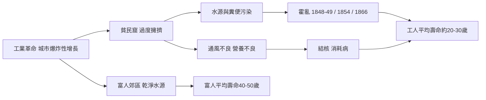

# 5.1 死亡統計：倫敦工人階級的二十歲人生（1837–1901）

## 一個被蒸汽機拉開的死亡鴻溝

維多利亞女王在位的六十四年間，大英帝國統治著全球四分之一的人口，倫敦成為史上第一座六百萬人的城市。但在泰晤士河的濃霧與煤煙之下，死亡依然依階級排隊。恩格斯在 1845 年《英國工人階級狀況》中，根據曼徹斯特的資料指出：工人區的平均壽命只有十七歲上下，而富人區可達三十八歲。1842 年查德威克的《大不列顛勞動人口衛生狀況報告》同樣記錄了駭人的差距——利物浦工人階級平均壽命約十五歲，紳士與專業人士則有三十歲以上；到了世紀末，倫敦工人階級的平均壽命約二十至三十歲，富裕階層則為四十至五十歲。

## 頭號殺手：三次霍亂大流行

霍亂弧菌沿著貿易路線在 1831 年首度登陸英國，隨後在 1848–49、1854、1866 三度席捲倫敦。1848–49 年的大流行奪走約一萬四千條倫敦人命，死者絕大多數是住在貧民窟的工人。1854 年蘇活區寬街爆發，十日之內五百餘人死亡；1866 年的東倫敦疫情則證明，只要水源再被污染，霍亂就會回來。病人可以在數小時內由劇烈腹瀉脫水到死亡，一個家庭往往一週之內全數消失。

## 「消耗病」：浪漫的白色瘟疫

比霍亂更緩慢但也更普遍的殺手是肺結核。十九世紀英格蘭與威爾斯約有五分之一至六分之一的死亡與結核相關，它被稱為「消耗病」（consumption）、白色的瘟疫。貧窮、擁擠與通風不良讓結核在工人階級中瘋狂蔓延，文學卻把它浪漫化——蒼白的臉頰、咳在帕子上的血、早逝的詩人。白喉、猩紅熱與麻疹則大量奪走兒童的性命；產褥熱使產婦的死如同一場賭局，在衛生不佳的醫院，產後感染的死亡率可達兩成。

## 因果鏈

$$
\text{工業化城市化} \rightarrow \text{水污染} \rightarrow \text{霍亂與腸道病} \rightarrow \text{階級間壽命差距} \rightarrow \text{公衛改革壓力}
$$

死亡統計第一次成為政治武器：正是這些數字，讓議會被迫面對貧民窟的死亡。而醫生與工程師如何找出兇手、鋪設下水道，是下一節的主題。

> 上一章我們看見啟蒙時代客廳裡「被馴服的死亡」；現在，工業化讓死亡重新變得野蠻而懸殊。下一節 5.2，斯諾的地圖與李斯特的石炭酸將逐層揭開殺手的真面目。
