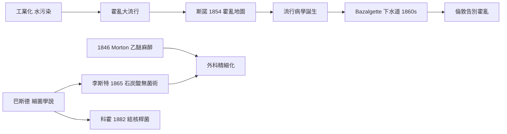

# 5.2 環境與醫療：麻醉、無菌術與斯諾的霍亂地圖（1837–1901）

## 瘴氣時代的醫學

維多利亞時代初期的醫學仍相信瘴氣說——疾病來自腐敗物散發的「壞空氣」。醫院是死亡的捷徑：手術在沒有麻醉、沒有消毒的狀態下進行，醫生穿著沾滿陳年血漬的外套，以速度為美德。當時截肢手術的死亡率常在四成以上，術後感染幾乎是必然。

## 1846：疼痛的終結

1846 年 10 月 16 日，美國波士頓麻省總醫院，牙醫威廉・莫頓（William Morton）公開示範乙醚麻醉，讓病人在無痛狀態下切除頸部腫瘤。消息數月內傳到倫敦，1846 年 12 月，倫敦大學學院醫院便完成了英國第一場乙醚麻醉手術，隨後氯仿也由辛普森（James Young Simpson）引入產科。外科第一次得以從「搶時間」轉為「求精細」——但疼痛的問題解決了，感染的問題才剛開始。

## 1854：斯諾的寬街幫浦

醫生約翰・斯諾（John Snow）長期懷疑霍亂經由水而非空氣傳播。1854 年蘇活區爆發疫情時，他逐戶訪查死亡案例，在地圖上標出每一個死者的住址——死亡點密集地環繞著寬街（Broad Street）的一座公共幫浦。他說服教區當局拆下幫浦把手，疫情隨之消退；追查更發現源頭是滲入井中的汙水。這張地圖被視為流行病學的誕生。1866 年最後一次霍亂大流行時，公衛當局已能依水源管理阻止疫情擴散——斯諾本人在 1858 年中風去世，未能親見勝利。

## 1860s：下水道與無菌術

工程師約瑟夫・巴札杰特（Joseph Bazalgette）為大都會工程委員會設計了倫敦下水道系統，1860 年代陸續完工：一千餘英里的磚砌隧道把污水導往下游排放，泰晤士河自此不再是一條露天的下水道，「大惡臭」（The Great Stink, 1858）成為絕響。倫敦此後再也沒有霍亂。

在醫院裡，匈牙利醫生塞麥爾維斯（Ignaz Semmelweis）早在 1847 年就發現，醫生用漂白水洗手後，維也納產科的產褥熱死亡率從兩成驟降至百分之一、二——卻被同儕嘲笑、最後死於精神病院。1865 年，英國外科醫生李斯特（Joseph Lister）受巴斯德細菌學說啟發，以石炭酸（phenol）噴灑手術室並處理傷口，開創無菌術，手術死亡率大幅下降。1876 年起，科霍（Robert Koch）與巴斯德確立細菌致病理論；1882 年科霍發現結核桿菌，「消耗病」終於有了名字。

## 一條因果鏈

$$
\text{斯諾的地圖} \rightarrow \text{水傳播證據} \rightarrow \text{下水道工程} \rightarrow \text{巴斯德/科霍細菌學說} \rightarrow \text{李斯特無菌術} \rightarrow \text{手術死亡率下降}
$$

到維多利亞末年，殺手的身份已被一一指認。連王室成員也逃不過其中一種——傷寒，正如下一節的阿爾伯特親王。

> 上一節的死亡統計迫使議會行動，這一節我們看見地圖、下水道與石炭酸如何逐層拆解死亡；下一節 5.3，溫莎城堡的排水管與巴黎的沙龍，將見證兩位名人與時代的死因交錯。
