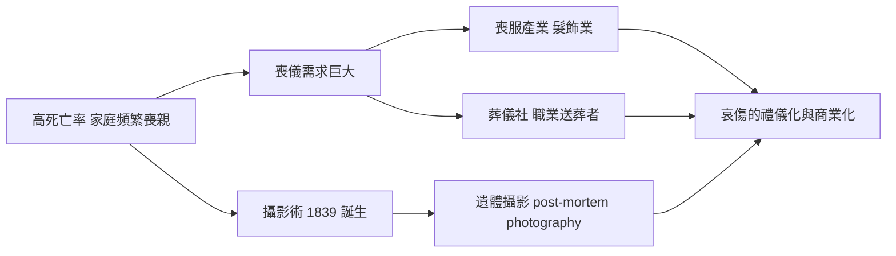

# 5.4 文化與信仰：喪服道德、攝影遺影與哀傷的商業化（1837–1901）

## 維多利亞式哀傷：一套完整的人生儀表板

沒有一個時代像維多利亞時代一樣，把哀傷制度化到如此程度。喪服（mourning dress）有嚴格階梯：最深重的是「全套喪服」（full mourning）——女王御用染坊出產的黑絲、黑紗，加上烏玉（jet）首飾；之後依時間遞減為灰、淡紫（lilac）、鑲紫（mauve），最後才能恢復彩色。為配偶服喪兩年半、父母一年、叔姪數月，兒童去世也要全家著黑。寡婦的「寡婦帽」（weeping veil）與寡婦帽針成為標準配備，衣領上別著的，有時是逝者的髮絲編成的飾品——用頭髮做戒指、胸針與花圈（hair jewellery）是維多利亞的專屬產業。

女王本人自 1861 年阿爾伯特死後四十年不脫黑紗，宮廷的喪儀成為帝國的禮法範本；喪服產業因而爆炸成長——倫敦的喪服店（mourning warehouses，如 Jay's London General Mourning Warehouse）供應各價位全套行頭，甚至出租喪服給付不起的人。批評者也隨之出現：《Punch》雜誌諷刺「哀傷是買來的」，強迫性服喪被稱為 bonnet noir 的暴政。

## 與死者合拍：遺體攝影

攝影術（1839 年達蓋爾法問世）幾乎立刻被用於一個陰鬱用途：遺體攝影（post-mortem photography）。在死亡率高、攝影昂貴的年代，遺照常是逝者唯一的一張照片。攝影師受雇進入喪家，為死者擺出安睡的姿態，有時讓嬰兒依偎在母親臂中，甚至用支架撐起屍體、繪上睜開的眼睛，做成「活著的肖像」。家人稱之為「紀念照」（memorial portrait），掛在客廳、寄給遠方親人。這不是獵奇，而是維多利亞人對「最後一面」的科技補償——當死亡頻繁造訪、照片比畫像便宜時，相機成為告別儀式的一部分。

## 公墓運動：死亡搬出教堂

人口暴增使舊教區墓園爆滿，屍體淺埋、地下水污染（又與霍亂互為因果）。1832 年起國會通過法案允許設立私營花園墓園，倫敦「七私墓」中最著名的是 1839 年開放的 Highgate Cemetery——維多利亞人把墓園當公園遊覽，週日到墓園野餐是正常社交。埃及風、哥德式的陵墓建築，讓死亡第一次擁有了風景。職業葬儀社、靈柩車、職業哭喪人（mutes）與羽毛帽送葬隊伍構成完整的殯葬市場；「哀傷的商業化」成為維多利亞的文明症狀之一。

## 一條因果鏈

$$
\text{高死亡率} + \text{攝影術} + \text{中產階級消費力} \rightarrow \text{喪服規範} \rightarrow \text{遺照產業} \rightarrow \text{公墓運動} \rightarrow \text{哀傷的禮儀化}
$$

到維多利亞末年，這套繁複的哀傷體系已開始鬆動——醫療把死亡推往醫院，兩次世界大戰將把黑色的喪服徹底沖淡。死亡的下一步，是離開家庭、走進白牆。

> 上一節我們在溫莎與巴黎看見王與樂師之死；這一節的喪服與遺照，是無數平民家庭的同款哀傷。而當醫院接管死亡、青黴素登場，維多利亞的黑紗將在第六章 6.1 漸漸褪色。
