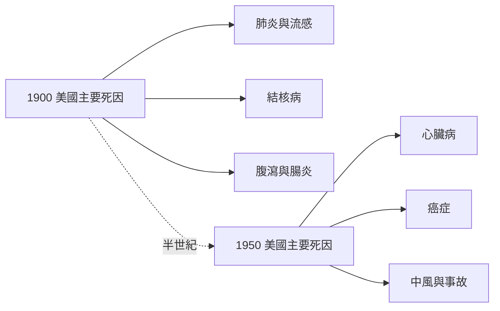

# 6.1 死亡統計：傳染病退位、慢性病登場（1900s–1950s）

## 半個世紀，死亡換了一張臉

二十世紀上半葉，是人類死亡史上分水嶺般的五十年。1900 年，美國十大死因的前幾名是肺炎與流行性感冒、結核病，以及腹瀉與腸炎——幾乎全是傳染病，而且大量奪走嬰幼兒的性命；美國平均壽命約四十七歲。到了 1950 年，榜單換了主角：心臟病與癌症躍居一、二位，結核病跌出前十。已開發國家的平均壽命在這半世紀間攀升至六十歲以上，英國、北歐等地接近六十八歲。這不是漸進的演變，而是一場死亡結構的斷裂式重組。

## 流感的插曲：1918 的斷裂

這條「傳染病退位」的曲線並非直線下滑。1918–1919 年的西班牙流感在兩年間橫掃全球，估計造成五千萬人以上死亡——超過一戰的陣亡人數，約當當時全球人口的百分之三。更令人不安的是它的年齡分布：一般的流感專攻老人與幼兒，死亡曲線呈 U 型；西班牙流感卻在 20–40 歲的青壯年層挖出一個深刻的 W 型凹谷。現代免疫學提出「細胞因子風暴」假說：青壯年擁有最強健的免疫系統，感染後免疫反應過度激烈，大量細胞因子湧入肺部造成急性損傷，反而是最強壯的人最先倒下。費城的停屍間不夠用，芝加哥的殯儀館拒收遺體——在抗生素尚未誕生的年代，醫學對這場瘟疫幾乎束手無策。

$$
\text{1918 大流行} \Rightarrow \text{青壯年死亡曲線異常} \Rightarrow \text{細胞因子風暴（過度免疫反應）}
$$

## 嬰兒死亡率：壽命數字背後的真相

平均壽命的躍升，主要不是因為成年人活得更久，而是因為更少的孩子夭折。1900 年美國每千名活產嬰兒約有百餘人活不過一歲，兒童在成年前死亡的比率接近五分之一；到了 1950 年，嬰兒死亡率已降至千分之三十以下。乾淨的水、巴氏殺菌的牛奶、隔離與檢疫，加上隨後到來的抗生素與疫苗，讓「失去孩子」從家常便飯變成罕見悲劇。老年人口比例隨之攀升，心臟病與癌症這些「長壽的代價」才得以登上死因榜首。

## 死亡的場所也換了地址

與死因結構同步變化的，是死亡發生的地點。1900 年，絕大多數美國人在自己家中死去，床邊圍繞家人與牧師；到了 1940 年代，美國死於醫院的比例首次過半。死亡從客廳遷入病房，從家事變成專業機構的事務——白牆、走廊、護理站的鈴聲，取代了家中的窗簾與鏡子。

## 因果鏈

$$
\text{公衛建設} + \text{抗生素與疫苗} \rightarrow \text{傳染病退位} \rightarrow \text{嬰兒死亡率下降} \rightarrow \text{壽命升至60歲以上} \rightarrow \text{慢性病成為主角} \rightarrow \text{死亡遷入醫院}
$$

> 西班牙流感是舊時代死亡的迴光返照——證明瘟疫仍能瞬間傾覆人間。但大勢已定：傳染病讓位，慢性病登場，死亡走進醫院。下一節 6.2，我們來看這場換位背後的醫療革命——自來水、青黴素與疫苗如何聯手改寫死因排行榜。
