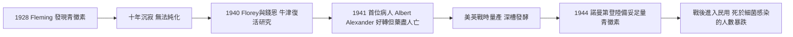

# 6.2 環境與醫療：公衛、青黴素與疫苗革命（1900s–1950s）

## 看不見的功臣：自來水與下水道

如果要在二十世紀上半葉找出挽救最多性命的發明，答案不是手術刀，而是水管。1900 年代前後，美國城市陸續完成濾水與加氯消毒系統——1908 年澤西市率先在供水系統中加氯，此後數十年間，水傳染病（傷寒、腹瀉腸炎）的死亡率斷崖式下跌。公共衛生史學界普遍估計，二十世紀初美國死亡率下降的一半以上應歸功於乾淨的水，而非藥物。市立衛生局開始系統性地登記出生與死亡、檢疫隔離、檢驗牛奶；公共衛生護士走進貧民窟。死亡第一次被當作可以行政管理的對象。

## Fleming 的培養皿：1928 年的意外

1928 年夏天，倫敦聖瑪麗醫院的細菌學家亞歷山大·弗萊明（Alexander Fleming）度假歸來，發現一個被黴菌污染的金黃色葡萄球菌培養皿中，黴菌周圍出現一圈透明的「抑菌環」。他將這種黴菌分泌物命名為青黴素（penicillin），並於 1929 年發表論文。但 Fleming 缺乏化學支援，無法穩定純化，青黴素在他的實驗室裡沉睡了十年。

## 1941 年：第一位病人 Albert Alexander

轉機出現在二戰。牛津的佛羅里（Howard Florey）與錢恩（Ernst Chain）團隊重新拾起 Fleming 的發現，於 1940 年在小鼠實驗中證實療效。1941 年 2 月，牛津拉德克利夫醫院收治了 43 歲的警員阿爾伯特·亞歷山大（Albert Alexander）——他在修剪玫瑰時刮傷嘴角，引發致命的敗血症，眼部與臉部化膿，已無藥可救。注射青黴素後，他奇蹟般好轉；但當時全世界的青黴素存量不足，團隊甚至從病人的尿液中回收藥物重複使用。藥量用盡後五天，亞歷山大死去。這個案例殘酷地宣告：藥有效，但量不夠。

## 量產：戰爭催生的工業奇蹟

美國政府與製藥業合作，在伊利諾州皮奧里亞發明以玉米浸液與深槽發酵量產青黴素的製程。1943 年量產青黴素剛夠軍用，1944 年諾曼第登陸時已備妥足量供應前線，1945 年產量足以治療數百萬人。戰傷感染的死亡率大幅下降，青黴素隨後進入民用市場，肺炎、敗血症、梅毒、產褥熱——這些曾經的死刑判決，第一次變成可治癒的疾病。Fleming、Florey 與 Chain 於 1945 年共獲諾貝爾生理學或醫學獎。

## 疫苗革命：白喉、百日咳與小兒麻痺

抗生素之外，疫苗在這半世紀逐步關閉了兒童死亡的大門。1920 年代白喉抗毒素與類毒素疫苗普及，白喉從歐美兒童的頭號殺手退居幕後；1930–40 年代百日咳疫苗問世；最大的勝利則屬小兒麻痺——1916 年紐約爆發疫情造成逾六千人死亡、兩萬餘人癱瘓，此後每年夏天的恐慌籠罩美國，連羅斯福總統本人也在 39 歲染病致殘。1955 年 4 月 12 日，沙克（Jonas Salk）的滅活疫苗宣布試驗成功，全美教堂鳴鐘、報紙頭版慶祝；隨後沙賓的口服減毒活疫苗於 1960 年代接棒。曾經在每一代父母心中盤據的恐懼，被一劑注射終結。

## 因果鏈

$$
\text{濾水與加氯} \rightarrow \text{腸道傳染病消退} \quad ; \quad \text{青黴素量產} + \text{疫苗普及} \rightarrow \text{細菌性死亡與兒童死亡崩塌} \rightarrow \text{醫院成為死亡的舞台}
$$

> 自來水、青黴素與疫苗共同改寫了死因排行榜，也把「治癒」變成社會的合理期待——死亡於是從家中被搬進醫院的白牆之內。下一節 6.3，兩個故事將展示這個時代的兩種死法：一位畫家死於無藥可用的流感，一位國王死於被精心安排的時間表。
