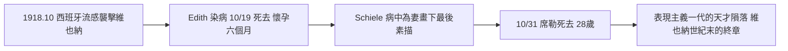

# 6.3 名人案例：席勒與西班牙流感、喬治五世的「被安排的死亡」（1918 / 1936）

## 席勒：最後的三天

1918 年秋，維也納。28 歲的奧地利表現主義畫家埃貢·席勒（Egon Schiele）正值創作巔峰——那一年他在分離派展廳獨占一個展間，被視為克林姆的接班人。但西班牙流感正沿著戰時的鐵路席捲歐洲。10 月 19 日，懷孕六個月的妻子伊迪絲（Edith Schiele）染病死去，得年 27 歲。席勒自己已經發燒，仍撐著病體為她畫素描——那是他最後的作品。三天後的 10 月 31 日，席勒在同一間公寓死去，臨終前對著牆上的鏡子、在幾乎無法握筆的狀態下喃喃工作，留下「我活著，就一定要畫，一定要畫」般的掙扎。鄰居在他們的公寓樓下停靈，用煤油燈守夜；他們的結婚照尚未從照相館取回。一對夫妻、一個未出生的孩子，在三天內消失——這正是 6.1 節所說的 W 型死亡曲線最真實的註腳：流感專攻的，恰恰是席勒這樣的青壯年。

## 喬治五世：一份注射時間表

十八年後的英格蘭，另一場死亡同樣精確，卻是被人為安排的。1936 年 1 月，68 歲的英王喬治五世因支氣管炎與心臟衰竭病危，躺在桑德林漢姆莊園。他的御醫、皇家內科醫師學會主席道森男爵（Lord Dawson of Penn）判斷國王已無痊癒可能。1 月 20 日深夜 11 點過後，道森為國王注射了約 0.75 克蘭嗎啡與 1 克古柯鹼（分兩次），國王於當晚 11 時 55 分安然離世。

為什麼是這個時間？當時的慣例是訃聞先發布給地方報社，再由倫敦全國性大報接續報導。道森後來對家人說過一句直白的話：如果國王在夜間稍晚死去，「應該刊登在晚報上——不太合適，或是在比較不莊重的報紙上」。讓國王在午夜前離世，訃聞就能趕上《泰晤士報》的早晨版，以應有的莊重見報。這句話在當年並未公開；直到 1986 年，歷史學家在道森的私人日記中發現了完整記載，事件才曝光，引發關於醫者角色與「善終」的長期爭論。

## 兩種死亡，一個時代的問題

兩個案例並置，恰好框出本章的核心張力。席勒死於無藥可用的傳染病，是「醫療尚未抵達」的死亡——醫生只能守著；喬治五世死於醫學有能力延後、卻選擇縮短的死亡——醫生不只是見證者，更成了時間的編排者。在前者的病房裡，醫學是無力的旁觀者；在後者的病榻邊，醫學第一次握有了決定「何時死去」的權力，而且這個決定可以是為了報紙的印刷時間。當死亡搬進醫院、當注射器成為常規工具，醫生站在生死的閘門前，而社會還沒有為此準備好任何倫理規則。

$$
\text{席勒（1918）：醫療的邊界之外} \quad \longrightarrow \quad \text{喬治五世（1936）：醫療跨入了死亡的時間表}
$$

道森的注射，日後在安樂死與「尊嚴死」的辯論中被反覆引用——但那要到第七、八章才會成為公共議題。此時更值得注意的是另一件事：如果連國王的死亡時間都能被安排，那麼醫學已經開始接管死亡本身。

> 一位畫家死於瘟疫，一位國王死於注射——兩個死亡都安静地發生在床榻上，而非硝煙之中。但同一個時代，兩次世界大戰正以前所未有的規模製造死亡，把「屍體」變成清點的數字、把「哀傷」變成匿名的儀式。下一節 6.4，戰場如何重塑整個世代對死亡的想像。
