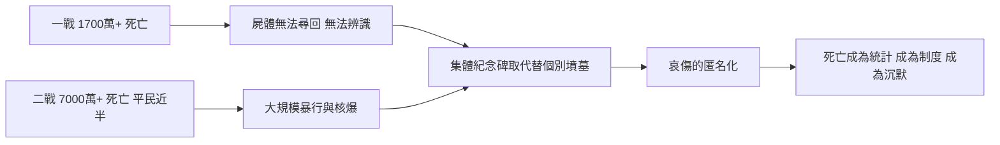

# 6.4 文化與信仰：兩次世界大戰對死亡觀的重塑（1914–1950）

## 死亡的工業化規模

醫院正在讓死亡變得乾淨、專業、遠離家門的同時，戰場卻以工業化的規模製造死亡。第一次世界大戰（1914–1918）造成約 1,700 萬以上軍民死亡；機槍、重砲與毒氣讓屍體大量地「無法辨識、無法尋回、無法安葬」——凡爾登與索姆河的泥濘中，許多士兵屍骨無存。第二次世界大戰（1939–1945）的死亡估計更高達七千萬以上，其中近半是平民：轟炸、種族滅絕、飢荒。奧許維辛的焚化爐與廣島的原子彈，把「現代文明擅長殺人」這件事推到極致。維多利亞時代那種由家人圍繞、有遺言、有遺容的「好的死亡」（good death），在這些數字面前顯得像另一個星球的習俗。

## 無墓可掃的一代：帝國戰爭墓園委員會

一戰留下的難題是：一百多萬大英帝國陣亡者中，近半連遺體都找不到。傳統的葬禮——挖墓、下葬、立碑、掃墓——整套儀式失去了對象。英國政府的回應是制度性的：1917 年成立帝國戰爭墓園委員會（Imperial War Graves Commission，今英聯邦戰爭墓園委員會），由魯德亞德·吉卜林參與設計原則：陣亡者不分階級、不分軍階，一律以相同規格的白色墓碑安葬或紀念；無法尋回遺體者，名字刻上「失蹤者紀念碑」——蒂耶普瓦勒紀念碑上刻了七萬餘個名字。這是史上第一次，國家以平等與規模來管理陣亡者的死後世界。每年 11 月 11 日上午 11 點的全歐默哀、無名戰士墓（英國西敏寺、法國凱旋門均於 1920 年安葬無名戰士遺骸），都是為「無法個別哀悼的死亡」發明的集體儀式。

## 哀傷的匿名化

戰後的哀傷也失去了個人性格。當一個村莊同時失去幾十個年輕人、一個家庭失去三個兒子，個別的悼念被壓縮進統一的儀式：紀念碑、默哀、罌粟花。維多利亞時代繁複的喪服規則——寡婦兩年的深黑、遺影攝影、喪禮的階層展演——在兩次大戰之後大幅退潮，並非因為人們不再悲傷，而是因為死亡太多、太遠、太無差別，個別化的哀傷儀式承載不了這種規模。心理學界也開始用新的詞彙描述這種狀態：「倖存者罪惡感」、「戰爭精神官能症」（一戰的 shell shock、二戰後的 PTSD 前身）。哀傷第一次被視為需要治療的集體創傷，而不是需要儀式的宗教事務。

## 死亡的新定義：從「醫療的盡頭」到「醫療的失敗」

這半世紀的另一層轉變更安靜，卻更深遠。青黴素與疫苗接連奏捷（見 6.2），讓公眾逐漸形成一種新預期：疾病應該被治好，死亡的到來意味著治療還不夠好。在此之前，死亡是生命的自然終點、是醫療陪伴的過程；此刻起，死亡開始被視為「醫療的失敗」。這個觀念有它的光榮——它驅動了此後數十年醫學的突飛猛進；也有它的陰影——它讓臨終變得難以啟齒，讓「承認病人即將死去」被當作放棄，把死亡的場所徹底推進醫院（1940 年代美國醫院死亡已過半）。白牆之內，死亡被靜音了。

## 因果鏈

$$
\text{大戰的大規模死亡} \rightarrow \text{遺體與哀傷的無法個別化} \rightarrow \text{集體紀念制度} \rightarrow \text{哀傷的匿名化} \quad ; \quad \text{醫學的勝利} \rightarrow \text{死亡＝醫療的失敗} \rightarrow \text{臨終的沉默}
$$

> 戰場把死亡變成數字，醫院把死亡變成失敗——兩者合力，讓二十世紀中葉的人類比任何時代都不擅長談論死亡。這份沉默將在 1960 年代被一位精神科醫師打破：庫伯勒-羅斯走進病房，第一次系統性地詢問垂死者「你感覺如何」。那是下一章的開場。
