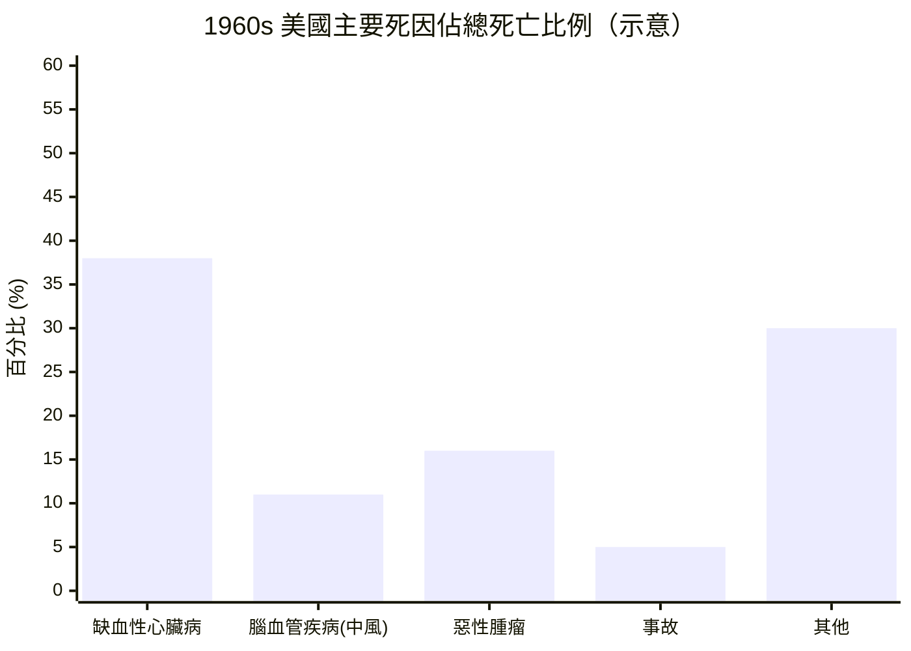

# 7.1 死亡統計：心臟病、中風與癌症三大殺手（1960s – 1970s）

到了 1960 年代，人類的死亡地圖已經徹底改寫。在已開發國家，平均壽命爬升到約七十至七十五歲——一個石器時代的狩獵採集者難以想像的數字。但壽命延長是有代價的：人們不再死於瘟疫與飢荒，而是死於自己身體的慢性崩壞。傳染病退居幕後，慢性退化性疾病登上了死亡統計的王座。

## 三大殺手的新秩序

當時已開發國家的主要死因，穩定地由三種疾病占據：

1. **缺血性心臟病**（冠心病）——心肌供血不足導致的心絞痛與心肌梗塞
2. **腦血管疾病**（中風）——腦部血管破裂或阻塞
3. **惡性腫瘤**（癌症）——細胞失控增生的百病之王

1960 年代的美國，冠心病是毫無爭議的頭號殺手。每一分鐘，都有美國人心臟驟停倒下。「冠狀動脈」這個原本只屬於解剖學課本的詞彙，成為報紙訃聞欄裡最常見的死因。

## 為什麼是心臟病？

答案藏在戰後的富裕生活裡。香菸、奶油、牛排、汽車、電梯——二十世紀中葉的美國人享受著人類史上最豐盛也最靜態的生活。菸草消費在 1950 至 1960 年代達到巔峰，美國成年人吸菸率超過四成；飽和脂肪與膽固醇成為餐桌主角。

1950 年代起，流行病學家開始注意到這條因果鏈。1950 年代發表的吸菸與肺癌研究、1958 年安塞爾·基斯（Ancel Keys）啟動的七國研究（Seven Countries Study），逐步把飲食、吸菸、高血壓這些「危險因子」與心臟病、中風連結起來。1964 年，美國公共衛生署長報告（Surgeon General's Report）正式確認吸菸致癌——這是死亡統計第一次反過來改寫人類的行為準則。

$$
\text{危險因子} = \text{吸菸} + \text{高血壓} + \text{高膽固醇} \;\Rightarrow\; \text{動脈粥樣硬化} \;\Rightarrow\; \text{心梗／中風}
$$

## 從「猝不及防」到「可預測的死亡」

三大殺手與瘟疫有著本質上的不同：它們不會在七天內奪走一整座城市，而是以數年、數十年的緩慢速度侵蝕一個人的身體。心臟病發作可能毫無預警，但癌症的病程往往長達數月甚至數年——病人會眼睜睜看著自己走向終點。

這正是這個時代最深刻的轉折：死亡第一次變成了一段「漫長的、可以被觀察的過程」。醫生知道病人快死了，家屬知道，有時候連病人自己也知道——但沒有人開口說出來。走廊上的低語、病歷上的縮寫、病房外的沉默，構成了一種新的死亡儀式：**否認的集體演出**。

1960 年代末，一位剛剛來到美國的精神科醫生走進芝加哥的醫院病房，開始坐在臨終病人床邊，聽他們說出心裡的話。她的名字叫庫伯勒-羅斯（Elisabeth Kübler-Ross），而她將在下幾節的故事裡登場——因為死亡統計的改寫，最終逼出了一場關於「如何面對死亡」的革命。

（死亡方式的改變，也改變了醫療現場的樣貌——請接著看 7.2。）
