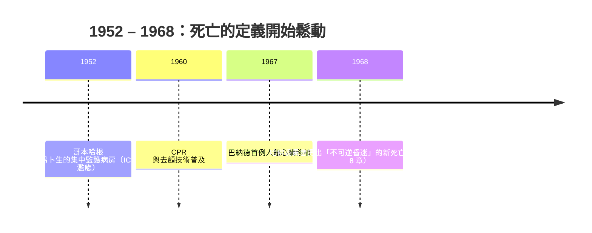

# 7.2 環境與醫療：ICU、呼吸器與「醫療的失敗」（1960s – 1970s）

1952 年的哥本哈根，小兒麻痺（脊髓灰質炎）大流行爆發，短短數個月內數千名患者癱瘓，其中許多人呼吸肌麻痺，即將窒息而死。丹麥醫生比約恩·易卜生（Bjørn Ibsen）做了一個改變歷史的決定：不再依賴當時低效的負壓「鐵肺」，而是為病人氣管插管，由護士在床邊用手動氣囊——連續數小時、數天——替病人「呼吸」，同時將所有垂危病人集中到一個專門病房，由專職團隊二十四小時監護。

死亡率從約八成降到約兩成。這間臨時病房，就是現代加護病房（ICU）的濫觴。

## 醫療機器的黃金年代

哥本哈根之後，ICU 的觀念迅速席捲歐美。1960 年代，一整套「復甦技術」開始普及：

- **心肺復甦術（CPR）**：口對口人工呼吸與胸外按壓的標準化，讓「心跳停止」不再是死亡的宣判
- **電擊去顫器**：以電流重整混亂的心律，救回瀕死的心臟
- **機械呼吸器**：從手動氣囊進化到自動化正壓呼吸器

1967 年 12 月，南非開普敦的克里斯提安·巴納德（Christiaan Barnard）完成史上第一例人體心臟移植手術——路易·瓦尚斯基（Louis Washkansky）換上了一位車禍喪生年輕女性的心臟。雖然瓦尚斯基十八天後死於肺炎，但全世界都明白了：連心臟都可以替換。

## 死亡成為「醫療的失敗」

這些技術帶來了一個前所未有的問題：**什麼時候可以停止？**

過去，死亡是心跳停止的那一刻，清晰而不可辯駁。現在，呼吸器可以讓一個腦部已經毀壞的軀體繼續「呼吸」，電擊可以讓停跳的心臟再次搏動。死亡不再是單一時刻，而是一條可以被機器拉長的斜坡。醫院於是發展出一套新文化：只要還有一項生命徵象，就必須搶救到底。放棄治療，等於承認「醫療的失敗」——而失敗，是不被允許的。

其後果是一種新的死亡樣貌：病人身上插滿管子，被儀器包圍，在無窗病房裡走完人生最後一程。1950 年代以前，多數美國人死在家中；到了 1960 年代末，過半的死亡發生在醫院裡，且比例持續攀升。

## 真相開始鬆動

另一道裂縫出現在「告知真相」上。長期以來，醫界奉行一條鐵律：絕不告訴絕症病人他的病情。醫生對家屬交代實情，對病人卻輕描淡寫——「再觀察看看」。這種出於善意的隱瞞，讓病人在孤獨與猜疑中死去。

1960 年代，這條鐵律開始鬆動。臨終研究的調查顯示，大多數病人其實想知道真相，即使醫生與家屬都假裝他們不想知道。病人被告知的權利，逐漸成為一種倫理主張——這股思潮在 1963 年前後與新興的生命倫理學（bioethics）合流，質問醫療的目的是延長生命，還是延長死亡？

正是在這樣的病房裡，庫伯勒-羅斯看見了問題的核心：醫院學會了維持生命，卻沒有人教醫生如何陪伴死亡。她決定坐到臨終病人床邊去——下一節，我們從一顆過量的安眠藥說起。

（病人的床邊故事，請接著看 7.3。）
