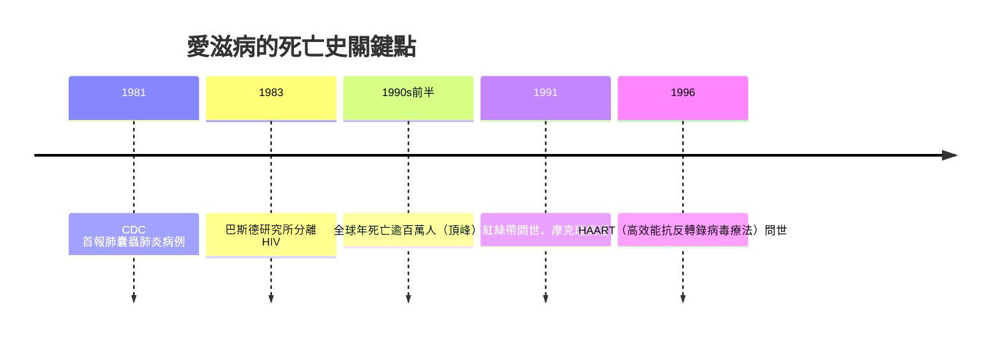
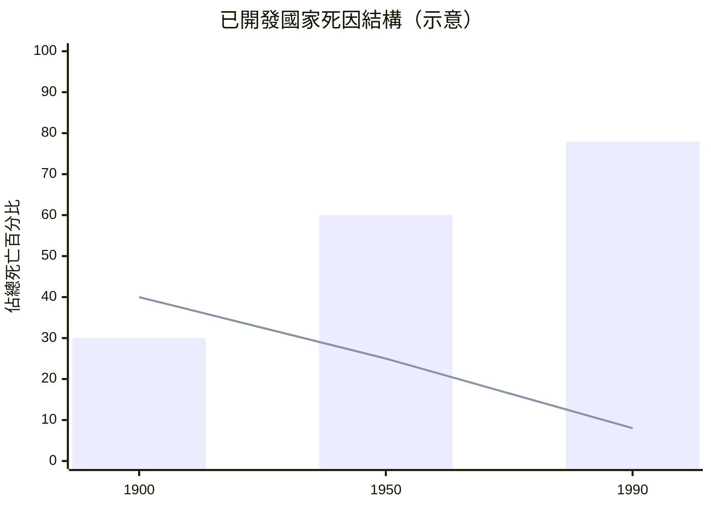

# 8.1 死亡統計：愛滋病時代與慢性病四分之三的佔比

到了二十世紀最後四分之一，人類的死亡版圖已經徹底翻轉。在已開發國家，慢性與退化性疾病——心臟病、癌症、中風、慢性肺病、糖尿病——合計佔據了總死亡原因的四分之三以上。死於急性傳染病的比例，被壓縮到統計圖表上幾乎看不見的角落。這是人類歷史上第一次，「怎麼死」不再是命運的突襲，而多半是一場漫長的、可以預見的衰敗。

但就在世人以為傳染病已被馴服之際，一種全新的疾病從陰影中現身。

## 1981：一則不起眼的疫情報告

1981 年 6 月 5 日，美國疾病管制中心（CDC）的《發病率與死亡率週報》（MMWR）刊出一則簡短報告：洛杉磯有五名年輕男同性戀者罹患罕見的肺囊蟲肺炎，其中兩人已死亡。當時沒有人料到，這五百字不到的通報，是一場全球大流行的第一聲警鐘。

1983 年，法國巴斯德研究所的呂克．蒙塔尼耶（Luc Montagnier）團隊分離出致病的反轉錄病毒，稍後定名為人類免疫缺乏病毒（HIV）。病毒摧毀人體的免疫系統，讓原本無害的感染變成致命殺手。由於初期病例集中於男同性戀者與注射藥癮者，病人不僅面對死亡，還面對污名、歧視與社會的恐懼。

## 頂峰的死亡浪潮

1990 年代前半，愛滋病達到死亡頂峰。全球每年死於愛滋病相關疾病的人數突破一百萬，撒哈拉以南非洲部分國家的平均壽命被硬生生拉低十歲以上。在美國，愛滋病一度躍居青壯年男性的頭號死因；1991 年搖滾天團 Queen 的主唱弗雷迪．摩克瑞（Freddie Mercury）病逝，更讓世人看清：這個病不分貧富貴賤。

## 1996： HAART 扭轉死亡曲線

1996 年於溫哥華舉行的國際愛滋大會上，高效能抗反轉錄病毒療法（HAART，俗稱雞尾酒療法）的成果震驚全場：合併使用多種抗病毒藥物，可將體內的病毒量壓至測不到。此後，已開發國家的愛滋病死亡率在短短數年內驟降六到八成——愛滋病從「死刑判決」轉變為可長期控制的慢性病。諷刺的是，這場大流行最終把愛滋病本身也納入了那張「慢性病」的清單。

（柱狀：慢性病佔比；折線：傳染病佔比）

## 死亡變慢了，於是問題變難了

當死亡從數日之內的急症，變成數年、數十年的慢性衰竭，新的難題隨之而來：當醫療可以無限期延長瀕死的身體機能，「何時該停止」成了新的死亡之問。呼吸器與餵食管能讓病人在無意識狀態下「活」上十年——下一節，我們就走進那間製造出這些難題的加護病房，看安寧療護、器官移植與腦死標準如何重新定義生與死的邊界。
