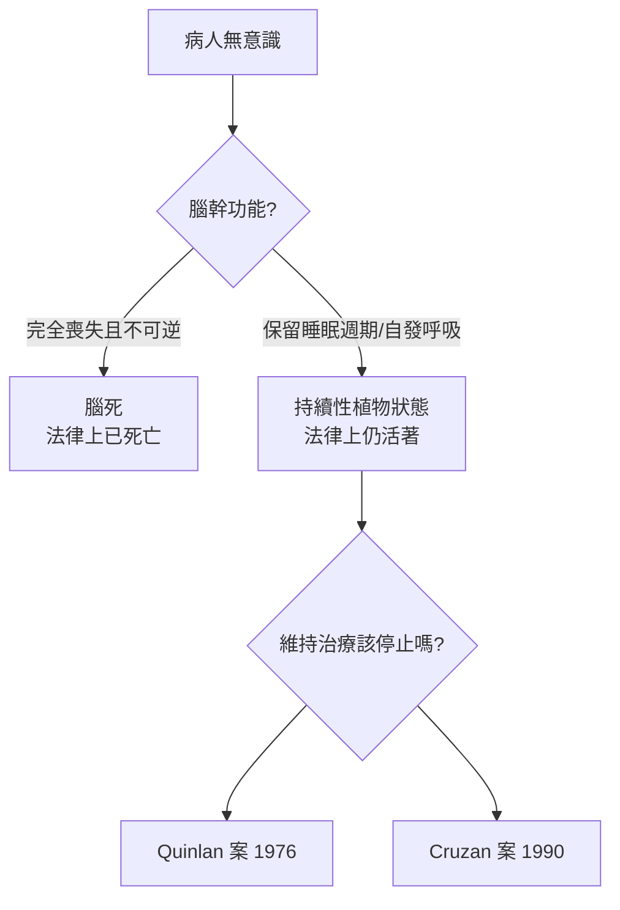

# 8.2 環境與醫療：安寧療護、器官移植與腦死標準

1970 年代之後，醫療同時朝兩個相反的方向狂奔：一邊是竭盡所能延續生命的高科技——加護病房、呼吸器、器官移植；另一邊，則是承認死亡必然到來的照護哲學——安寧療護。生死之間的界線，第一次需要被重新定義。

## 1967：聖克里斯多福安寧醫院

1967 年，英國醫師西西里．桑德斯（Cicely Saunders）在倫敦南郊創立聖克里斯多福安寧醫院（St Christopher's Hospice），現代安寧療護（hospice care）由此誕生。桑德斯原是護士與社工，後來成為醫師，她的核心信念只有一句話：「你重要，因為你是你，即使到了生命的最後一刻，你仍然重要。」安寧療護不加速也不延後死亡，而是以規律給藥控制疼痛、以團隊照護陪伴病人與家屬走完最後一程。這套模式在 1970 年代傳入北美，逐步擴散全球，成為對抗「白牆內孤獨死亡」的溫柔革命。

## 1967：巴納德的心臟移植

同樣在 1967 年 12 月 3 日，南非開普敦的外科醫師克里斯蒂安．巴納德（Christiaan Barnard）完成史上第一例人體心臟移植：他將車禍死者丹妮絲．達瓦爾（Denise Darvall）的心臟，植入五十四歲的華什卡斯基（Louis Washkansky）胸腔。病人依靠免疫抑制藥物存活了十八天，死於肺炎——但這十八天宣告了一個新紀元：器官可以在人與人之間流轉，死亡不再必然是終點，也可能是一種「給予」。

心臟移植的瓶頸很快顯現：人體的免疫系統會攻擊外來器官。直到 1980 年代環孢素（cyclosporine）等更有效的免疫抑制劑問世，移植存活率才大幅提升，心、肝、肺、腎移植成為常規手術。

## 1968：哈佛委員會與腦死標準

然而心臟移植立刻撞上一個根本問題：摘取仍在跳動的心臟，算不算殺人？傳統的「心肺死亡」定義已不敷使用。

1968 年，哈佛醫學院一個特別委員會發表《不可逆昏迷的定義》（A Definition of Irreversible Coma），提出全新的死亡判定標準：當病人呈現不可逆的深度昏迷、無自發呼吸、腦幹反射消失，且經過一定時間的觀測複驗仍無變化，即視同死亡——即使心臟仍在跳動。這就是「腦死」標準的起源。它一方面為器官移植打開合法之門，另一方面也揭開了新難題：腦死是死亡，但「持續性植物狀態」不是腦死——植物人仍有睡眠週期與自發呼吸，卻可能永遠不再醒來。

## 兩條路線的張力

安寧療護與高科技救命術，代表了同一時代對死亡的兩種回答。前者說：有時最好的醫療是放手與陪伴；後者說：只要技術可行，生命就該被延續。這道張力在加護病房的病床邊日日上演，直到 1975 年，一位名叫卡倫．安．奎蘭（Karen Ann Quinlan）的年輕女孩，把這道難題推上了法庭——她的故事，就是下一節的主題。
