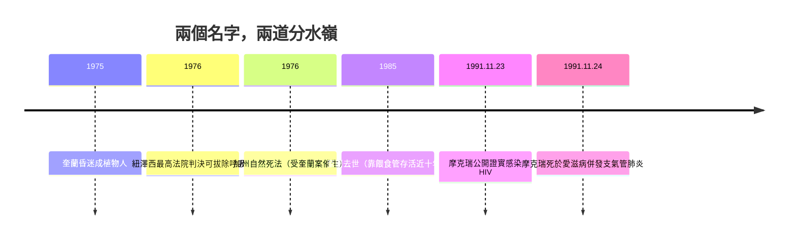

# 8.3 名人案例：卡倫．基蘭案與弗雷迪．摩克瑞

兩個名字，兩種死亡，共同改寫了二十世紀末人類對「何時該死」與「如何去死」的理解。

## 卡倫．安．奎蘭：一場昏迷掀起的法學革命

1975 年 4 月 15 日，二十一歲的紐澤西女孩卡倫．安．奎蘭（Karen Ann Quinlan）在朋友派對上混合服用鎮靜藥物與酒精後陷入昏迷。幾個月後醫師判定她處於持續性植物狀態——她沒有腦死，會自發呼吸，但意識再也沒有回來。她的父母約瑟夫與茱莉亞．奎蘭在宗教上的掙扎之後，做出艱難決定：請求醫院移除使她維持呼吸的呼吸器，讓女兒「回到上帝手中」。

醫院拒絕了。醫師們明白：移除呼吸器若導致死亡，他們可能面臨殺人指控。奎蘭夫婦於是向法院請求成為女兒的監護人並獲授權決定治療的終止。1976 年 3 月 31 日，紐澤西州最高法院做出歷史性判決：病人若處於不可逆昏迷且治療僅延長瀕死過程，其家屬與醫師有隱私權所衍生的權利，同意撤除呼吸器——法院甚至援引了教宗庇護十二世 1957 年的談話，認為無需以「非常手段」延續生命。

戲劇性的結局是：拔除呼吸器後，卡倫竟能夠自發呼吸。她靠著餵食管繼續存活，直到 1985 年 6 月 11 日才因肺炎併發症過世，前後長達近十年。但此案的意義早已超越她本人的命運：它是全球第一件關於「拒絕無效醫療」的里程碑判例，確立了「醫療可以延長死亡，而病人（或其代理人）有權拒絕」的原則。奎蘭案也直接催生了 1976 年加州《自然死法》（Natural Death Act）——美國史上第一部承認「生前預囑」效力的法律（詳見 8.4）。

## 弗雷迪．摩克瑞：死前一天的公開告別

如果奎蘭案代表「拒絕延長死亡」的權利，那麼弗雷迪．摩克瑞（Freddie Mercury）之死則代表另一種尊嚴：在污名與恐慌中選擇誠實面對。

這位 Queen 樂團的主唱是二十世紀最偉大的表演者之一。1991 年 11 月 23 日，病情已經惡化的他發表聲明，公開證實自己感染愛滋病毒——在當時，這樣的告白幾乎等於社會性死亡。他說：「我覺得保護隱私的正確時機已經過去，為了世界各地感染此病的患者，這個真相必須現在說出。」二十四小時後的 1991 年 11 月 24 日，摩克瑞死於愛滋病併發的支氣管肺炎，得年四十五歲。他死後不久成立的梅爾希巴基金會（Mercury Phoenix Trust），持續投入愛滋防治。

## 一個拒絕機器，一個拒絕沉默

奎蘭與摩克瑞，一個是平凡的年輕女孩，一個是萬人仰望的巨星；一個的死亡由父母與法官代為抉擇，一個親手在死前一天對世界坦白。他們共同指向同一個時代課題：死亡的時機與方式，應該由誰決定？而這道問題，在 1990 年代被推上了美國最高法院，也催生了席卷各國的「自然死」立法運動——那就是下一節的故事。
