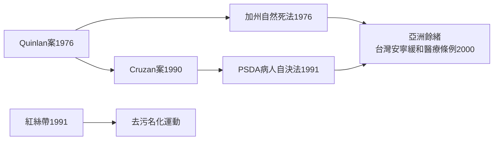

# 8.4 文化與信仰：生前預囑與「自然死」立法運動

奎蘭案之後，一個過去無人思考的問題成了大眾議題：當我再也無法開口，誰來替我決定？整個 1980 到 1990 年代，西方社會用立法、法庭判決與一枚小小的紅絲帶，重新劃定了死亡的自主邊界。

## 1990：克魯桑案——最高法院的第一課

南茜．克魯桑（Nancy Cruzan）二十五歲時車禍成為植物人，靠餵食管維持生命七年。她的父母請求醫院拔除餵食管，案子上訴到美國最高法院。1990 年 6 月，最高法院做出史上第一件「拒絕維生治療」判決（Cruzan v. Director, Missouri Dept. of Health）：憲法保障的自主權確實包含拒絕維生治療的權利，但各州可要求「清楚且令人信服的證據」證明這是病人本人的意願。克魯桑生前曾對同事說過不願靠機器活著，法院後來據此允許拔管，她於 1990 年 12 月去世。

判決雖有保留，卻確認了一個大原則：拒絕治療是受憲法保護的權利。更重要的影響在立法端——

## 1991：病人自決法（PSDA）

就在克魯桑案判決後數月，美國國會通過的《病人自決法》（Patient Self-Determination Act）於 1991 年 12 月 1 日正式生效：所有接受聯邦醫療保險（Medicare/Medicaid）給付的醫療機構，必須在病人入院時告知其擁有兩項權利——預立醫療指示（advance directive）與指定醫療委任代理人。從此，「生前預囑」從概念變成制度，每個進醫院的美國人都會被問到那個問題：如果有一天你無法開口，你想怎麼被對待？

## 「自然死」運動與去污名化

這波立法浪潮被稱為「自然死」（natural death）運動：目標不是加速死亡，而是拒絕以插管、電擊、心肺復甦等「非自然」手段延長瀕死過程。加州 1976 年的《自然死法》是第一部，其後美國各州、加拿大、歐洲各國陸續跟進。世界性的組織如「死亡權利」運動者，也在此時期將議題帶入公共討論。

同一時期，另一場運動在對抗死亡之上的第二層傷害：污名。愛滋病曾被稱為「天譴」，病人被醫院拒收、被社區驅離。1991 年，藝術家組成的視覺愛滋組織以紅絲帶作為關懷的標誌——它在 1992 年的奧斯卡典禮上別滿明星胸前，成為二十世紀最著名的公共衛生符號之一。 Freddie Mercury 的公開坦白、紅絲帶的流行、名人與病友的現身說法，逐步把愛滋從道德審判轉為醫療與公衛議題——這正是「去污名化」最經典的一役。

## 哀傷五階段之後：生死教育進入日常

承接庫伯勒－羅斯開啟的臨終心理學，1980–90 年代「生死教育」（death education）進入醫學院、中學與社區課程；安寧療護從英國模式擴散為全球體系。這條路線在亞洲持續延伸：台灣於 2000 年通過《安寧緩和醫療條例》，讓末期病人可以預立意願書拒絕心肺復甦術——成為亞洲自然死立法的先驅，也為日後《病人自主權利法》鋪路。

## 從「何時死」到「如何活到最後」

二十世紀末的人類，終於為「現代死亡」立法：腦死定義了生命終止的科學界線，生前預囑界定了放手與繼續的自主權利，安寧療護提供了放手的溫柔技術，紅絲帶則教會社會不再用恐懼看待病人。死亡仍是必經之路，但走這條路的方式，第一次由本人說了算。

然而長壽還在繼續推進——當人類普遍活過七十五歲、活過八十歲，孤獨死、超高齡與照護的重擔，將把這場善終革命帶入二十一世紀的下一章。
