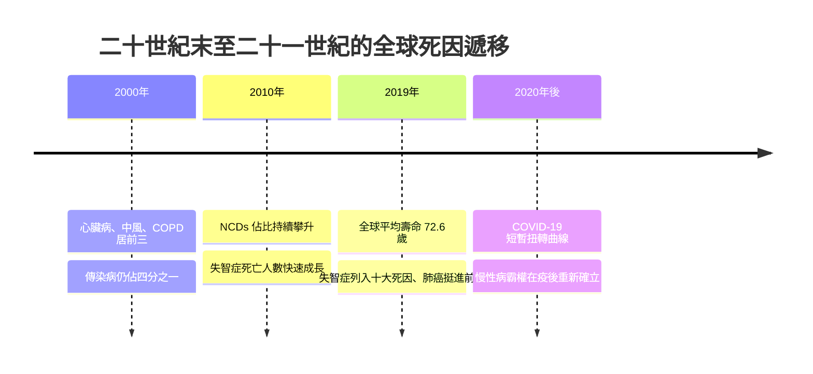

# 9.1 死亡統計：全球平均壽命七十二歲之後

2019 年，世界衛生組織（WHO）公布了一份歷史性的統計：全球出生時平均餘命（life expectancy at birth）達到約 72.6 歲——這是人類史上第一次，全球平均壽命跨過七十歲大關。從遠古的三十歲，到二十世紀初的四十餘歲，再到七十二歲，人類用了一百年左右的時間，把平均壽命延長了一倍以上。這個數字背後，是疫苗接種、抗生素、公衛工程與營養改善共同堆疊的成果。死亡並未消失，它只是被推遲，並且改變了形狀。

## 新的死亡排行榜

根據 WHO《全球健康估計》（Global Health Estimates），2019 年全球十大死因中，非傳染性疾病（NCDs）佔據了七席，合計造成全球約 74% 的死亡。排在前端的是：

1. **缺血性心臟病**：全球每年約奪走 900 萬條生命，自 2000 年起穩居頭號死因，死亡人數二十年間增加超過 200 萬。
2. **中風（腦血管疾病）**：每年約 600 萬人死亡，加上心臟病，心血管疾病合計每年造成約 1,800 萬人死亡——相當於每三起死亡中就有一起。
3. **慢性阻塞性肺病（COPD）**：吸菸與空氣污染的複合遺產。
4. **下呼吸道感染**：十大死因中僅存的傳染病之一。
5. **新生兒狀況與氣管、支氣管、肺癌**：肺癌首次進入前六，成為最致命的癌症。

最引人注目的變化，是阿茲海默症與其他失智症——2019 年，失智症首度擠入全球十大死因，並在部分高收入國家（如美國、英國）躍升為第二大死因。隨後 WHO 更新排序時，已將其列為全球第七大死因。這是一個統計上的里程碑：**人類活到了大腦會先於心臟衰竭的年紀**。

## 發達國家的八十歲與日本的八十四歲

平均壽命的地理分布極度不均。日本以約 84 歲以上連年蟬聯世界最長壽國家；香港、瑞士、南韓、澳洲、義大利等亦在 82 至 84 歲之間。許多西歐與北美國家落在 80 至 83 歲。相形之下，撒哈拉以南非洲部分國家的平均壽命仍在 55 至 65 歲徘徊——這段差距，正是疫苗覆蓋率、愛滋病防治、婦幼醫療與潔淨飲水差距的總和。

在發達國家內部，死亡早已高度集中在老年。以日本與西歐為例，65 歲以上死亡佔總死亡的比重超過八成，85 歲以上者佔一半以上。婦女生下孩子的年齡比過去更晚，而她們埋葬自己子女的機率，則降到了人類史的最低點。死亡的第一線面孔，從孩子的空床，變成了醫院裡一位配戴鼻導管的八十五歲老人。

## 「長壽悖論」：多活的歲月，誰來陪伴

然而，平均壽命的勝利帶來了一個始料未及的副作用：**活得久，卻未必死得好**。2019 年 WHO 估計，全球健康平均餘命（HALE）約 63.7 歲——比平均壽命少了將近九年。這九年的差距，就是失能、臥床、失智與依賴照護的歲月。

$$\text{失能年數} \approx e_0 - \text{HALE} \approx 72.6 - 63.7 \approx 9 \text{ 年}$$

更隱蔽的代價是社會性的。在高齡化最深的社會，越來越多的死亡發生在無人知曉的公寓裡：老人獨居、家人散落、社區連結鬆脫。當死亡從家庭客廳被移進醫院白牆（第 6 章），再從醫院被推回一個空無一人的家，一種全新的死亡形態誕生了——日文中稱之為「孤立死」（孤獨死），每年以數萬件的規模在日本發生，死後數週甚至數月才被發現。

平均壽命七十二歲，是人類文明最偉大的成就之一；而這個成就的陰影——孤獨、失能與「不想這樣活下去」的呼聲——正是本章其餘三節要處理的問題。要理解這些陰影如何形成，必須先看清楚二十一世紀的醫療與社會結構：下一節，我們走進超高齡社會的病房與藥房。

> 延伸閱讀：見下一節〈9.2 環境與醫療：超高齡社會、標靶藥物與照護荒〉。
