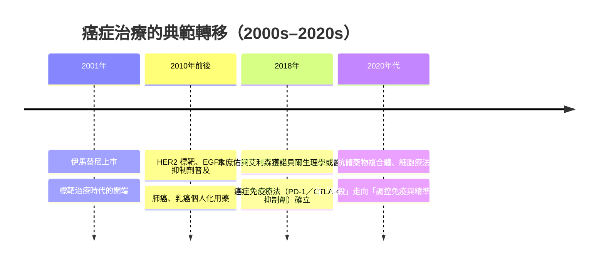
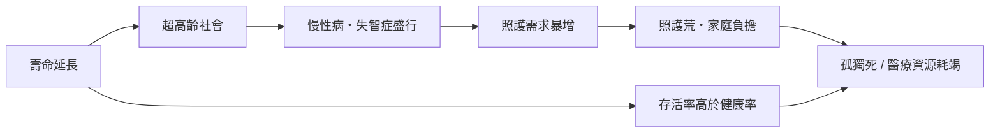

# 9.2 環境與醫療：超高齡社會、標靶藥物與照護荒

二十一世紀的醫療，面對的是一個前所未見的敵人陣容：不是鼠疫桿菌，而是老化的血管、癌變的細胞與退化的大腦；不是無藥可醫，而是藥物太貴、病人太老、照護的人手太少。這一節描述支撐「七十二歲世界」的醫療系統——以及它正在崩塌的邊緣。

## 標靶藥物：從毒殺到精準打擊

癌症治療在整個二十世紀的主旋律是「毒殺」：手術切掉、放射線燒掉、化療毒掉。真正的典範轉移發生在 2001 年——費城染色體的發現者之一珍妮特·羅利（Janet Rowley）的分子遺傳學研究，經數十年累積，結晶為第一個成功的標靶藥物：伊馬替尼（imatinib，商品名基利克 Gleevec / Glivec），用於治療慢性骨髓性白血病（CML）。它以分子鎖鑰的方式精準抑制致癌基因 BCR-ABL 的酪胺酸激酶，使 CML 患者的五年存活率從約三成躍升至九成上下，讓一種絕症變成每天吞一顆藥的慢性病。

2018 年的諾貝爾生理學或醫學獎頒給了日本的**本庶佑**（Tasuku Honjo）與美國的**詹姆斯·艾利森**（James Allison），表彰他們發現「以抑制負向免疫調節來治療癌症」：艾利森解鎖了 T 細胞上的 CTLA-4 刹車，本庶佑則發現了 PD-1 這道更關鍵的免疫剎車，並催生出 Nivolumab 等免疫檢查點抑制劑。部分晚期黑色素瘤與肺癌患者因此活了五年、十年以上——這在十年前是不可思議的。

但「精準」是有價格的。基利克上市時年費以數萬美元計，免疫療法單一年療程動輒數十萬美元。醫療史上的老問題以新形式重現：**能救命的藥，只有買得起的人用得到**。

## 超高齡社會：老年人口成為多數

日本是全球老化的最前線。1990 年代日本 65 歲以上人口占比突破 14%（「高齡社會」），2007 年突破 21%（「超高齡社會」），成為全世界第一個由老年人口構成超過五分之一國民的國家。此後這個數字一路攀升至近三成。整體社會的形貌隨之改變：

- **獨居老人激增**：高齡者單人家戶成長最快的戶型之一，許多人的日常接觸對象只剩送餐員與照護員。
- **照護人手缺口**：日本政府推估 2025 年護理人員缺口高達數十萬人，「介護離職」（為照顧父母而辭職）成為社會性名詞。
- **平均住院與在宅死亡**：多數日本人仍在醫院過世，但政策開始強力推動「在宅醫療」與「人生的最後階段在自己家中」的選項。

## 尊嚴死的制度化：醫助死亡的立法浪潮

當醫療能延長瀕死的過程，「何時停止」便成為法律問題。二十一世紀第一個十年，一組國家把「協助結束生命」寫進了法律：

- **荷蘭（2002）**與**比利時（2002）**：將安樂死（醫師依患者明確、自願且持續的請求施予致死藥物）合法化，條件包括無法治療的痛苦、多重醫師評估等。
- **瑞士**：長期以來允許「協助自殺」——醫師開立處方，患者自己動手。1998 年成立的組織 **Dignitas**（尊嚴，位於蘇黎世附近）以及歷史更久的 **Exit**（1982 年成立），使瑞士成為「安樂死旅遊」的終點站。
- **加拿大（2016）**：聯邦立法通過「醫療協助死亡」（MAiD, Medical Assistance in Dying），起先限於「自然死亡可合理預期」的患者，2021 年擴大適用範圍，後續並數度討論精神疾病為唯一病因者的適用（已數度展延）。

與此同時，另一條更溫和的路線也在普及：**安寧療護**（hospice & palliative care）。從 1967 年桑德絲創立的聖克里斯多福安寧院出發（見第 8 章），到了二十一世紀，WHO 呼籲將安寧療護列為全民健康覆蓋的一環，台灣、日本、韓國與多數歐洲國家都建立了住院安寧、居家安寧與社區安寧的體系。醫學界逐漸形成共識：**多數死亡不需要加速，也不應該被無限延長，而是需要好好被陪伴**。

這些制度上的分岔——標靶藥物、免疫療法、安寧療護、醫助死亡——共同回答著同一個問題：在死亡不可避免時，人要怎樣掌握自己的死法？下一節的兩位名人，恰好站在這個問題的兩端。

> 延伸閱讀：見下一節〈9.3 名人案例：賈伯斯的替代療法與古道爾的瑞士之旅〉。
