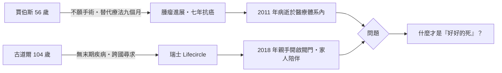

# 9.3 名人案例：賈伯斯的替代療法與古道爾的瑞士之旅

2011 年與 2018 年，兩個相隔七年的死亡，恰好框出了二十一世紀人類對「怎樣死」的兩難：一位是不願開刀、押注替代療法的科技巨頭；一位是無病無痛、卻執意赴死的高壽學者。他們的故事，是「七十二歲之後」的死亡統計最鮮活的註腳。

## 史帝夫·賈伯斯（1955–2011）：九個月的猶豫

2003 年 10 月，蘋果公司共同創辦人史帝夫·賈伯斯（Steve Jobs）在例行的腹部電腦斷層檢查中，被發現胰臟上有腫瘤。醫師起初告訴他這可能是「必死無疑」的胰臟癌，幸運的是，病理切片確認他罹患的是罕見得多的**胰臟神經內分泌腫瘤**（pancreatic neuroendocrine tumor）——生長緩慢、若及早手術預後相對良好的類型。

賈伯斯在 2005 年史丹佛大學畢業演講中親口回顧了這段經歷：

> 「我沒有接受手術。這不是我一輩子中最驕傲的決定。當時的醫學太神祕了，我不想讓身體被人切開。我改而嘗試其他可能對我有所幫助的療法。」

所謂「其他療法」，據包括傳記作者華特·艾薩克森（Walter Isaacson）在內的多方記述，主要指嚴格的**素食、果汁斷食、針灸與草藥等替代療法**。這段期間持續了約九個月——對一個腫瘤仍局限、可能被手術根治的病人而言，這是黃金時間。2004 年 7 月，腫瘤已經增大，賈伯斯終於接受了 Whipple 手術（胰十二指腸切除術）。他在病後寄給員工的信中坦承：「那個週末我接受了成功的治療，而它是及早發現才能奏效的那一種。」

此後七年，他的癌症仍持續復發與轉移，經歷肝臟移植（2009）與多輪標靶、荷爾蒙治療——包括當時新一代的精準醫療手段。2011 年 10 月 5 日，賈伯斯於加州帕羅奧圖過世，得年 56 歲，死因為呼吸停止，源於胰臟神經內分泌腫瘤的轉移。他是《財富》雜誌及後續醫學評論（如《Live Science》引述醫師估計「若及早手術可能治癒」）反覆引用的案例，也讓「替代療法延誤根治時機」成為腫瘤醫學教育中常被討論的個案。九年相對於「可能被治癒」，是替代療法爭論史上最沉重的數字。

## 大衛·古道爾（1914–2018）：一百零四歲的最後決定

2018 年 5 月 10 日，瑞士巴塞爾邦的利斯塔爾（Liestal），一位 104 歲的澳洲老人舉行了記者會。大衛·古道爾（David Goodall）是植物生態學家，澳洲科學界榮譽研究員，一生發表逾百篇論文。他不是絕症患者——他只是老了：視力衰退、無法獨立行走、生活品質持續下降。

澳洲法律不允許協助死亡，古道爾於是飛往瑞士。協助他的是「壽命圈」（Lifecircle，由 Exit International 成員組成的協助組織，與歷史悠久的 Exit 團體傳統一脈相承）。由於瑞士的協助自殺不以「末期疾病」為必要條件，像他這樣「厭倦了活著的老人」得以成行——這正是瑞士制度與荷蘭、比利時模式最大的分歧點。

記者會上，記者問他是否感到遺憾。他回答：

> 「我對此感到遺憾嗎？不會。」（Do I have any regret? No.）

他補充說，若一個人想死，社會卻要求他「以自殘、絕食等笨拙的方式死去」，那才是不人道的。5 月 10 日下午，古道爾聽著貝多芬的《快樂頌》，親手打開點滴閥門，注射了麻醉劑與巴比妥酸鹽，於數分鐘內安然離世，享嵩壽 104 歲。他的孫女與數位家人在場陪伴。臨終前他說的最後一句話被記錄為「這要花很長時間嗎？」隨後便失去意識。

## 兩個死法，一個問題

賈伯斯與古道爾，代表同一枚硬幣的兩面：**一個放棄了可能有效的治療，一個爭取了法律禁止的死亡**。前者的遺產是對「自然與純淨」迷思的警示；後者的遺產，則是推動澳洲於 2017 年由維多利亞州率先立法通過自願協助死亡（2019 年生效），西澳、塔斯馬尼亞等州陸續跟進。一個人的死亡，改寫了一整片大陸的法律。

然而，這兩位名人至少還有資源、家人與制度選項。對絕大多數人而言，二十一世紀的死亡要沉默得多——在一間沒有開燈的公寓裡，無人知曉。下一節，我們走進那間公寓。

> 延伸閱讀：見下一節〈9.4 文化與信仰：孤獨死、無緣社會與善終的重新定義〉。
