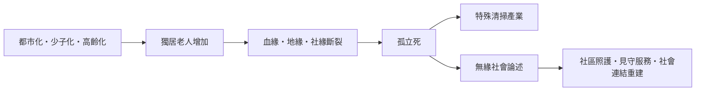
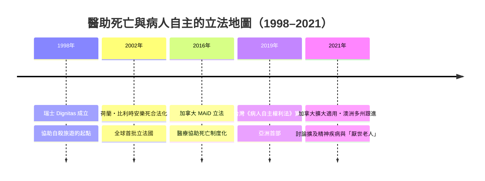

# 9.4 文化與信仰：孤獨死、無緣社會與善終的重新定義

2010 年 1 月，日本 NHK 電視台播出一輪特別節目，標題三個字震動了整個社會：**「無緣社會」**（むえんしゃかい）。節目追蹤了那些死後無人认領的遺體、斷絕了血緣、地緣與社緣的獨居者，統計出全日本每年有超過三萬具遺體無人认領或無人送終。這個詞隨即成為年度流行語，成為二十一世紀對「孤獨死」現象的總稱。

## 孤獨死：一種新的死亡形態

「孤立死／孤獨死」（孤立死）指獨居者在無人知曉的情況下死去，經過數日、數週甚至數月才被發現。日本的推計顯示，每年孤獨死的人數以**數萬件**計——僅東京都一地，年度「独居高龄者の孤独死等」通報便已突破數千件，且逐年攀升。此現象並非日本獨有：南韓發展出「고독사（孤獨死）」一詞並於 2020 年立法制定《孤獨死預防及管理法》；台灣、香港、中國的城市也陸續出現類似報導。

孤獨死催生了一個前所未有的產業——**特殊清掃**（特殊清掃）：專門清理孤獨死現場、除臭、處理遺留物、甚至替無人认領的遺物尋找下落的公司，從 2000 年代起在 日本與台灣迅速成長。當死亡的現場無人處理，市場便填補了親屬缺席的位置——這是死亡商業化（第 5 章）在二十一世紀的陰暗迴聲。

## 善終的重新定義：從「不死」到「好好的死」

面對孤獨死與過度醫療的死亡，二十一世紀出現了一場安靜但深刻的觀念革命：**善終（good death）的定義，從「不死」轉向「好好的死」**。

這場革命的第一項支柱是**病人自主**。台灣於 2016 年三讀、2019 年正式實施的《病人自主權利法》，是亞洲第一部完整保障病人知情、選擇與拒絕醫療權利的法律——它不只允許末期病人拒絕維生治療（如 2000 年《安寧緩和醫療條例》所規範），更擴及不可逆轉的昏迷、永久植物人狀態、極重度失智等五類臨床條件，並要求預立醫療決定須經過「預立醫療照護諮商」。從此，「怎樣的死」可以由本人在意識清醒時預先決定。

第二項支柱是**預囑文化的普及**。日本推廣「エンディングノート」（Ending Note，人生終筆記），荷蘭、比利時的安樂死制度則要求「自願、明確且持續的請求」作為前提。這些制度的共同精神是：死亡決定權回到當事人手中。

第三項支柱是**在家死亡與社區安寧**的再興。當死亡被移出家庭（第 6 章）半世紀後，各國政策開始反向推動：在宅醫療、社區安寧、「人生最後在自己家中」。這不僅是地點的選擇，更是修補「無緣」的努力——讓臨終者重新被人的網絡包圍。

## 制度的地圖：誰可以選擇怎樣的死

這張地圖顯示著深刻的分歧：荷蘭、比利時、加拿大允許醫師主動施予致死藥物；瑞士只允許患者自行服用；台灣與多數亞洲國家則停在「拒絕治療」的自主權，尚未觸及主動結束生命。分歧的背後，是宗教、醫學倫理與「滑坡效應」疑慮的長期拉鋸——包括 2017 年後「厭倦生命但無病的老人」是否應納入適用的爭論，正是古道爾案例（9.3）拋出的難題。

## 回到死的意義

無緣社會揭示的是：當社會連結斷裂，死亡可以孤獨到連屍體都無人认領。而病人自主立法與安寧療護的普及則證明：社會也可以選擇讓死亡成為被陪伴、被尊重、被本人決定的過程。孤獨死與善終，是同一個高齡化社會的兩種可能結局——而選擇權，第一次掌握在活著的人手中。

這場「善終革命」尚未結束。下一章，我們將看到死亡進入新的疆域：COVID-19 如何再度扭轉死亡統計、失智症如何逼近死因排行榜頂端，以及數位遺產與 AI 如何讓人類開始追問——死亡，是否可以根本地被超越。

> 延伸閱讀：見第 10 章〈10.1 死亡統計：COVID-19 大流行與失智症的崛起〉。
