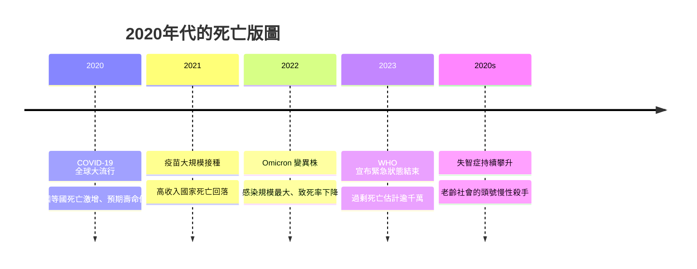

# 10.1 死亡統計：COVID-19 大流行與失智症的崛起

正當人類以為傳染病已被馴服進博物館之際，二十一世紀二十年代的開端，一場大流行撕裂了這份自信。2019 年底，SARS-CoV-2 冠狀病毒在中國武漢出現，數個月內席捲全球。世界衛生組織於 2020 年 3 月 11 日正式宣布「全球大流行」——這是 1918 年西班牙流感以來，死亡規模最大的傳染病事件。

## 兩種計數：報告死亡與過剩死亡

截至 2023 年 5 月 WHO 宣布「公共衛生緊急事件」結束時，各國通報的 COVID-19 確診死亡累計超過 700 萬人。但這個數字遠低估了真實死亡：許多死於家中的人未經檢測，許多國家的通報系統在疫情高峰時癱瘓。流行病學家因此轉向更可靠的指標——過剩死亡（excess deaths），即與疫情前基準線相比多出來的全死因死亡人數。《經濟學人》與《自然》期刊的模型估算，2020 至 2022 年間的全球過剩死亡約在 1,500 萬至 2,000 萬以上，甚至可能更高。

$$\text{過剩死亡} = \text{疫情期間實際總死亡} - \text{疫情前趨勢預期死亡}$$

這場瘟疫也提醒我們：死亡率從來不是純粹的生物學數字。同一種病毒，在不同年齡結構、醫療量能與貧富條件下，殺傷力截然不同——富國老年人大量接種 mRNA 疫苗後死亡驟降，而疫苗分配嚴重不均，讓低所得國家的高峰晚了整整一年。

## 慢性病時代的新王者：失智症

大流行退潮後，高收入國家的死因排行榜上，一個長期被低估的名字持續攀升：失智症。隨著人口老化，阿茲海默症與其他失智症在美國長年位居十大死因前段（CDC 排名在第六至第七之間浮動），在日本則穩居前五；而在英國，失智症更是女性的頭號死因之一。失智症的特殊之處在於，它不直接「殺死」人，而是緩慢地拆除一個人的記憶、自我與吞嚥能力，最終讓肺炎、敗血症或跌倒成為壓垮生命的最後一根稻草。

## 歷史的迴聲

把鏡頭拉遠，2020 年的死亡統計圖與 1348 年、1918 年有著驚人的同構：一道陡峭的死亡尖峰，一條被瘟疫拉低的預期壽命曲線，以及隨後的緩慢復原。美國人均預期壽命在 2020 年一年內就倒退近兩歲，這是二次大戰以來最大的單年跌幅。

但不同之處同樣深刻：這一次，人類在三百多天內就研發出疫苗；這一次，死亡的統計是由演算法即時繪製的；這一次，倖存者不是靠教堂的鐘聲得知疫情，而是靠手機上不斷跳動的確診曲線。傳染病證明了自己並未退場，而統計學——這門從黑死病年代的生命表起步的學問——終於長成了能與瘟疫對話的工具。

然而，比起瘟疫的尖峰，更值得凝視的是慢性病的高原。當人們不再死於突發的感染，而是死於漫長的退化，醫療體系必須重新回答一個問題：我們要如何對待一段注定走向衰竭的生命？下一節將看到，科學家試圖用基因剪刀與人工智慧，正面迎戰這個問題。

> 延伸閱讀：見下一節〈10.2 環境與醫療：CRISPR、延壽科學與 AI 醫療〉。
