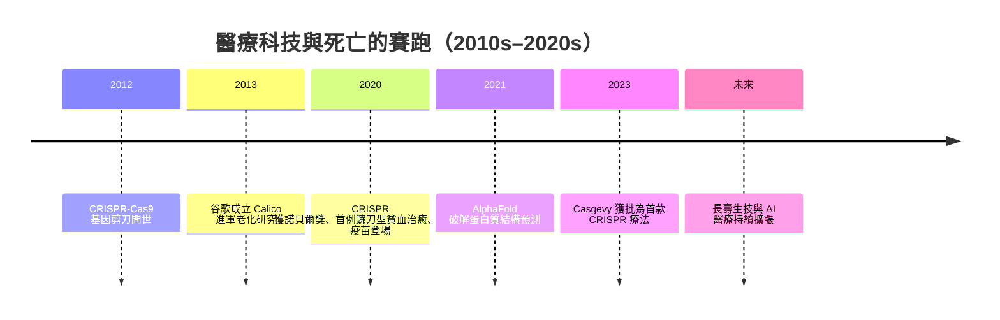

# 10.2 環境與醫療：CRISPR、延壽科學與 AI 醫療

2020 年 10 月，諾貝爾化學獎頒給珍妮佛·道納（Jennifer Doudna）與艾曼紐·夏彭提耶（Emmanuelle Charpentier），表揚她們開發的基因剪刀 CRISPR-Cas9。這是人類首次擁有能夠精確改寫生命密碼的工具——而頒獎的同一時刻，全世界最頂尖的科學家正用另一種新技術（mRNA 疫苗）對抗大流行。兩件事共同宣告：二十一世紀的醫療，正在從「對抗疾病」轉向「改寫命運」。

## 基因剪刀與治癒的可能

2020 年 12 月，醫學界迎來里程碑：美國一名鐮刀型貧血症患者接受體外 CRISPR 基因編輯治療後，被宣告功能性治癒。這項療法其後正式化為藥物 Casgevy，並於 2023 年獲英國與美國核准，成為史上第一款 CRISPR 療法。過去只能「控制」的遺傳疾病，第一次被真正「治癒」。除了編輯基因，mRNA 技術也從數十年的冷板凳一躍成為主角：輝瑞-BioNTech 與莫德納疫苗以極快的速度問世，證明了平台式醫療的威力。

## 人工智慧進入醫院

同一時期，人工智慧開始改寫診斷學。2021 年，DeepMind 的 AlphaFold 破解了蛋白質摺疊難題，將過去需要數年的結構解析縮短到數小時，為新藥開發打開大門。在臨床現場，AI 已能從視網膜影像判讀糖尿病病變、從皮膚照片辨識黑色素瘤、在醫學影像中找出人眼容易漏看的早期腫瘤。醫療知識的邊界，第一次由演算法共同守護。

## 延壽科學與矽谷的野心

當疾病可治、壽命延長，下一個問題便自然浮現：衰老本身能否被當成一種「可治療的疾病」？2013 年谷歌成立 Calico，投入老化研究；矽谷資金大量湧入「長壽生技」（longevity biotech），從 senolytics（清除衰老細胞）、NAD+ 前驅物，到換血實驗與重編程幹細胞。億萬富豪們公開宣稱要「活到一百二十歲」甚至「治癒死亡」。這些努力的科學成果仍屬早期，但它們延續了一條古老的脈絡——從秦始皇的仙丹到維多利亞時代的電療，人類從未放棄對長生的追尋，只是這次，追尋者手中有數據與資本。

## 有限戰場上的新武器

然而必須誠實地說：這些技術改變的是「怎麼死」與「何時死」，而不是「是否死亡」。CRISPR 治癒了一位貧血少年，卻無法阻止他的祖母死於失智症的緩慢衰竭；AI 可以提早兩年從眼底照片預測死亡風險，卻無法替任何人回答「延長的生命要用來做什麼」。正如抗生素時代沒有消滅死亡、只是改寫了死因排行榜，基因與演算法時代也一樣——醫療的每一次躍進，都只是把死亡往後推，推到一個更老、更需要照護的年紀。

當科技不斷重新定義醫療的極限，「老死」反而成了一種愈來愈稀有、也愈來愈珍貴的經歷。下一節的主角，正是一位以最傳統的方式——在睡夢中自然老死——告別世界的女性：她同時也是全世界最著名的人。

> 延伸閱讀：見下一節〈10.3 名人案例：伊莉莎白二世的老衰與數位時代的告別〉。
