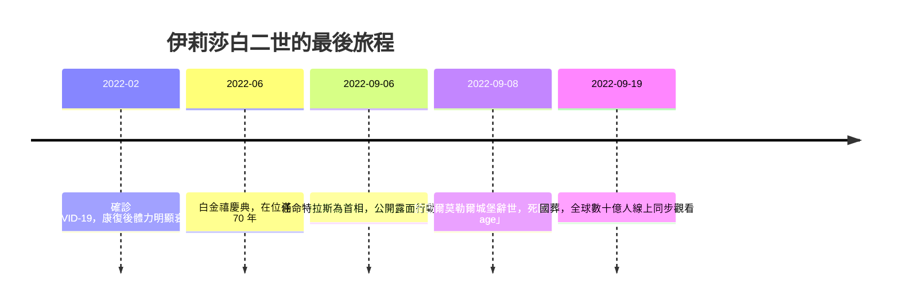

# 10.3 名人案例：伊莉莎白二世的老衰與數位時代的告別

2022 年 9 月 8 日，英國女王伊莉莎白二世（Elizabeth II）在蘇格蘭巴爾莫勒爾城堡安詳辭世，享耆壽 96 歲，在位 70 年——英國史上在位最久的君主。兩週後，蘇格蘭國家檔案館公布了她的死亡證明，死因欄只有簡潔的三個字母：**old age（老衰）**。沒有併發症，沒有侵入性治療的清單，就像十九世紀醫生筆下的死亡證明一樣。這或許是二十一世紀最後一次，世界最知名的人以最古老的死法離開人間。

## 「老死」作為一種殊榮

在抗生素與加護病房的年代，「老衰」已成罕見的死因。多數高齡者的死亡證明寫的是肺炎、敗血症、吸入性肺炎或心衰竭——失智與衰弱的最終合併症。女王卻是在短短數月內明顯衰退：她退出多次公開儀式、握手時手背出現淤青（靜脈注射的痕跡）、最後在家族的陪伴下於度假行宮安息。她沒有接受搶救，沒有在醫院的白牆內走完最後一程。以本書的語言來說，她達成了幾乎所有現代人求而不得的東西：**在家、在意識清醒的家人陪伴、在醫療不被過度介入的情況下自然老死**。這是一場「被馴服的死亡」在二十一世紀的最後示範——只是這一次，觀眾有數十億人。

## 數位時代的國葬

女王的死亡與葬禮，同時是數位時代哀悼文化的總展演。官方在王室社群帳號上以一則貼文宣布死訊；BBC 中斷所有節目、主持人換上黑色領帶；倫敦橋行動（Operation London Bridge）——這份早在 1960 年代就開始規劃的國葬計畫——在網路上被逐條討論。9 月 19 日的國葬與葬禮遊行由全球數十億人透過電視與網路直播同步觀看，西敏廳外的隊伍綿延數公里，Twitter 上出現創紀錄的哀悼流量。哀悼不再需要身體在場：蠟燭圖、獻花照與 RIP 標籤取代了靈前守夜的火盆。

## 對照與省思

把女王與同時代其他名人的死亡並列，更能看清時代的光譜：賈伯斯在 2011 年與胰臟癌纏鬥四年，以精密醫療換取時間；近年亦有富豪公開嘗試各種延壽療法。而女王則選擇了另一極：接受生理的極限，讓死亡保持自然。兩者之間，是整個人類社會正在辯論的問題——當醫療可以不斷延長生命，「何時停止」便成了新的核心難題。

女王的死亡證明上，職業欄寫著「Her Majesty The Queen——HM The Queen」。一位見證了從收音機到智慧型手機全部歷史的女性，最終以一種石器時代長老都會認得的死法離世。但她的告別儀式卻是史上最「數位」的一場：直播、 hashtag、線上弔唁簿。傳統與科技在同一週內交會，提醒我們：**死亡的形式由生理決定，告別的形式由技術決定**。

當告別搬進網路，另一個問題便隨之而來：肉身已逝，資料猶存。下一節將走進數位墓園，遇見那些不會停止說話的「AI 幽靈」。

> 延伸閱讀：見下一節〈10.4 文化與信仰：數位永生、AI 靈魂幽靈與人類的終極追問〉。
