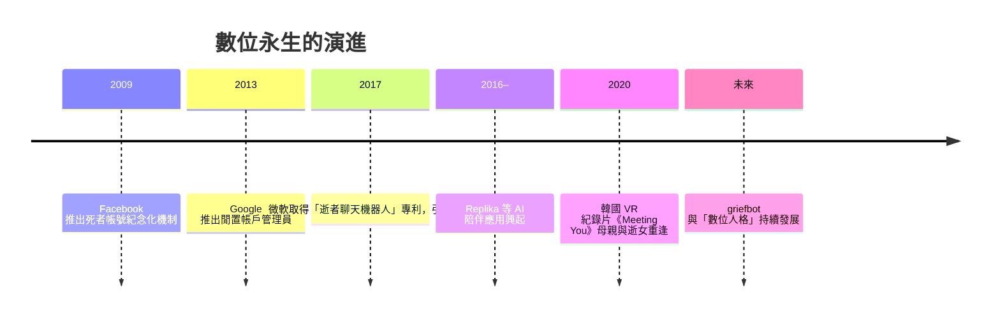
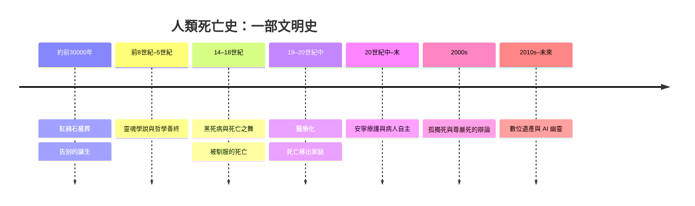

# 10.4 文化與信仰：數位永生、AI 靈魂幽靈與人類的終極追問

本書從紅赭石墓葬開始，講到這裡，我們抵達了人類死亡史的最新一章——一個連「死亡」的定義都開始鬆動的時代。

## 當帳號比肉身長壽

每一個時代的人類都留下了遺物：遠古是骨器與貝殼，維多利亞時代是遺影照片，二十一世紀則是數位足跡。當 Facebook 用戶超過三十億，一個現象隨之出現：平台上「死去的使用者」以每年數百萬的速度累積，預計在本世紀中將超過活人。Facebook 為此推出「紀念帳號」（Memorialized Accounts），讓逝者的頁面成為追思牆；Google 則推出「閒置帳戶管理員」（Inactive Account Manager），讓使用者預先指定自己死後資料的去向。遺囑律師開始處理「數位遺產」條款——照片、密碼、加密貨幣，成為二十一世紀的陪葬品。

## AI 幽靈與聊天式的永生

2017 年，微軟取得一項爭議性專利：利用逝者的社群貼文、語音與書信訓練聊天機器人，重現其「人格」。消息曝光後輿論譁然，微軟一度表示短期內無量產計畫，但這個方向早已無法回頭——Replika 等應用讓用戶與 AI 夥伴建立深度情感連結，而當用戶自己所愛的人離世，「griefbot（哀傷機器人）」的商機隨之成形：用逝者的訊息訓練出一個會說話的分身。

2020 年，韓國紀錄片《Meeting You（與逝者重逢）》將這一切搬上螢幕：一位母親戴上 VR 頭盔，在虛擬公園裡「重逢」已逝去數年的女兒——由動作捕捉與 AI 建構的數位女孩，一聲聲喚著「媽媽」。母親伸手觸碰、泣不成聲的畫面，引發全球辯論：這是療癒，還是阻止哀傷自然完成的枷鎖？

## 五萬年的同一個問題

從技術史的角度，griefbot 無比新穎；從人類學的角度，它卻古老得驚人。遠古人在墓中放進陪葬品，相信靈魂前往另一個世界；維多利亞人拍下死者睜眼的遺影，把逝者「留在」相紙上；今天我們用逝者的語料訓練聊天機器人，把逝者「留在」對話框裡。技術變了，欲望沒有變——**讓離開的人以某種方式留下來**，是人類做了一萬代的事。

但每一次新技術都帶來同一個倫理提問：那個「留下來」的，還是逝去的人嗎？巫師的通靈、靈媒的降神、AI 的回覆，究竟召喚的是逝者，還是我們自己的哀傷？哲學家提醒我們，數位分身只繼承了逝者的語言，不繼承其意志；心理學家則擔心，無限供應的「重逢」可能讓人永遠無法走完哀傷。而支持者反問：如果一面能回話的墓碑能減輕痛苦，我們憑什麼阻止？

## 收束全書：人類如何死去，就如何活著

現在，讓我們把全書走過的五萬年放回同一張圖上：紅赭石墓葬中第一次的告別；尼羅河畔對靈魂的辯論；黑死病年代「死亡之舞」面前的平等；客廳裡被家人圍繞的善終；白牆內被儀器包圍的孤獨；安寧病房裡重新被聽見的意願；瑞士公寓中自主選擇的謝幕；以及直播鏡頭前、AI 對話框裡不肯散去的幽靈。

這條曲線的每一個轉折，都不是醫學單獨推動的，而是科技、經濟、制度、信仰共同書寫的。死亡率下降了三十倍，預期壽命從三十歲走到八十歲，但有一件事始終未變：每個人依然只有一次死亡，而且沒有人知道它何時到來。

也許這正是本書最想說的話：人類是唯一知道自己會死、卻依然認真活著的動物。我們建造墳墓，是為了記得；我們寫下遺囑，是為了安排；我們訓練 AI 模仿逝者，是為了不捨。從紅赭石到演算法，改變的只是告別的媒介，不變的是告別本身。伊莉莎白二世的死亡證明上那句「old age」，與三萬年前一位長老在家人陪伴下的安息，說的其實是同一件事——

**人終有一死。而正因如此，人類才發明了文明：醫學、法律、宗教、藝術，乃至於所有試圖戰勝遺忘的技術。我們如何死去，映照著我們如何活過。而如何面對死亡，永遠是檢驗一個時代最深誠實的試金石。**

> 全書完。感謝你陪我走完這五萬年的死亡史——願它不是讓你恐懼，而是讓你更珍惜活著的每一天。
