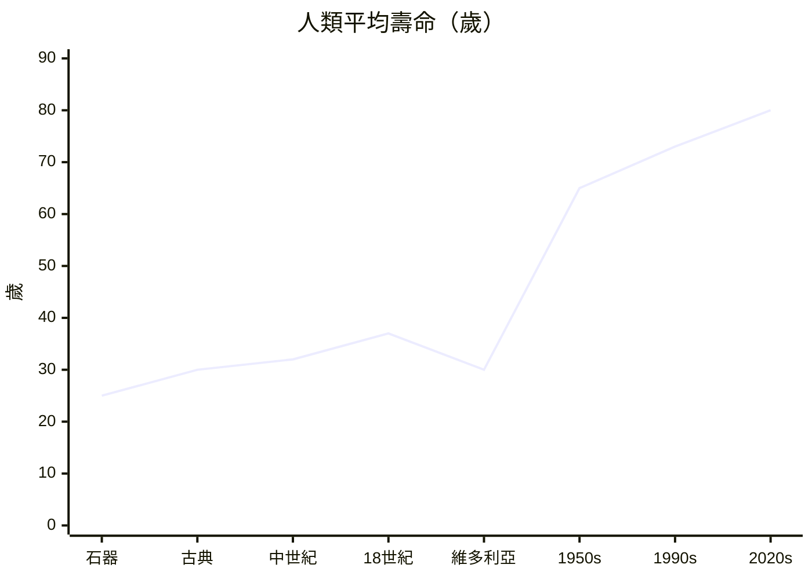

# 附錄A：人類平均壽命變遷總表

人類平均壽命的曲線並非平緩上升，而是長期被「嬰兒死亡率」壓低的水平線，直到十九世紀末公衛革命才真正起飛。以下數字為該時代典型估計值（地區差異極大，僅供全書對照）。

| 時代 | 平均壽命（出生時） | 關鍵因素 |
|---|---|---|
| 石器時代（前3萬–前3千年） | 約 20–30 歲 | 嬰兒死亡率 40–50%，外傷感染無藥可醫 |
| 古希臘羅馬（前8世紀–5世紀） | 約 25–35 歲 | 瘧疾、腸道傳染病、戰亂；引水道略降水源疫病 |
| 中世紀–16世紀 | 約 30–35 歲 | 黑死病抹去歐洲三至六成人口 |
| 17–18世紀 | 約 35–40 歲 | 天花、斑疹傷寒；金納牛痘（1796）初現曙光 |
| 維多利亞時代（1837–1901） | 工人 20–30，富人 40–50 | 霍亂與結核；斯諾寬街地圖（1854）開啟公衛 |
| 1900s–1950s | 60–68 歲 | 自來水加氯、青黴素（1941 首例）、疫苗普及 |
| 1960s–1990s | 70–75 歲 | 慢性病取代傳染病；ICU 延長病程 |
| 2000s–2020s | 全球 72–73，發達國家 80–85 | 標靶與免疫療法；失智症與孤獨死成新課題 |

以 mermaid 呈現曲線的階躍式躍升：

（維多利亞點取工人階級數值，反映工業化初期壽命的不均倒退——這是全書的重要教訓：壽命曲線曾經一度「向下」彎折。）

用 LaTeX 表示同一件事：總壽命 $L$ 是各年齡死亡風險 $\mu(x)$ 的積分，

$$
L = \int_0^{\infty} S(x)\,dx, \qquad S'(x) = -\mu(x) S(x)
$$

嬰兒段 $\mu(x)$ 的暴降（疫苗、潔淨飲水）是十九世紀後曲線起飛的主因；老年段 $\mu(x)$ 的下降（抗生素、慢性病管理）則是二十世紀的第二段躍升。
