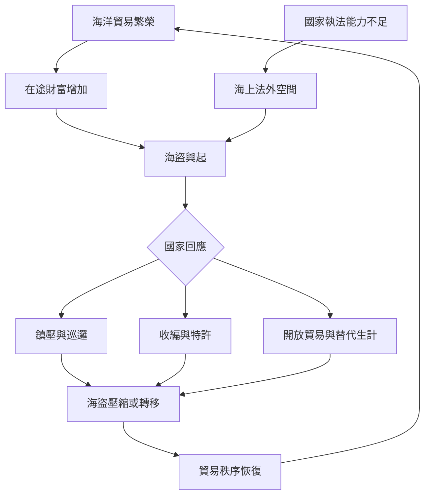

# 7.3 結語：海盜是貿易的影子

回顧四千年的海盜史，我們可以整理出幾條貫穿始終的規律。這些規律不是道德判斷，而是社會系統的運行法則。

第一條規律：海盜是貿易的影子。沒有貿易就沒有海盜。青銅時代的銅錠航路、羅馬的穀物艦隊、西班牙的白銀船隊、明代的走私網絡、今日的亞丁灣油輪——海盜的規模與財富流動量成正比，與執法能力成反比。這個差值，就是海盜的生存空間。因此，海盜問題永遠不會被「消滅」，只會被壓縮與轉移。

第二條規律：海盜與國家的界線是政治的，不是道德的。同一個船長，拿著特許狀是德雷克爵士，拿著自己的旗是德雷克海盜；同一個漢族商人，出海貿易是倭寇，拿到官職是鄭芝龍總兵；同一支武裝船隊，站在西山政權一邊是官軍，回到廣東就是紅旗幫。私掠制度的存在證明：國家需要的時候，海盜是政策工具；國家不需要的時候，海盜是犯罪。一八五六年廢除私掠，是人類第一次承認這個雙重標準無法再維繫。

第三條規律：海盜問題的終極解法是改變激勵結構，而不是消滅海盜。龐培給土地，糊塗查理給諾曼第，伍茲羅傑斯給赦免，隆慶開關給貿易權，百齡給官職，現代國際社會給索馬利亞發展援助與地方審判權。每一次成功的平定，背後都有一個「讓海盜變得不如正行」的方案。反之，凡是只靠鎮壓的嘗試——明代前期的嚴禁、西班牙的單方面清剿——往往製造更暴力的反彈。這是制度經濟學的洞見：人不是被道德驅動的，是被報酬結構驅動的。

第四條規律：海盜社會常常比主流社會更「現代」。維京船隊的夥伴分成、托爾圖加的傷殘撫恤、羅伯茨法典的選舉罷免與保險機制、拿騷的種族混合、鄭氏的商業網絡、紅旗幫的規章制度——這些在各自時代都超前於主流制度。原因不難理解：海盜是高風險的合作生產，必須設計出讓水手願意賣命的制度；而主流社會有國家暴力兜底，反而可以長期忍受專制與不公。歷史學者雷德克稱海盜船是「民主的實驗室」，這個觀察同樣適用於鄭氏的貿易公司與紅旗幫的幫規。

第五條規律：海盜的命運最終由技術與資訊決定。長船讓維京人征服北海，帆船砲戰讓英國打敗無敵艦隊，蒸氣與電報終結了帆船時代的劫掠，今日的衛星追蹤與武裝護衛壓制了亞丁灣。技術落差與資訊落差，是海盜經濟模型的兩根支柱；兩根柱子一倒，產業就崩潰。但技術從不會永遠偏向國家——胡塞武裝的無人機與飛彈告訴我們，下一次海洋安全的變局，可能不再是小艇與火箭彈，而是演算法與太空。

最後，回到那個最初的問題：當海上出現法律真空時，誰來制定秩序？四千年的答案是：要嘛是國家，要嘛是最強的武裝集團，要嘛——在難得的歷史縫隙裡——是平等者之間的自願契約。海盜史因此不只是犯罪史，它是人類在國家之外組織暴力與合作的實驗紀錄。讀完這些故事，我們也許能更清醒地看待今日的世界：哪些秩序是真實的，哪些只是旗幟；哪些規則保護弱者，哪些規則只是強者的特許狀。海洋依然遼闊，貿易依然流動，而海盜——作為貿易的影子——將繼續與文明同行。
