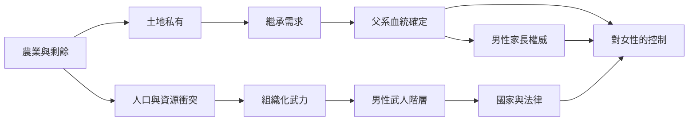

# 1.2 農耕、土地與父系繼承

## 剩餘改變了一切

約一萬一千年前的肥沃月灣，人類開始馴化小麥與大麥；此後幾千年，農業獨立地出現在長江黃河、中美洲、安地斯與新幾內亞。這場被稱為新石器革命的轉型，徹底改寫了性別的權力地圖。

農業帶來三個前所未有的現象：

1. 剩餘：一畝田可以養活遠超過耕作者家庭的人口，多出來的穀物變成財富。
2. 土地：財產第一次變成不可移動、可以世代持有的東西。
3. 人口密度：村莊需要防禦，防禦需要組織化的武力。

這三件事共同產生了一個核心問題：這塊地，死後歸誰？

## 為什麼是「父系」

在採集時代，母親的身分毫無疑問——孩子從她肚子裡出來。但父親的身分從來無法百分之百確定。在沒有財產可繼承的時代，這種不確定無關緊要；可是當土地、牲畜與儲糧需要傳給「自己的血脈」時，確定父親身分就變成財產制度的第一要務。

於是出現了一整套制度的發明，其共同目的只有一個：確保女性生育的後代「屬於」特定男性。

- 一夫一妻（或多妻）的婚姻制度，將女性固定在單一男性身邊。
- 對女性貞操的極端要求：處女崇拜、通姦重罰。在許多古代法典中（如《漢摩拉比法典》），通姦罪主要懲罰女方。
- 為出生嬰兒命名、行割禮或各種成年儀式，將孩子納入父親的家系。

尤瓦爾·赫拉利在《人類大歷史》中直白地指出：父權制度並非自然律，而是特定歷史條件下的想像秩序——而土地私有正是最重要的那個條件。

## 家族掌門人的誕生

伴隨父系繼承而來的，是男性角色的第二次定義。第一次（獵人）定義男性為風險承擔者；第二次則定義男性為家族掌門人：他代表整個家對外簽約、結盟、涉訟；家族榮辱繫於他一身；他掌管女兒的婚配、兒子的分產。中國的宗法制度、印度的種姓家系、羅馬的家父權、猶太的族長傳統，儘管文化迥異，結構卻驚人地一致。

這個角色對男性本身也是枷鎖。做不到的男性——無產、無嗣、無力保護家產者——在幾乎所有父系社會中都淪為「不完全的男人」。男人之間的階序，與男人對女人的支配，是同一套制度的兩面。

## 誰在維持這套制度

制度一旦運轉，就需要意識形態潤滑。神話與宗教開始講述男性創世神（天空之父壓倒大地之母的敘事在多地神話中反覆出現）；哲學開始論證女性理性不足；法律開始把父權寫成條文。這些我們將在後面的章節，特別是古羅馬的家父權中，看到最完整的形態。

## 小結

獵人時代的性別分工是應付環境的策略；農耕時代的父權則是為了財產而設計的制度。從這一刻起，男性的「保護者」角色開始變質：他保護的與其說是家人，不如說是家產與血統的純度。這個制度延續了五千年，直到工業革命才開始鬆動——那將是本書第五篇的主題。
