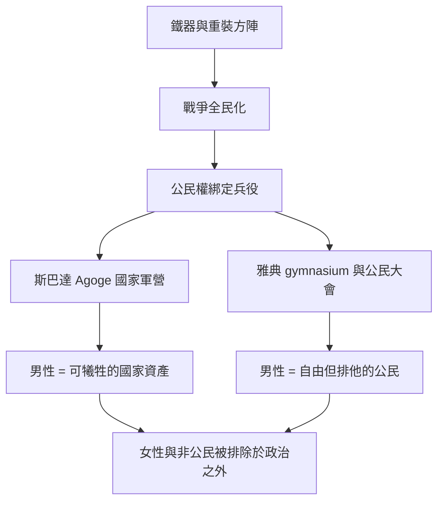

# 2.1 斯巴達與城邦的戰爭機器

## 公民的代價

西元前八世紀，希臘城邦林立。在鐵器普及、重裝步兵方陣（hoplite phalanx）出現之後，戰爭不再是貴族戰車的表演，而是全民的事：一方陣的強度取決於每一排 citizen 是否願意站在原地。這催生了希臘獨有的政治與軍事合一的男性理想——公民戰士。你之所以是公民，是因為你能扛盾持矛；你之所以能參與議事，是因為你敢於列陣。

雅典與斯巴達是這個理想的兩種極端實現。

## 斯巴達：國家即兵工廠

斯巴達大約在公元前七世紀征服美塞尼亞之後，把被征服者變成黑勞士（Helots）。黑勞士人口是斯巴達公民的十倍上下，數度起義。為了壓住這個火藥桶，斯巴達做了歷史上最激進的實驗：把整個男性人口變成常備軍。

- 嬰兒出生後由長老檢查，體弱者被棄於泰格特斯山（Apothetae，遺棄之地）。
- 七歲離家進入 Agoge（國家教育體系）：編隊生活、體能、耐飢、偷竊演練（被抓到不是因為偷，而是因為笨）、毆打訓練服從與承受。
- 二十歲成為正規戰士，三十歲才允許住進自己家，六十歲退役。
- 斯巴達男孩在阿高蓋中會配對一名年長男性作為導師（Eirenes 制度中的師徒與親密關係），這種制度化關係在古希臘被視為培養勇氣與德性的正常途徑。

斯巴達母親的名言出自普魯塔克：要麼帶著盾回來，要麼躺在盾上被抬回來。在斯巴達，逃兵的母親親手處死兒子是有記載的極端案例。男性在這裡不是家庭成員，而是國家資產。斯巴達國王阿基斯四世曾說，斯巴達人的財產就是他們的身體。

斯巴達的代價同樣極端：文化成就近乎零，公民人口因為土地分配與生育壓力持續萎縮，到公元前四世紀已不足千人，最終於前一九二年被亞該亞同盟吞併。一部把男性鍛造到極致的機器，最後死於沒有足夠的男性。

## 雅典：另一種公民戰士

雅典的路徑不同但共享同一個底層結構。雅典男性公民同樣從小接受體操館（gymnasion）與音樂教育，成年前接受兩年軍訓（Ephebia，約十八至二十歲）。雅典的重裝步兵在馬拉松（前四九〇年）擊退波斯，那場戰役的意識形態意義遠大於軍事意義：自由公民的方陣勝過帝王的僱傭軍。

但雅典公民戰士的陰影在於：這個自由只屬於男性公民。雅典女性沒有政治權、財產權，出門需要監護人陪同意象。亞里士多德在《政治學》中直接論證：男性天生比女性更適合統治，正如主人天生比奴隸更適合統治。戰場上的平等公民，回家是家庭的絕對君主。

## 制度如何鍛造人

古希臘留下一個至今仍重要的洞見：男性氣質不是天生的，是制度生產的。斯巴達用國家教育生產戰士，雅典用公民權與方陣生產榮譽，兩者都在告訴男人：你的身體屬於城邦，你的勇氣是義務，你的恐懼是恥辱。

## 小結

當羅馬崛起、希臘城邦衰落，這套「公民即戰士」的理想被羅馬繼承並放大，但它遭遇了一個希臘人從未想過的問題：當帝國太大、戰線太遠，公民兵不夠用了怎麼辦？答案將在羅馬的軍團與家父權中揭曉。
