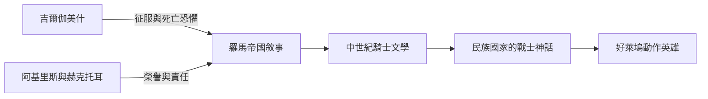

# 2.2 吉爾伽美什與伊利亞德的英雄

## 文學之前的男性

在文字出現之前，男性氣質靠口傳故事傳承。當蘇美人在西元前二一〇〇年左右把《吉爾伽美什》刻上泥板，當荷馬的吟遊詩人在前八世紀唱出《伊利亞德》，人類第一次把「怎樣才算一個男人」寫成了經典。有趣的是，這兩部最古老的英雄史詩，講的其實都是英雄的失敗與恐懼。

## 吉爾伽美什：力量與死亡恐懼

吉爾伽美什是歷史上真實存在的烏魯克國王（約前二七〇〇年），史詩中的他三分之二是神、三分之一是人，起初是個壓榨子民的暴君——強迫男性服勞役、霸佔女性初夜權。眾神於是創造了野人恩奇都與他角力，兩人不分勝負，成為摯友。

這段友誼是史詩的核心：吉爾伽美什的男性氣質從破壞性的征服，轉化為共同冒險的夥伴關係。他們一起屠殺洪巴巴、獵殺天牛。但恩奇都死後，吉爾伽美什第一次真正面對死亡——他害怕到失態，遠渡重洋尋找不死之藥，得到後又被蛇偷走，空手而歸。

史詩的結尾沒有勝利。國王學到的是：人不免一死，留下的只有城牆與名聲。這是男性氣質敘事的第一個悖論：要求男人征服一切，卻不允許他逃避死亡，於是「不怕死」成為男性最重要的表演。

## 阿基里斯：榮譽與脆弱

《伊利亞德》開篇就是阿基里斯的憤怒（Menin aeide thea——女神啊，請歌唱那憤怒）。這首三千年前的詩對男性心理的描寫細膩得驚人：

- 阿基里斯因為阿伽門農搶走他的戰利品女奴而罷戰——他憤怒的不是女人，而是榮譽被奪。在希臘戰士文化中，timē（榮譽、名聲）是男人的第二生命。
- 好友帕特羅克洛斯戰死後，阿基里斯的悲慟超出一切規範：他抱屍痛哭、以頭搶地。荷馬寫戰士哭泣毫不吝嗇——事實上《伊利亞德》中的英雄經常流淚，哭泣在當時並不損害男子氣概。
- 殺死赫克托耳後，普里阿摩斯國王深夜潛入敵營，親吻殺子仇人的手求還屍體。阿基里斯與之相擁而泣——一個哭父親，一個哭朋友。荷馬讓兩個敵人在共同的脆弱中认出彼此的人性。

換言之，古典的男性理想從來不是「無淚硬漢」。戰士可以痛哭，只要他在戰場上不退。真正的轉變要等到後世——特別是十九世紀維多利亞時代——才把「哭泣」從男性身上剝奪。

## 赫克托耳：另一種男人

《伊利亞德》中最接近現代情感的男性形象，其實是失敗者赫克托耳。第六卷中他與妻子安德洛瑪刻城牆訣別：他伸手想抱兒子，孩子卻被他的盔甲嚇哭，他大笑脫盔抱起孩子親吻，說出全詩最柔軟的話。然後他明知特洛伊將亡、自己將死，仍走出城牆——因為他聽見內心的聲音：如果我也躲進城裡，我無顏面對特洛伊的男子漢們。

荷馬並存的兩種男性模範——追求不朽名聲的阿基里斯、為家庭與城市負責的赫克托耳——至今仍在爭論：男人該為榮譽活，還是為所愛的人活？

## 英雄敘事的後世傳承

這條文學血脈從古代一路流到今天：亞歷山大枕著《伊利亞德》睡覺，並自比阿基里斯；羅馬的西庇阿在毀滅迦太基時流淚引用特洛伊的命運；中世紀貴族把亞歷山大與赫克托耳列入「九偉人」；今天的好萊塢仍然在重拍特洛伊。

## 小結

古典文學確立了男性氣質的核心引擎：用武勇換取不朽的名聲，以對抗死亡的恐懼。但它同時留下了珍貴的另一面：英雄的眼淚、摯友的喪痛、父親的吻。男性情感表達被壓抑是後來的事，而非古典的原貌——這個歷史事實，正是當代男性情感解放運動重要的論據。
