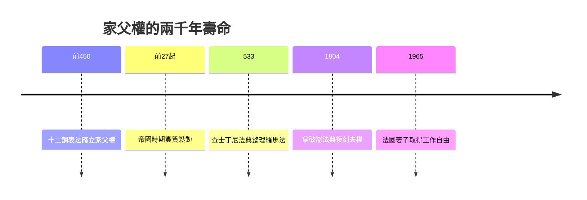

# 2.3 羅馬家父權與男性法律支配

## paterfamilias：家中的絕對君主

如果說希臘用教育鍛造男性，羅馬則用法律定義男性。羅馬法的核心概念 paterfamilias（家父）指家庭中最年長的男性，他對所有家子（包括成年的兒子）、妻子（早期婚姻形式下）以及奴隸擁有 patria potestas——家父權。這不是一般的管理權，而是近乎絕對的支配權：

- 家父可以出售子女（早期允許三次）、甚至處死家庭成員（ius vitae necisque，生殺之權）。
- 兒子無論多大年紀、官居多高，法律上都不能擁有財產；一名率軍獲勝的將軍，戰利品在法律上仍屬於他的父親。
- 家父主宰子女的婚姻：女兒出嫁需要家父的同意與嫁妝安排，婚姻本身是兩個家庭之間由男性締結的契約。

共和我們熟悉的故事——布魯圖斯處死謀叛的兒子（前五〇九年，共和國傳說的開端）——正是這個制度的意識形態宣示：對父親與對祖國的忠誠合一，家庭內的服從訓練成為共和國的基礎。

## 為什麼羅馬需要強家父權

家父權不是暴君的任性，而是農業帝國的制度需求：

1. 經濟單位：羅馬家庭（familia）包括土地、房屋、奴隸與全部人口，是一個生產與納稅單位，需要單一負責人。
2. 兵源：羅馬公民兵制依賴有產家庭提供裝備自費的步兵。家父徵召家子從軍，等於國家透過家父動員人力。
3. 社會秩序：羅馬沒有龐大的警察系統，家庭內部秩序靠家父維持，國家的統治成本因此降低。

換言之，國家把一部分合法暴力外包給了每一位家父。這是第一章「武力獨佔」的古典版本：國家壟斷對外的暴力，家父壟斷對內的暴力。

## 男性之間的階序

家父權的殘酷之處在於：它讓幾乎所有男性都活在另一個男性的權力之下。年輕男性處於家父的支配中，必須透過父親死亡、獲得政治職位、累積門客（clientela）來攀升。羅馬公共生活的核心是 dignitas（尊嚴）與 gloria（榮耀）的競賽——競選、戰功、法庭辯論、公共營建，全都是男性展示價值的舞台。元老院議員甚至被禁止從事某些「不體面」的營生（如經營公共拍賣），因為羅馬精英的男性氣質要求他們只靠土地、戰功與影響力立足。

對無法攀升的男性——貧民、解放奴隸、被征服者——羅馬文化毫不掩飾地貶低。西塞羅的演說中，攻擊對手「不像個男人」是最常見的修辭武器。帝國後期甚至出現更尖銳的問題：當戰爭轉為邊防、軍團職業化，普通羅馬男性的戰士舞台消失了，精英男性轉向哲學（斯多噶主義）與修辭競技場，尋求新的自我證明方式。

## 鬆動與遺產

家父權在帝國時期實質衰弱。哈德良（二世紀）明令禁止家主殺害奴隸；成年兒子開始可持有軍營財產（peculium castrense）；女性也逐漸獲得獨立財產權。基督教的興起進一步改變家庭倫理——雖然教會同樣強化夫權，但它把婚姻變成神聖盟約而非純粹父契，為後世「婚姻需雙方同意」埋下伏筆。

羅馬法的家父概念並未消失：它透過《查士丁尼法典》進入中世紀，再經文藝復興法學復活，成為近代歐陸民法中「夫權」與「親權」條款的直系祖先。法國《拿破崙法典》（一八〇四年）明文規定丈夫對妻子的人身與財產擁有支配權，法國妻子直到一九六五年才獲得無須丈夫同意即可工作的權利——家父權的幽靈在現代法律的迴聲，持續了將近兩千年。

## 小結

羅馬完成了一件影響深遠的事：把男性的家庭支配權寫成法律條文，並讓男性之間的競爭成為社會運轉的燃料。下一章，這套法律化的支配將與基督教結合，換上「騎士」的新衣。
