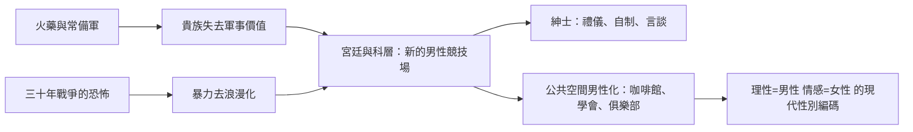

# 4.1 從戰場勇士到宮廷紳士

## 常備軍與失去戰場的貴族

十七世紀的歐洲經歷了兩場革命，摧毀了舊的男性理想。第一場是軍事革命：常備軍取代了封建徵召。火炮要專業工程師，火槍要齊射操練，軍官要讀過軍校——貴族的業餘武藝不再有位置。一六〇〇至一七〇〇年間，歐洲軍隊規模成長四至十倍，但主體是招募的平民士兵與職業軍官，貴族淪為「偶爾掛名的上校」。

第二場是三十年戰爭（一六一八至一六四八）的浩劫：德意志人口可能減少三分之一，暴力的浪漫外衣被徹底撕碎。戰後的歐洲精英普遍厭倦了血腥，凡爾賽宮廷代表了一種全新的男性價值：不靠殺人，靠優雅。

## 凡爾賽：禮儀即政治

路易十四（一六四三至一七一五在位）建造凡爾賽宮，把約一萬名貴族圈進宮廷。這是一場精心設計的馴化：貴族離開自己的城堡（失去地方勢力），來到國王的視線內（失去獨立性），捲入永無止境的禮儀競爭（失去反叛的心力）。

宮廷男性的核心技能全面改寫：

- 禮儀：晨起覲見（lever）的繁瑣程序，誰能為國王遞上襯衫是政治地位的指標。
- 對話：機鋒（esprit）、讚美的藝術、不動聲色的恭維與羞辱。
- 舞蹈與儀態：路易十四本人是傑出芭蕾舞者，創立皇家舞蹈學院（一六六一），男性跳舞是必修，不是陰柔。
- 情感控制：宮廷生存的第一法則是不露聲色。憤怒、嫉妒、恐懼一旦被讀出，就成為對手的武器。

聖西門公爵的《回憶錄》記載了這套體系的殘酷：一次失禮、一個不當的座位排序，可以毀掉一個家族幾十年的經營。男性氣質從「敢死」變成「能忍」——從物理的勇氣變成心理的表演。

## 紳士：英國的版本

英國的對應物是 the gentleman（紳士）。這個概念在十六至十八世紀逐漸脫離血統，轉向教養：自然哲學家法蘭西斯·培根在《論學習》中把紳士定義為有教養、博學、能辦事的人。一七〇九年《旁觀者》(The Spectator) 雜誌由艾迪生與斯蒂爾主編，成為紳士行為的教科書：談吐溫和、控制情緒、尊重女性、有品味。

約翰·洛克《教育片論》（一六九三）明確主張：紳士教育的核心是「自我克制」（self-denial）與「名譽感」（是榮譽感而非鞭子讓孩子守規矩）。洛克認為男孩應從小學會掩飾與管理情緒，因為這是社會交往的資本。這份教育綱領影響整個十八世紀的英國上層男性，也將維多利亞時代的「硬漢教育」預先寫好腳本。

## 咖啡館、俱樂部與公共男性空間

這個時期出現了新的男性制度空間：咖啡館（一六五二年倫敦第一家）、沙龍、俱樂部。一六九〇年代的倫敦咖啡館被稱為一分錢大學——一杯咖啡的價格，可以讀報紙、聽辯論、談生意。男性在這裡練習一種新的權力：言談的權力。一六九五年勞埃德咖啡館成為海險交易所，一七七四年倫敦證券交易所在喬納森咖啡館誕生——資本主義的市場，最初就誕生於男性的談話空間。

同時，辦公室、官僚體制、文官制度（普魯士、法國的職業官僚）開始出現。一種全新的男性成功標準誕生：科層升遷、專業能力、社交手腕。它是十九世紀「組織人」的直接祖先。

## 女性的排除

諷刺的是，這個「更文明」的時代在性別上反而更封閉。沙龍（salon）由女性主持，是少數男女共處的思想空間；但正式的科學學會（如英國皇家學會，一六六〇）拒絕女性，大學拒收女性，行會、議會、法庭、軍隊全部是男性領地。盧梭在《愛彌兒》（一七六二）中主張女性教育的目的只是取悅男性。理性、公共、政治被標記為男性領域，情感、家庭、私生活被劃給女性——這條公私分界線，是現代性別分工最重要的發明之一。

## 小結

十七、十八世紀的男性，從戰場撤到了沙龍與辦公室，從劍轉向了禮儀與理性。但這個「文明化」的代價，是把男性的情感禁錮得更深。啟蒙時代一邊高呼自由平等，一邊把女性與「感性」一起鎖進家庭——這正是下一章要解剖的理性家長。
