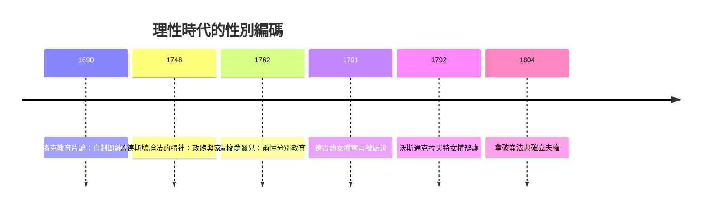

# 4.2 啟蒙時代的理性家長

## 理性的性別化

啟蒙運動的核心宣稱是：理性是普遍的，人人生而平等。但同時代的哲學家幾乎一致認為：這個普遍理性，主要是男性的。

- 康德在《論優美與崇高感》（一七六四）中斷言：女性對深奧或抽象的原理沒有興趣，她們的德性是「優美的德性」，男性的德性才是「崇高的德性」。
- 盧梭在《愛彌兒》第五卷寫道：男子應該被教育為獨立、主動、理性的公民；女子（蘇菲）應該被教育為順從、取悅丈夫、守護家庭的人。「女人的一切教育都必須與男人相關：取悅他們、幫助他們、被他們愛與尊重。」
- 達爾文的祖父輩學者如盧梭的追隨者，普遍以「自然」論證女性不適於抽象思維。

這套論述的社會效果深遠：當「理性」成為現代社會的核心資格（投票權、受教育權、職業資格），把女性排除在理性之外，就等於把她們排除在現代社會之外。一七八九年法國大革命發布《人權宣言》，一七九一年奧蘭普·德古熱（Olympe de Gouges）寫下《女權與女性公民權宣言》反擊，一七九三年她被送上斷頭台。同時代的英國，瑪麗·沃斯通克拉夫特於一七九二年出版《女權辯護》，直接反駁盧梭——她主張女性表面上的「感性、膚淺」，正是男性教育剝奪的結果，不是天性。

## 家長制的現代化

啟蒙時代並未廢除父權，而是把它從宗教權威轉換成契約語言。幾個關鍵變化：

1. 家庭契約論。洛克在《政府論》中主張政治權威來自同意而非神授——這個思想革命卻在家庭問題上踩了煞車：他認為父親對子女的權威是自然的（雙親共同撫養），但妻子對丈夫的服從則在婚姻契約中自然形成。家庭成為唯一免於契約邏輯檢驗的角落。
2. 法國《拿破崙法典》（一八〇四年）將啟蒙與革命的成果法典化，卻明文寫道：丈夫應保護妻子，妻子應服從丈夫；妻子的財產由丈夫管理；妻子未經丈夫同意不得出庭、立契、工作。
3. 公私領域的正式分割：男性在公共領域（市場、國家、科學）以契約與理性運作；家庭被想像成不受市場污染的避風港（the haven in a heartless world），而這個避風港的主人是男性家長，管家的是女性。

## 好父親的理想：新教與情感的限制

但也有真正的鬆動。啟蒙時代誕生了「好父親」的新理想：父親不應是暴君，而應是孩子的理性導師。洛克反對體罰、主張以理性說服教育兒童；盧梭主張父親親自哺乳與教育（他把自己的五個孩子送進育幼院，這位《愛彌兒》作者的個人實踐是歷史著名的諷刺）；日耳曼新教地區的虔敬主義運動強調父親主持的家庭崇拜。

父親角色的情感化開始萌芽——但同時被限定：父親可以溫柔，但不能軟弱；可以教育，但不可以承認自己的焦慮與失敗。男性被要求成為家庭中的理性太陽，這意味著男性必須把自己真實的情感（恐懼、悲傷、無助）永遠留在看不見的地方。

## 感性的歸屬：感傷主義的矛盾

十八世紀同時流行感傷主義（sentimentalism）：理查森的《克拉麗莎》、歌德的《少年維特之煩惱》（一七七四）。維特——一個為愛哭泣、最終自殺的年輕男性——風靡全歐，引發所謂「維特熱」，男性讀者穿維特式藍外套黃背心。這顯示當時的男性文化仍允許濃烈的情感表達。

但注意這個矛盾的走向：感傷主義被主流文化逐漸「女性化」。十八世紀末起，閱讀小說、哭泣、寫日記、談論情感，被歸類為女性活動；男性如果沈溺其中，會被懷疑是「不像男人」。情感領域的性別隔離在十九世紀維多利亞時代達到頂峰——男性的情感生活被壓縮到幾近真空。

## 小結

啟蒙時代完成了現代性別秩序的藍圖：理性、公共、競爭歸男性；情感、家庭、養育歸女性。這張藍圖在十九世紀被工業革命徹底物質化——當工廠把「工作」從家庭中抽走，養家糊口者（breadwinner）誕生，男性最後的角色枷鎖被鑄造完成。
