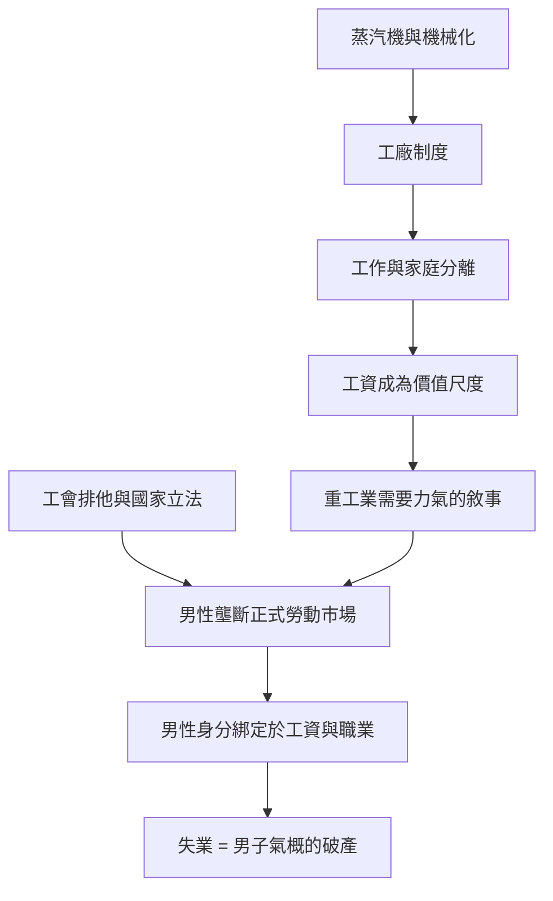

# 5.1 從農田到工廠：工資勞動的綁定

## 家庭不再是生產單位

在工業革命之前，絕大多數歐洲家庭是生產單位：農民家庭耕種自己的田，工匠家庭經營自己的作坊，妻子與子女是天然的勞動力，家庭與工作場所是同一個屋頂。男性家長是這個單位的負責人，但他的權威建立在共同勞動之上，而非單獨的經濟供養。

十八世紀末起，這一切被拆開。英國的紡織業首先機械化：一七六四年哈格里夫斯的珍妮紡紗機、一七六九年阿克賴特的水力紡紗機、一七八五年卡特賴特的動力織布機，把紡織從家庭搬進工廠。瓦特在一七七〇年代改良的蒸汽機，使工廠可以離開河流而建在城市，也使工時第一次可以無限延長——太陽不再是時鐘。

工作場所與家的分離（the separation of home and work）是工業時代對性別最重要的結構性改變。從此，一份工作的價值用「工資」衡量，而誰能拿到工資、拿多少，重新分配了家庭內的權力。

## 誰在工廠裡

最初的工廠工人並非以男性為主。紡織業早期大量僱用女性與童工——紡紗、接線、看管織機被認為需要「靈巧的手」而非力氣，而且工資便宜。一八三〇年代英國蘭開夏的紡織廠中，女工與童工占勞動力的多數。煤礦裡也有大量婦女與兒童做搬運工作（直到一八四二年英國《礦場法》才禁止女性與十歲以下男孩下礦）。

那麼「男人的工作」是如何被製造出來的？透過三股力量的合力：

1. 機器重力的錯覺。重工業（鐵、鋼、鐵路、蒸汽船）在十九世紀中期崛起，鑄造、煉鋼、鋪軌確實需要爆發力，於是力氣 = 男性 = 高工資的等式被建立起來。但機械化的歷史一再證明：今天需要力氣的工作，明天就被機器接管——需要力氣的判準始終是暫時的。
2. 工會的排他策略。十九世紀的熟練工人工會（如英國的機械工聯合會）大量採用「封閉的行會」策略，把女工、非熟練工排除在外，以維持工資水準。一八七〇至一八九〇年代英國的工會運動高漲，同時女工組織屢遭熟練男工阻撓。
3. 國家立法。各國勞動立法陸續限制女工與童工工時（英國一八四四、一八四七年《工廠法》限制女工與少年工時至十小時），本意是保護，客觀效果卻是把女性推向「非正式」的低薪工作，並鞏固了男性在正式勞動市場的壟斷地位。

## 經濟學如何為新秩序命名

古典經濟學在這個過程中提供了理論框架。亞當·斯密、李嘉圖的勞動市場理論把工人視為自由締約者，卻從不追問家庭內部分工如何被這個市場重塑。直到一八九〇年代，帕森斯等社會學者與後來的貝克爾（Gary Becker，一九六〇至八〇年代的家庭經濟學）才正式把「男主外、女主內」模型化為理性分工——那已是二十世紀，距離它成為現實已近百年。

更直接的意識形態來自宗教與道德運動。維多利亞時代的布道、婦女雜誌與議會演說反覆宣講：男人的戰場是市場，女人的王國是家庭（the man's sphere is the market, the woman's is the home）。這句口號式的分工論，把一種經濟安排升格為自然律與道德律。

## 男性：被工資綁架的身份

對男性而言，這個新秩序的影響是雙重的：

一方面，男性第一次獨佔了正式勞動市場，工資給了他前所未有的家庭權威物質基礎。
另一方面，他的自我價值從此被一個數字綁定。失業不再是運氣不好，而是男子氣概的破產。十九世紀英美的失業救濟被普遍視為對男性尊嚴的羞辱，濟貧院（workhouse）的恥辱印記使家庭寧可挨餓也不申請。馬克斯·韋伯觀察到，新教倫理把世俗職業成功視為蒙恩的證據——職業（Beruf，天職）這個詞本身就帶有宗教重量。

## 小結

工業革命沒有創造男性的工作壓力，但把這種壓力制度化為一生的義務。接下來兩節我們將看到：這個「養家糊口者」的理想如何成為二十世紀的家庭標準，以及維多利亞教育如何在男孩心中鑄造「不可流淚」的鋼鐵枷鎖。
