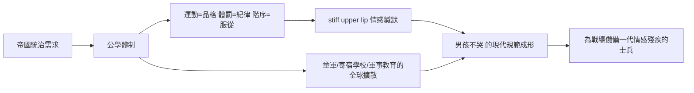

# 5.3 維多利亞時代（1837-1901）的硬漢教育

## 為帝國培養男孩

維多利亞時代的英國統治著全球約四分之一的人口，管理帝國需要一批批「能吃苦、能統治、能不流淚」的男性。於是出現了歷史上最系統化的男性氣質製造工程：公學（public school）體制。

一八五七年托馬斯·休斯的《湯姆·布朗的求學時代》（以拉格比公學為背景）是這套教育的聖經。書中校長阿諾德博士（Thomas Arnold，拉格比校長一八二八至一八四二）代表的理念是：基督教 + 男子氣概 + 競技場。體育、紀律、忍耐、忠誠，被等同於基督徒品格。

## 身體紀律的制度化

這套教育的核心是幾個發明：

1. 團隊運動作為品格訓練。十九世紀公學把足球、板球、橄欖球（拉格比學校正是橄欖球傳說的誕生地）神聖化：「球場是品格的搖籃」。一八四八年起各公學制訂運動規章，一八六三年英國足總成立。運動從娛樂升格為道德教育——輸贏、忍耐、不哭、不抱怨。
2. 舍監與學長制（fagging）：低年級男孩服侍高年級，建立殘酷的權力階序；男孩學會的第一課是向上服從、向下支配。
3. 情感的緘默條款（the stiff upper lip）。男孩不准哭、不准想家（homesickness 被視為可恥）、不准表達親密。公學男孩之間的友誼被壓縮在運動與打鬧的形式裡——任何被視為「情感性」的親近會招致羞辱。歷史學者指出，這正是現代「男孩不哭」規範正式制度化的時刻。
4. 對「軟弱」與「娘娘腔」的系統性羞辱。罵人「girl」「sissy」是公學最狠的髒話——把女性等於軟弱、把軟弱等於恥辱，一次完成。

## 冷酷的代價

這套教育的代價在當時就有記錄。公學的霸凌（bullying）極其普遍，體罰（杖笞）是日常。精神科史研究指出，維多利亞晚期的「歇斯底里」診斷雖被視為女性病，但男性也有大量被壓抑為「神經衰弱」（neurasthenia，一八六九年比爾德提出）的案例——上流社會的治療方案常是去殖民或冒險旅行，把症狀轉化為征服行動。

吉卜林的小說《斯托基公司》（Stalky & Co.，一八九九）記錄了這套教育的實際氛圍：狡詐、團結、對情感的不屑。邱吉爾在《我的早年生活》回憶哈羅公學的痛苦：體罰、羞辱、學業失敗，他寫道：「我在那裡度過了兩年無用的、無人照管的生活。」

## 帝國的全球出口

公學模式隨大英帝國出口到全世界，也影響了其他帝國的精英教育：

- 美國的寄宿學校（如一八八四年成立的 Groton School，刻意模仿英國公學）。
- 日本的舊制中學與軍事教練制度、德國的士官生學校（Kadettenanstalten）與後來的希特勒青年團，走的都是同一条「集體、紀律、身體」的路線。
- 各國的童軍運動：一八〇七年貝登堡創立童軍（一九〇七年的布朗西島實驗營），明確目標是對抗都市化造成的「男孩女性化」，用野營、結繩、體操恢復「男子氣概」。這場運動席捲全球，成為二十世紀最大規模的男孩社會化工程之一。

## 同時代的反例

但維多利亞時代並非鐵板一塊。同一個時代裡：

- 女性主義者如約翰·斯圖亞特·密爾（一八六九年《婦女的屈從地位》）論證性別角色是文化的壓迫。
- 拉斐爾前派與唯美主義運動中的男性（如王爾德）刻意採用華服與審美姿態，挑戰粗獷男子氣概的壟斷——王爾德一八九五年的審判，正是「不守規範的男性」被制度懲罰的著名案例。
- 十九世紀末的男性友誼文化（the friendship of men）依然允許濃烈的情感書信（如維多利亞紳士之間的深情通信），說明「絕對無淚」的規範在當時也並未完全成功。

## 小結

維多利亞教育製造了一代能統治帝國、卻不知道如何處理自己情感的男性。一九一四年，這批公學畢業生帶著「像個男人一樣上陣」的信念走向西線戰壕——等待他們的，是機槍、毒氣與讓他們的男子氣概崩潰的現實。下一章，我們將走進那片泥濘。
