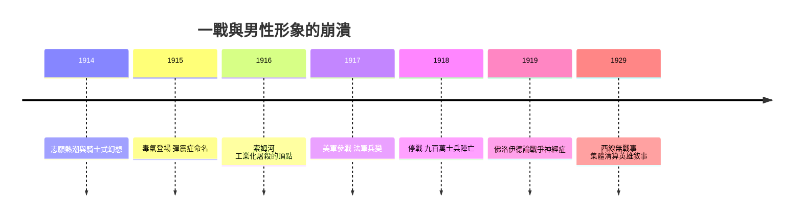

# 6.1 一次大戰（1914-1918）：毒氣、戰壕與彈震症

## 「聖誕前回家」的幻覺

一九一四年八月，歐洲各國的年輕人湧向徵兵站。倫敦、巴黎、柏林的街頭擠滿歡呼的人群——當時普遍預期戰爭會在幾個月內結束，許多年輕人真心相信這是一場「會讓男孩變成男人」的偉大冒險。英國志願軍中的「夥伴營」（Pals Battalions）允許同鄉、同校、同俱樂部的男性一起入伍——整支球隊、整間公司的男人一起報名。這些營在一九一六年索姆河戰役的頭一天（七月一日，英軍陣亡近兩萬人）幾乎被整建制抹去，英國的數百個小鎮一夜之間失去了整整一代年輕男性。

徵兵宣傳的視覺語言完全是維多利亞公學的延伸：基奇納元帥的手指直指你（Your Country Needs You），母親們被告知兒子上戰場是她們的榮耀，女孩會把白羽毛（懦夫的象徵）塞給沒穿軍裝的年輕男性。男性氣質的宣傳機器全速運轉。

## 工業化屠殺

戰場上的現實與宣傳完全脫節。這是人類歷史上第一次工業化屠殺：

- 機槍：馬克沁機槍每分鐘數百發，把步兵衝鋒變成收割。
- 火炮：索姆河戰役開戰前英軍砲擊七天、發射約一百五十萬發砲彈；約六成傷亡來自砲火。
- 毒氣：一九一五年四月伊珀爾，德軍首次大規模使用氯氣；隨後光氣、芥子氣接連登場，造成逾百萬傷亡。
- 戰壕：西線四百餘英里的戰壕對峙四年，士兵在泥漿、鼠群、屍體與炮擊中生活。

傳統的英雄敘事在這裡徹底失效。沒有騎馬衝鋒、沒有面對面的勇氣對決、沒有可供展示的戰功——死亡是匿名的、隨機的、工業化的。你在睡夢中被砲彈炸死，與你是不是「勇士」毫無關係。詩人威爾弗雷德·歐文（Wilfred Owen）在《Dulce et Decorum Est》中描寫毒氣下士兵的痛苦，並把賀拉斯的古老格言「為國捐軀是甜美且光榮的」斥為「天大的謊言」。歐文本人死於停戰前一週（一九一八年十一月四日）。

## 彈震症（Shell Shock）：男子氣概的醫療崩潰

戰爭爆發不久，一種前所未見的病症大量出現：士兵失去聽力或視力卻查無損傷、全身顫抖、失語、噩夢、僵硬、失禁、莫名恐懼。英國軍醫查爾斯·邁爾斯（Charles Myers）於一九一五年在《刺胳針》首次以 shell shock（彈震症）命名——當時的解釋是炮彈爆炸的物理震盪傷及神經。

但症例很快超出了物理解釋：從未經歷近距爆炸的士兵也發病；症狀與個人勇氣無關——獲頒最高勳章的老兵同樣崩潰。到戰爭結束，英軍約有八萬名 shell shock 病例，德國與法國的數量相當甚至更多。

軍方的反應暴露了男性氣概規範的殘酷：

- 一部分軍官堅持彈震症是「裝病」「懦弱」，症狀者應送軍事法庭。英軍在一戰中處決了三〇六名士兵，罪名多為逃避職守與臨陣脫逃——其中不少是彈震症患者。二〇〇六年英國政府才為這些士兵集體赦免。
- 軍醫的主流療法是「回歸職責」（返隊）治療：迅速施壓、電擊（部分法國醫院採用電擊療法 solfarino）、羞辱，目標是盡快把男人送回戰壕——治療的標準不是康復，而是「能再打仗」。

奧地利醫師西格蒙德·佛洛伊德與同事在戰後寫下《精神分析與戰爭神經症》（一九一九），把戰爭神經症解釋為自我與死亡恐懼之間的衝突——醫學正式承認：男人的心理可以被打碎，與他的勇氣無關。這份認可遲到了，但它開啟了二十世紀創傷心理學的大門，最終通往一九八〇年 PTSD 正式進入 DSM-III。

## 被戰爭改寫的男性敘事

一戰留下了三份遺產：

1. 對英雄敘事的文學清算。海明威《太陽依舊升起》（一九二六）、雷馬克《西線無戰事》（一九二九）寫出了「迷惘的一代」——倖存者帶著身體殘缺與情感麻痺回到一個不懂他們的社會。這批文學徹底改寫了男性形象的樣板：英雄不再是光榮的騎士，而是幻滅的倖存者。
2. 對「男子氣概＝不怕死」的科學質疑。心理醫學開始承認恐懼是正常的，崩潰是自然的——這條線在二戰的美軍研究（如 Roy Grinker 與 John Spiegel 的戰爭神經症研究）繼續延伸。
3. 對兵役與公民權關係的重新思考。女性在一戰中大量進入兵工廠、醫院、行政體系（英國約百萬女性在軍需廠工作），直接推動了戰後多國女性取得投票權（英國一九一八年、美國一九二〇、德國一九一九）——男性戰場壟斷的崩潰，意外成為女性公民權的開端。

## 小結

一戰粉碎了男性氣質的舊神話，卻沒有建立新神話——這個真空在二〇、三〇年代被各種運動爭奪，其中最危險的搶奪者，是把「超人男性氣概」推到極致的法西斯主義。那是下一節的主題。
