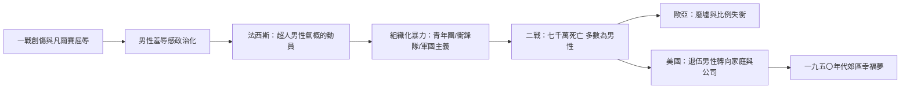

# 6.2 法西斯狂熱與二次大戰（1939-1945）的肉身代價

## 對「軟弱」的報復

一次大戰讓數百萬倖存者帶著創傷回國，也讓戰敗國（尤其德國）承受凡爾賽條約的屈辱與超通貨膨脹（一九二三年）的經濟崩潰。在這種氛圍下，一種新的政治商品熱銷：對「軟弱男性」的憤怒，與「重建強硬男性」的承諾。

法西斯主義的核心情感燃料正是男性羞辱感。戰敗被解釋為「內部的背叛」（刀刺在背的傳說 Stab-in-the-back myth）：猶太人、共產主義者、自由主義者、現代藝術，被指為使德國男性「陰柔化」的共謀。納粹的宣傳把魏瑪共和描繪成頹廢、女性化的時代，把男人應有的形象鎖定為三個原型：戰士（Soldat）、農民（Bauer）與父親。

## 被組織起來的男性身體

納粹把男性氣概的規訓推到前所未有的組織化程度：

- 希特勒青年團（HJ）：一九三六年起強制所有男孩參加，內容是體育、露營、軍事操練與意識形態灌輸。口號「你們不是天生的法西斯，是訓練出來的」的具體實踐。
- 衝鋒隊（SA）與黨衛軍（SS）：街頭暴力被組織為政治工具，一九三三年的「野蠻集中營」拘留政治犯由 SA 執行。
- 勞動服役（Reichsarbeitsdienst）：青年先服六個月勞役，鐵鍬與步槍並列為男性成年的象徵。
- 對「退化」的清除：納粹醫學把同性戀男性、身心障礙者、羅姆人視為「種族退化的男性」，系統性迫害與絕育——一七五條款下約十萬男性被起訴，數千被送進集中營。
- 女性的對應規訓：Kinder, Küche, Kirche（孩子、廚房、教堂），納粹婦女組織宣講「德國女性的榮耀是生育戰士」。

墨索里尼的義大利、佛朗哥的西班牙、日本的軍國主義教育，都採用類似的組織化男性規訓。極權主義的發現是：男性氣概可以被國家當作統治資源來「養殖」。

## 戰爭的肉身代價

第二次世界大戰（一九三九至四五）造成約七千萬人死亡，其中軍人約二千萬至二千五百萬，絕大多數是男性。蘇聯陣亡約八百七十萬軍人（另有逾千萬平民）、德國約四百五十萬、中國軍民逾千萬。蘇聯戰後的男女比例失衡持續數十年——一九五九年蘇聯二十至二十九歲人群中，女性比男性多出逾三分之一，直接造成戰後「找不到丈夫的一代」的社會現象。

但二戰的男性經驗比一戰複雜：

- 陸海空並行，有真實的「英雄戰役」敘事（不列顛空戰、斯大林格勒、諾曼第），英雄主義的部分邏輯在宣傳中復活。
- 美國的軍隊心理學有備而來：一戰的教訓使美軍在二戰中系統性研究戰鬥疲勞（battle fatigue）。二戰結束時美軍因精神症狀退役者逾九十萬人。軍醫發現一條殘酷規律：連續戰鬥的時間越長，崩潰率越接近必然——諾曼地登陸後的諾曼第戰役與太平洋島嶼戰（如貝里琉）中，連續作戰部隊的精神崩潰率急升。
- 對「男子氣概」的宣傳在戰後立即轉向家庭與工作：退伍軍人被期待「回家、結婚、生子、買房」——這直接鋪設了一九五〇年代郊區幸福夢與「組織人」的舞台。

## 戰後的男性：兩條岔路

戰爭結束後，歐亞大陸的男性面對的是廢墟、戰俘營、失蹤名單與戰爭罪審判；美國男性面對的是另一種問題：如何從戰士變回上班族。喬治·奧威爾在一九四〇年代注意到，英語世界的硬漢形象（如海明威筆下）與辦公室社會的平庸之間存在巨大斷裂。這條斷裂的裂縫，將在一九五〇年代以「灰色西裝男」的形式被寫成小說——那是下一章的主題。

## 小結

兩次大戰是人類對「男性作為戰爭資源」這個五千年老制度的清算：數千萬男性被這個制度消耗。戰後，先進國家的男性被指派了新角色——公司裡的組織人、郊區的養家者。但這個新角色的內在空虛，很快在文學與電影中爆發出來。
