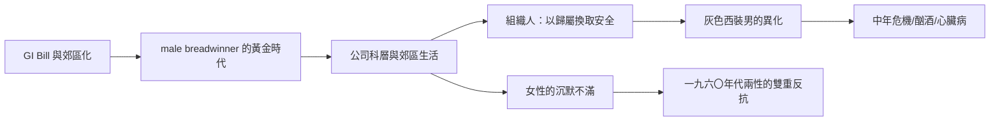

# 7.1 灰色西裝男（1950s）：組織中的異化

## 戰後的安排

一九四五年後，美國進行了人類史上最大規模的男性角色重組：一千六百萬退伍軍人透過《退伍軍人權利法》（GI Bill，一九四四）進入大學、拿到低利房貸，搬進新興的郊區（Levittown 一九四七年開始量產式造屋），進入快速擴張的公司。

戰後二十年，美國形成了一個幾乎完美對應 male breadwinner 模型的社會：男性上班，女性持家（一九五〇年代美國女性勞動參與率約三成，已婚女性更低），郊區的獨棟房子、汽車、冰箱、電視，是這個模型的物質裝潢。媒體把這個安排描述為常態與幸福。

## 組織人的誕生

但這個幸福夢內部很快出現了異化的聲音。兩本書擊中了要害：

- 威廉·懷特（William H. Whyte）的《組織人》（The Organization Man, 一九五六）：研究美國大企業與郊區社會後，懷特指出新一代美國男性已拋棄新教徒的個人奮鬥倫理，換上「歸屬的倫理」——把自己獻給公司與群體，以安全換取靈魂。公司甚至介入員工的人格測驗與社交生活（如推薦「合適的」太太俱樂部）。
- 斯隆·威爾遜（Sloan Wilson）的小說《灰色法蘭絨套裝的男人》（The Man in the Gray Flannel Suit, 一九五五，翌年改編電影）：主角是一名參加過二戰、進入公關公司的上班族，妻子感到疏離、他自己感到空虛，夾在工作的表演性與家庭的真實需求之間。書名成為整個時代的代名詞：一批穿著相同灰色西裝、說著相同話術、在公司科層中消耗生命的男性。

社會學者大衛·理斯曼（David Riesman）的《孤獨的人群》（The Lonely Crowd, 一九五〇）提供理論框架：美國男性從「內心導向」（inner-directed，以內在價值為羅盤）轉變為「他人導向」（other-directed，以同儕的觀感為羅盤）。這是現代男性心理學與「男性異化」論述的起點。

## 中年危機：新詞與新病

一九六五年，心理分析師艾略特·賈克斯（Elliott Jaques）在論文《死亡與中年危機》中首次提出 midlife crisis（中年危機）這個術語——他的研究對象正是藝術與專業領域的男性，發現他們在中年出現創造力下滑與存在焦慮。這個詞迅速流行，成為二十世紀後半最常見的男性心理標籤。

這個現象的結構性原因很清楚：當男性的一生被壓縮為「讀書—上班—升遷—退休」的單線軌道，中年（約四十至五十歲）就是唯一可以回頭看的時刻——而看到的常常是：我為這個軌道犧牲了什麼？我還能改變嗎？公司會要我多久？

## 郊區的沉默面

郊區幸福夢還有更陰暗的一面。一九五〇至六〇年代大量研究記錄了郊區主婦的抑鬱（貝蒂·弗里丹《女性的奧秘》，一九六三，是女性的版本）；但男性版本的研究姍姍來遲：

- 酗酒：戰後美國男性酒精消費顯著上升，酒矯治中心在五〇至六〇年代大量設立。
- 心臟病：米蘭與加州的企業中層男性被發現是心臟病高風險群（這促成了著名的 Framingham 心臟研究對 type A 行為模式的研究，一九五九至七〇年代）。
- 自殺：美國男性自殺率在各年齡層都顯著高於女性，其中中年男性是最高的群體——這個模式至今未變。

## 小結

一九五〇年代的美國創造了人類史上最富足的男性，也創造了最富足的異化：一切物質需求被滿足，但意義、親密與自我表達被組織與性別腳本接管。電影工業敏銳地捕捉了這種空虛——下一節我們將走進好萊塢，看銀幕上的男性如何從無敵的牛仔，轉變為迷惘的崩潰者。
