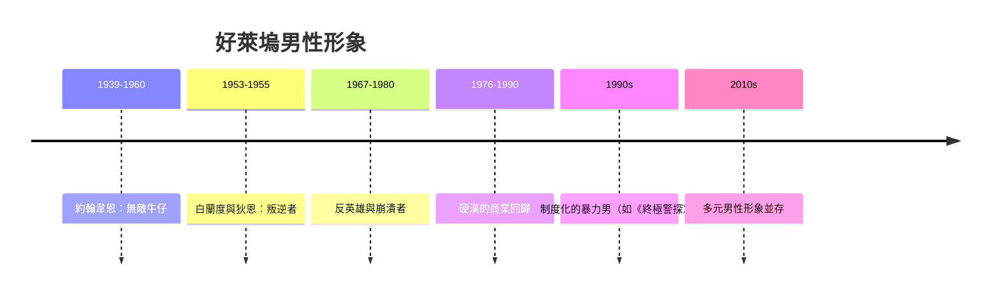

# 7.2 好萊塢硬漢形象的演變與崩解

## 第一階段：無敵的牛仔

好萊塢在二十世紀上半葉建造了美國男性形象的主要工廠。西部片是最重要的生產線：約翰·韋恩（John Wayne）從一九三〇年代的《驛馬車》（Stagecoach, 一九三九）到一九六〇年代的《邊城英烈傳》（The Alamo, 一九六〇），塑造了銀幕男性的標準規格——高大、沉默、直率、以暴力維持秩序、對情感只以行動表達（救人、護送、報仇），從不傾訴。

韋恩式的男子氣概有一套完整的敘事公式：個人武力 + 道德確定性 + 對「文明」的既保護又疏離。它之所以暢銷，是因為它回應了現實中男性角色的真空：組織人無法在辦公室表演英雄，就在電影院裡租借兩小時的英雄幻覺。冷戰的政治氛圍（一九五〇年代的麥卡錫主義）也強化了這種硬漢形象的政治正確——韋恩本人是堅定的反共保守派。

## 第二階段：叛逆者的登場

一九五〇年代中期，一種新的男性形象出現，它不反對硬漢，而是呈現硬漢的失敗：

- 馬龍·白蘭度（Marlon Brando）在《野性一族》（The Wild One, 一九五三）中被問「你在反抗什麼」，答：「你手裡有什麼？」——動機的真空成為姿態。
- 詹姆斯·狄恩（James Dean）在《養子不教誰之過》（Rebel Without a Cause, 一九五五）中飾演的少年，痛苦的核心是父親的軟弱與無法溝通——父權第一次在主流電影中被描寫為問題而非答案。狄恩死於一九五五年車禍，年僅二十四歲，成為「迷惘而美麗的年輕男性」的永恆象徵。

這批「叛逆者」形象代表男性氣質的內部分裂：硬漢的殼還在，但殼裡的人已經迷路。

## 第三階段：反英雄與崩潰

一九六〇至七〇年代，好萊塢系統性地拆解了韋恩公式：

- 《畢業生》（The Graduate, 一九六七）：達斯汀·霍夫曼的班傑明是被父母與社會期望推著走的迷惘青年，拒絕了韋恩式的果斷。
- 《半夜牛郎》（Midnight Cowboy, 一九六九，首部 X 級獲奧斯卡最佳影片）：喬·巴克是幻想自己是牛仔的落魄男妓，硬漢夢成為悲劇的燃料。
- 《計程車司機》（Taxi Driver, 一九七六）：勞勃·狄尼洛的崔維斯·畢克爾是越戰退伍的紐約夜班司機，失眠、孤獨、偏執、對城市的暴怒——他是組織人與硬漢兩個神話同時失敗的產物。他的名句「You talkin' to me?」是男性在鏡子前自我確認的病態象徵。
- 《蠻牛》（Raging Bull, 一九八〇）：拳王 Jake LaMotta 在拳台上無敵，在家中暴力、猜忌、自我毀滅——把硬漢公式倒過來寫成病理報告。

這一波「新好萊塢」（New Hollywood）的男性形象有一個共同的社會背景：越戰（一九六五至七三）與水門案（一九七四）使美國男性對國家、軍隊與道德確定性全面失去信心。銀幕上的男性從英雄轉為反英雄，是社會心理的直接投射。

## 第四階段：復仇式的硬漢回歸

但硬漢沒有死。一九七〇年代末起，好萊塢出現了硬漢的商業性回歸：《洛基》（Rocky, 一九七六）、《第一滴血》（First Blood, 一九八二，藍波的越戰創傷與社會排斥被包裝為暴力奇觀）、阿諾·史瓦辛格的動作片系列。同時期流行的還有《教父》（The Godfather, 一九七二）——黑幫家庭把父權、榮譽與暴力包裝成史詩。

歷史學者與電影研究者對此的解釋是：一九七〇年代男性身分的動搖（經濟滯脹、女性就業上升、男性主導產業外移）引發了男性的文化焦慮，而動作片是這種焦慮的止痛藥。八〇年代雷根時代「美國重新強大」的政治氛圍，與銀幕硬漢的復興完全同步。

## 銀幕男性形象的演變地圖

## 小結

好萊塢的歷史顯示：男性氣質的影像從來不是單線演進，而是硬漢與反英雄的拉鋸。每一次硬漢的回歸，都伴隨現實中男性身分的焦慮加深。當焦慮無法再靠銀幕止痛，就會在真實社會中以更沉重的方式呈現——一九七〇年代起，女性主義與男性研究開始正面拆解「男性氣質」這個概念本身，那是第八章的主題。
