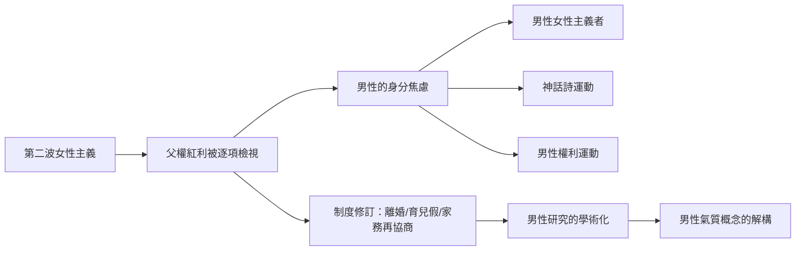

# 8.1 當父權紅利被檢視：女性主義浪潮下的男性

## 第二波女性主義的衝擊

一九六三年，貝蒂·弗里丹的《女性的奧秘》指出郊區主婦的「無名的問題」；一九六六年，全國婦女組織（NOW）成立；一九七〇年代，女性主義進入法律、職場、學術與家庭生活的每個角落。美國一九七二年的教育修正案第九條（Title IX）禁止教育中的性別歧視，羅伊案（Roe v. Wade, 一九七三）確立墮胎權，同婚外性行為與家暴的法律概念被重寫。

對男性而言，這波衝擊是雙面的：

一方面，傳統的父權紅利被逐項檢視：男性主導的高薪職業、政治、學術、家務的免責權、對妻子身體與勞動的支配，一一被拉上審判台。男性第一次被迫以被檢視者的身分存在。

另一方面，女性主義也間接為男性鬆綁：當「男主外女主內」被指出是壓迫性安排，男性被允許（至少在理論上）不當唯一的養家者；當情感被承認為人類的共同需求，男性被允許表達脆弱。這是女性主義贈與男性的隱藏禮物，但許多男性在當時感受不到——感受到的是地位動搖與身分焦慮。

## 男性回應的三條路徑

一九七〇年代起，男性對女性主義的回應大致分化為三條路徑：

1. 支持派的男性女性主義者（pro-feminist men）：約翰·斯托爾滕伯格（John Stoltenberg）《Refusing to Be a Man》（一九八九）、傑克遜·卡茨（Jackson Katz）後來的反性別暴力工作，主張男性應主動反對父權，因為父權同樣傷害男性。
2. 神話詩派（mythopoetic men's movement）：詩人羅伯特·布萊（Robert Bly）一九九〇年的《鐵約翰》（Iron John）暢銷書帶動的運動，主張現代社會剝奪了男性的「深層男性」養成（initiation），男性需要回到森林、擁抱陽剛的原始力量。它在九〇年代初達到高峰（一九九一年《鐵約翰》長居暢銷榜），但被批評為迴避結構性問題、把男性議題個人化與浪漫化。
3. 權利反擊派：認為女性主義已經過頭、男性才是真正的弱勢（離婚法庭、撫養權、徵兵制等議題）。這條路徑在網路時代演變為 men's rights movement（男性權利運動），部分支流滑向對女性的敵意。

## 制度的具體變化

七八〇至九〇年代，多個先進國家出現了對男性角色的具體制度修訂：

- 離婚法改革：美國加州一九六九年率先採用無過失離婚（no-fault divorce），離婚率隨後急升；撫養權判定從「父親優先」轉為「兒童最佳利益」，單親母親家庭比例大增——男性的經濟義務（贍養費、扶養費）以新形式繼續存在，男性的家庭角色卻失去制度化腳本。
- 家務與育兒的重新協商：一九七〇至八〇年代，雙薪家庭在先進國家成為多數，但家務分工的改變遠慢於就業改變——社會學者霍克希爾（Arlie Hochschild）一九八九年的《第二輪班》（The Second Shift）記錄了職業女性下班後仍承擔大部分家務的現實，也記錄了部分男性的「待命爸爸」（the man who does the dishes when asked）現象。
- 父親參與的法律促進：瑞典一九七四年成為世界第一個以「父母假」（parental leave，取代產假）取代性別化育嬰假立法的國家；一九九五年瑞典引入「父親配額」（father's quota，不可轉讓給母親的育嬰假天數），此後配額不斷延長——這是至今最系統性的「制度化父親參與」實驗。

## 學術的成形

一九七〇年代起，「男性研究」（men's studies）正式出現。早期代表作包括：

- 喬瑟夫·普萊克（Joseph Pleck）關於「男性性別角色壓力」（male sex role strain）的研究：主張傳統男性規範本身對男性造成系統性心理傷害。
- 沃倫·法雷爾（Warren Farrell）早期以支持女性主義聞名（《被解放的男人》，一九七四），後期轉向男性權利立場（《男人為什麼賺更多》，並非如標題暗示的特權論證）。
- 心理學界開始系統研究「性別角色衝突」（gender role conflict, James O'Neil, 一九八〇年代起）：男性被規範限制情感表達、限制親密、以成就定義自我，與心理健康問題的相關性。

## 小結

女性主義迫使男性重新回答一個古老的問題：如果我不當「傳統男人」，我要當什麼？學術界接手了這個問題，並在一九八〇至九〇年代提出了解釋框架——霸權男性氣質。那是下一節的主題。
