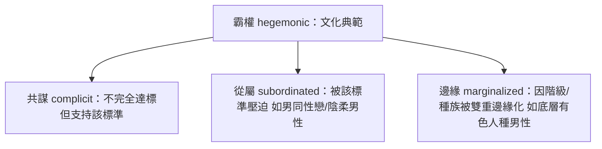

# 8.2 康奈爾與「霸權男性氣質」

## 從單數到複數

一九八〇年代之前，討論「男性氣概」的人預設它是單一標準：一套所有男性都應該達到的特質（堅強、果斷、主導、不情感化）。澳洲社會學者 R.W. 康奈爾（Raewyn Connell）在一系列研究（與同事合作研究澳大利亞男性，後集結為《Gender and Power》一九八七、《Masculinities》一九九五）中提出了改變整個領域的觀點：

1. 男性氣質應該用複數（masculinities）——男性內部存在多種樣態，彼此競爭、互相壓迫。
2. 這些樣態構成一個階序（hierarchy），而位於頂端的是霸權男性氣質（hegemonic masculinity）。

## 霸權男性氣質的定義

康奈爾借用了葛蘭西（Antonio Gramsci）的「霸權」概念：不是靠強制，而是靠文化共識讓被統治者同意統治的合法性。霸權男性氣質因此不是「最多男性擁有的特質」，而是「文化上被尊為男人典範、讓多數男性自覺不足並努力靠攏的那套標準」。

在二十世紀末的西方，這套標準大致是：異性戀、已婚、白領或事業有成、體格健碩、情感克制、對他人有支配力。康奈爾強調：絕大多數男性無法完全達到這個標準——但關鍵在於他們仍然「承認」這個標準的合法性，並因此形成四種位置：

- 共謀型（complicit）：大多數男性。他們不完全符合霸權標準（不夠富有、不夠強壯），但從這個體系獲得「父權紅利」（patriarchal dividend，康奈爾的術語——男性僅因性別而獲得的整體優勢），因此不反抗它。
- 從屬型（subordinated）：男同性戀是理論上的核心案例（一九七〇年代前的西方，同性戀男性被視為「不夠男人」的極端）。陰柔氣質的異性戀男性也常被放入這個位置。
- 邊緣型（marginalized）：因階級、種族被雙重邊緣化的男性。例如黑人男性在美國常被同時賦予「超陽剛」的刻板印象（來自奴隸制與種族主義的身體化敘事）與制度性的無權力——這是「邊緣化的霸權」的矛盾位置。

## 理論的關鍵洞見

康奈爾框架的顛覆性在於三個論點：

1. 父權制度也壓迫男性。它壓迫的是不合標準的男性、以及為達標而付出心理與健康代價的男性。男性群體整體享有父權紅利，但紅利分配極不平均。
2. 男性氣質是實踐而非本質。它不是天生 hormones 的產物，而是男性在日常行為中不斷「做出來」的（doing gender，與 West 與 Zimmerman 一九八七年的著名論文同呼應）。因此它是可以被改變的。
3. 男性內部的壓迫與男性對女性的壓迫是同一套機制。罵男同性戀「娘娘腔」與罵女性「不像女人」用的是同一把尺——把陰柔＝低等。這把尺不除，兩種壓迫都無法根除。

## 影響與修正

霸權男性氣質成為跨學科的關鍵詞，被引用於教育、健康（如為何男性較少就醫）、犯罪學（多數暴力犯罪者為年輕男性的社會學解釋）、職場研究（如 Canada 的一九九〇年代對勞工階級男性氣質的民族誌）等領域。聯合國與 WHO 後續的男性健康與性別平等報告大量借用這個框架。

理論內部也有重要的批評與修正：

- 一九九〇年代後，學者（如 Demetrakis Demetriou、Jeff Hearn、Mike Donaldson）指出霸權男性氣質的界定過於靜態，難以解釋跨文化差異與商業媒體的複雜作用。
- 二〇〇五年，康奈爾與 James Messerschmidt 發表〈霸權男性氣質：重新思考這個概念〉（Hegemonic Masculinity: Rethinking the Concept），承認原概念被濫用（被簡化為「壞男人」的標籤），並重新把它定位為「在特定歷史情境中，男性內部與兩性之間建立合法領導權的過程」——強調它的動態、情境與可變性。
- 對康奈爾的批評還包括：過於強調西方經驗、對非西方男性氣質（如拉丁美洲 machismo、東亞的父親角色）的覆蓋不足，以及對實證研究的因果機制著墨有限。

## 小結

康奈爾的理論提供了男性解放運動最強大的分析工具：它讓「男性」從一個籠統的名詞，變成一個可以被拆解、被分層、被歷史化的結構。但理論要落地，需要制度性的實驗——家庭主夫與育嬰假是其中最直接的實驗場。那是下一節的主題。
