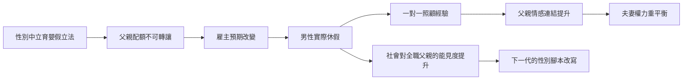

# 8.3 家庭主夫（Stay-at-home Dad）與育嬰假的艱難跨越

## 為什麼父親回家這麼難

如果女性可以走出家庭，男性為什麼不能走進家庭？理論上很簡單，實踐上阻力重重，阻力來自三個方向：

1. 制度：絕大多數社會政策以 male breadwinner 為設計前提（第五、六章所述）。育兒假最初是「產假」，給母親的；托育服務、稅制、健保依附規則，都預設男性是主要工作者。
2. 市場：男性工資普遍高於女性（部分因為職業隔離與歧視，部分因為男性被期待做更長工時的工作），家庭理性計算下「誰留在家」的答案傾向女性。這是結構的自我強化：因為男性被期待工作，所以男性投入更多工作，所以工資更高，所以男性更被期待工作。
3. 文化：全職媽媽面對的質疑是「為什麼不工作」，全職爸爸面對的質疑是「為什麼不養家」——後者直接衝擊男性身分的核心（第五章所述的 breadwinner 綁定）。美國一九八〇年代的調查顯示，全職父親普遍隱瞞或含糊自己的身分，在公園、親子場合被誤認為「保母」或「失業」。

## 育嬰假：制度實驗的主戰場

北歐國家進行了最系統的制度設計：

- 瑞典一九七四：以性別中立的父母假（föräldraledighet）取代產假，初期九〇天，隨後不斷延長，至二〇一六年達四百八十天（約十六個月），由父母分享。
- 瑞典一九九五：引入不可轉讓的父親配額（pappamånad）三十天——不用就作廢。二〇〇二年延至六十天，二〇一六年延至九十天（三個月）。這個設計的巧妙在於：它把父親的育兒假從「選項」變成「用或失去的權利」，直接改變了雇主與家庭的預期。
- 冰島二〇〇〇：更激進的三三三制——母親三個月、父親三個月、共用三個月，各九成薪。
- 挪威、丹麥、德國（二〇〇七年改革，引入父親配額）、日本（二〇一〇年代推動，男性育嬰假取得率長期低於一成，二〇二〇年代政策強化後快速上升）相繼跟進。

結果顯示制度確實能改變行為：瑞典父親使用育嬰假的比例從一九九〇年代的約一成，升至二〇二〇年代的約三成（以總天數計），九成以上瑞典父親會申請至少一段育嬰假。研究者發現，父親在嬰兒期獨自照顧孩子兩週以上，與數年後更高的父親參與度有穩定相關——制度性的「一對一照顧時間」是父親情感連結的催化劑。

## 家庭主夫的現實

全職父親在先進國家穩定但緩慢地增加：

- 美國：一九八九年估計約有數十萬名全職父親，皮尤研究中心（Pew Research Center, 二〇一四）估計全職父親約二百萬人（占全職家長的百分之十六），是一九八九年的約四倍。
- 英國、加拿大、澳洲的官方統計也顯示全職父親在二〇〇〇年後明顯上升，二〇二〇年新冠疫情期間的封控使更多男性暫時承擔全職照顧。
- 全職父親的普遍經驗：社會孤立（缺乏媽媽團體的接納）、被誤認、自我懷疑，以及夫妻權力關係的反轉焦慮。研究也發現，全職父親家庭中夫妻對家務的滿意度並未如想像中改善——因為女性往往仍保留「家務總管」（household manager）的心理責任。

## 運動與文化代表

一八九〇年代起，男性親職運動在多國出現：

- 美國的 Daddy und Parenting 雜誌與組織（如 City Dads Group，二〇〇八年起），加拿大、英國的 Dad 俱樂部。
- 日本的「 ikumen 」（育兒男）運動，二〇一〇年由內閣府與民間推動，儘管被批評為口號化，確實提升了父親參與的社會能見度。
- 網路時代的全職父親部落格與社群（如 Dad 2.0 Summit，二〇一二年起）形成跨國的支持網絡。

## 制度改變心理的因果圖

## 小結

家庭主夫與育嬰假的歷史證明：男性角色的改變不太可能只靠個人勇氣，需要制度先行。瑞典的經驗顯示，把「父親參與」寫進法律，比宣傳一萬句「爸爸多陪孩子」更有效。進入二十一世紀，這場變革迎來了新的變數——AI 與自動化正在改寫「工作」本身的定義，也改寫男性的價值腳本。那是第十章的主題。
