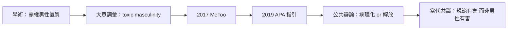

# 9.1 「毒性男性氣質」的公共討論

## 一個詞的旅程

Toxic masculinity（毒性男性氣質）一詞並非學術界首創，而是從二十世紀末的男性運動與流行文化中逐漸成形。一九八〇至九〇年代，部分男性成長工作坊（如 Robert Bly 陣營的批評者、神話詩運動的對立面）使用該詞批評「僵硬、攻擊、情感閉鎖」的男性模式；學術界則更傾向使用康奈爾的「霸權男性氣質」與 Pleck 的「男性性別角色壓力」。

這個詞在二〇一〇年代進入主流：

- 二〇一三年後，社交媒體的推動使 toxic masculinity 成為熱詞。
- 二〇一五年後，一系列公共事件（美國校園性侵案、MeToo 運動的二〇一七爆發）把男性暴力與男性文化放上審判台。
- 二〇一九年一月，美國心理學會（APA）發布首份《男孩與男性的心理學實務指引》（Guidelines for Psychological Practice with Boys and Men），明確指出傳統男性氣質規範（stiff upper lip、不求助、競爭性支配）與負面心理結果相關。這是主流專業學會第一次以官方文件討論這個問題，引發廣泛辯論——批評者認為它把男子氣概病理化，支持者認為它終於把男性的痛苦納入心理學視野。
- 廣告業的介入：吉列（Gillette）二〇一九年廣告〈The Best Men Can Be〉直接以 toxic masculinity 為主題，引發消費者兩極反應，顯示這個詞已進入大眾消費文化的戰場。

## 毒性的定義：規範而非男性本身

需要釐清的是：toxic masculinity 指的是一套社會規範及其傷害後果，不是男性本身，更不是所有男性特質。被指為「毒性」的核心規範包括：

1. 情感壓抑：不准哭、不准怕、不准示弱（在第五章維多利亞教育中已成形）。
2. 支配性競爭：以支配他人（包括其他男性）確認自我價值。
3. 對女性與陰柔的貶低： misogyny 與恐同是同一把尺的兩面（康奈爾框架的核心洞見）。
4. 拒絕求助：看醫生（尤其心理醫生）是軟弱。

這些規範對男性的實際傷害，在公共衛生數據中可以清楚看到（下一節將詳述）。

## MeToo 與男性的位置

二〇一七年十月，MeToo 標籤在好萊塢製片人 Harvey Weinstein 案後爆發，數百萬女性（與部分男性）講述性騷擾與性侵經歷。對男性文化的影響是深遠的：

- 制度反應：多國企業、學術機構、政府部門強化性騷擾通報機制；法國、西班牙等國通過同意年齡與同意定義的法律改革（如西班牙二〇二二年通過「只有是才算是」法）。
- 男性內部辯論：主流輿論中，多數男性表達支持，但也有焦慮聲音（「還能不能稱讚女同事」「還能不能追求」）。研究者指出，這種焦慮其實反映了傳統追求腳本中「主動＝男性、被動＝女性」的僵硬分工——當這個腳本失效，部分男性缺乏替代腳本。
- 男性受害者被看見：MeToo 也促使男性受害者（戰爭性暴力、童年性侵、男性間性侵）的討論增加，聯合國相關報告指出男性在衝突性暴力中是長期被忽視的受害者群體。

## 批評與爭議

毒性男性氣質的討論也面對嚴肅批評：

1. 詞語的濫用：在網路戰場上，這個詞常被用來攻擊任何男性特質（如果斷、冒險、競爭），造成「男性＝毒性」的誤讀。批評者（包括部分女性主義者）主張這種濫用會引發男性防衛，反而阻礙改變。
2. 跨文化差異被忽略：把西方脈絡的「毒性」清單套用到非西方社會，可能簡化當地的性別文化。
3. 結構 vs 個人：把問題定位於「個別男性的毒性」，可能掩蓋制度性因素（經濟剝奪、教育體系、媒體產業）對男性行為的形塑。

回應這些批評的當代主流做法，是回到結構性語言：討論 gender norms（性別規範）的傷害，而不是攻擊個人。WHO、UN Women 等機構的報告多用 harmful masculinities（有害的男性氣質規範）這個較不刺激的說法。

## 小結

毒性男性氣質的討論標誌著男性議題從邊緣進入主流。但討論要落地，必須面對最沉重的數據：男性的孤獨、心理疾病與自殺。那是下一節的主題。
