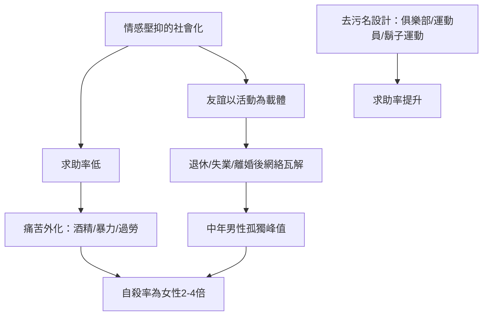

# 9.2 孤獨流行病與男性心理健康危機

## 數據的沉默尖叫

男性心理健康危機最殘酷的證據是一條幾乎不變的規律：

- 自殺率：全球各國（不論文化、收入、發展程度）男性自殺率普遍為女性的二至四倍。根據世界衛生組織（WHO）的全球統計，男性占自殺死亡人口的約七成。英國每兩小時就有一名男性自殺；美國男性自殺率為女性的三點五倍以上；俄羅斯、韓國、東歐國家的男性自殺率長期居於高位。
- 年齡分布：先進國家的最高風險群是中年男性（四十五至六十歲上下）——正是第七章所述「組織人」與「中年危機」的那一代及其後繼者。
- 求助率：男性就診心理師或精神科的比例顯著低於女性；英國的研究顯示，自殺男性中有相當比例在死前一年從未接觸過任何心理衛生服務。
- 成癮與暴力：男性占酒精與物質成癮診斷的多數、占暴力犯罪與暴力受害者的絕大多數。這些行為可被視為壓抑情緒的「替代出口」——心理學者稱之為 externalizing（外化）的痛苦表達方式：男性較少把痛苦說出來，較多把它做出來。

## 孤獨流行病

二〇一〇年代起，孤獨（loneliness）被公共衛生界正式命名為流行病：

- 美國醫師 Vivek Murthy 在二〇一七與二〇二三年兩度發布衛生總監報告，二〇二三年版直接稱孤獨為「流行病」，其健康風險相當於每天吸十五支菸。
- 英國二〇一八年設立孤獨事務部長（Minister for Loneliness）——首相特雷莎·梅的內閣創舉，回應「孤獨委員會」的報告。
- 日本二〇二一年設立孤獨與孤立對策擔當大臣。

孤獨有明顯的性別面向：男性的親密友誼網絡普遍較小、較淺。多項調查（如美國 Survey Center on American Life 二〇二一年報告）顯示，表示「沒有親密朋友」的男性比例從一九九〇年的約百分之三升至二〇二一年的約百分之十五；男性「沒有任何可以討論重要私事的朋友」的比例顯著高於女性。

原因結構性地指向男性的社會化：男性友誼以活動為載體（打球、喝酒、工作），一旦活動停止（退休、搬遷、失業、離婚），友誼網絡就瓦解——因為缺乏直接的情感維繫能力。而離婚對男性的社交打擊尤其致命：多數男性在婚內把「維持社交」外包給妻子，離婚後失去整個社會網絡。

## 為什麼男性不求助

心理學研究指出幾個互相加強的機制：

1. 規範內化：男性從小被教育「自己的問題自己扛」，求助等於承認失敗（第五章、第九章第一節的規範）。
2. 語言缺乏：男性在情感詞彙上的訓練明顯較少——分不清 sad、empty、anxious、shame 的差別，使心理治療的開場（「說說你的感受」）對許多男性近乎外語。
3. 服務設計的性別盲：傳統心理治療的形式（面對面、長期談話、探索童年）與許多男性偏好的問題解決導向、行動導向、短期目標不合，導致男性中途退出率高。
4. 社會懲罰：公開表達脆弱的男性（特別是在職場或男性群體中）常被輕視或邊緣化，形成負回饋。

## 有效的回應實驗

各國出現了針對這個問題的創新方案：

- 澳洲的 Movember（二〇〇三年起，男性十一月留鬍子募款）：從攝護腺癌起家，擴展到男性自殺預防與心理健康，成為全球最大的男性健康運動。
- 蘇格蘭的 Andy's Man Club（二〇一六年起）：由自殺者家屬創立，以「OK to talk」為口號，全國各地設立男性聊天小組，不叫治療、不叫諮詢，就叫「俱樂部」——刻意繞過求助污名，數年間擴及數十個據點，每周吸引數千名男性。
- 英國的 Campaign Against Living Miserably（CALM，二〇〇六年起）以熱線與運動觸及不會走進診間的男性。
- 運動場域的介入：職業運動員公開談論心理健康（NBA 的 DeMar DeRozan 與 Kevin Love 二〇一八年公開談論憂鬱與恐慌發作、英格蘭足球員 Adam Yates 與 Marcus Rashford 的心理健康倡議、日本選手的公開分享）被研究顯示能有效降低男性求助的心理門檻。

## 小結

男性心理健康危機證明了第八、九章的核心論點：情感壓抑不是男性氣概的代價，是它的成本。當社會開始允許男性脆弱，最先受益的就是男性的生命本身。下一節我們將看男性身體與審美的解放——規範鬆動的另一個戰場。
