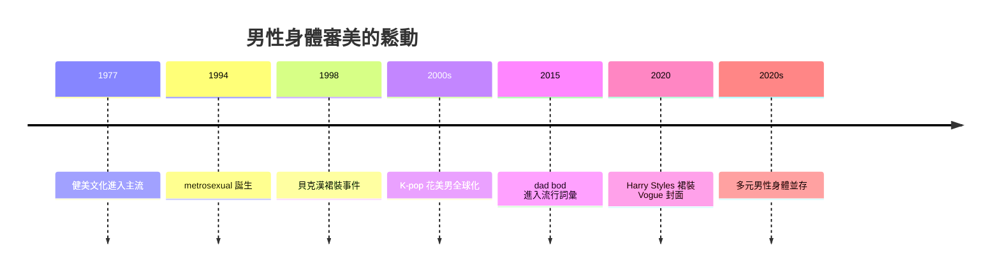

# 9.3 身體自主與審美的多樣化

## 肌肉硬漢的標準從哪裡來

二十世紀下半葉，西方男性的身體標準經歷了一場奇特的膨脹。一九五〇至六〇年代的銀幕男性（如早期柯克·道格拉斯、保羅·紐曼）以精瘦為美；一九七〇年代末起，健美文化（阿諾·史瓦辛格一九七七年的《鐵金剛》Pumping Iron 使健美進入主流）與動作片工業合力，把男性的理想身體推向了前所未有的肌肉量。八〇至九〇年代的動作明星（史瓦辛格、席維斯·史特龍、尚克勞德·范達美）的身體，被研究者形容為「穿著西裝的盔甲」。

社會學者研究這個現象的多重驅動：

1. 商業：健身產業、蛋白粉、男性時尚在八〇年代爆發式成長，需要一個「可以購買的理想身體」作為行銷引擎。
2. 補償：男性傳統領域（工業、戰爭）的重要性下降，身體成為新的男子氣概展示場——你不能用拳頭保衛世界，但你可以用二頭肌展示你自己。
3. 媒體技術：數位修圖與後來的濾鏡、社群媒體，使男性也開始面對幾十年來女性一直在面對的「不可能身體」的轟炸。

研究顯示，男性身體不滿（body dissatisfaction）在近三十年顯著上升；肌肉上癮（muscle dysmorphia，俗稱 bigorexia，一九九〇年代末正式描述）在男性健身族群的報告增加；男性飲食失調的診斷與報告率雖仍低於女性，但成長速度更快，且男性飲食失調更常與過度運動、類固醇使用並存。

## Metrosexual：九〇年代的商業性鬆動

一九九四年，英國記者馬克·辛普森（Mark Simpson）在《獨立報》創造了 metrosexual 一詞，指都市中關心時尚、保養、消費文化的異性戀男性。這個詞在二〇〇〇年代初爆紅，代表人物是足球明星貝克漢（David Beckham）——他代言男妝、穿裙裝拍攝雜誌封面（Sarong Gate, 一九九八）、公開染髮美甲，同時保持頂級運動員的身分。

metrosexual 現象的文化意義：它證明了男性身體可以被凝視、被妝點、被消費，而不（必然）損害男子氣概的商業價值。背後的驅動是男士美容市場的爆發（全球男性理容市場在二〇〇〇年代起快速成長）與時尚工業對男性身體的重新開發。

## K-pop 與東亞花美男

男性審美的多樣化在東亞走出另一條路。韓國的偶像工業（一九九〇年代起，H.O.T.、東方神起、BIGBANG、防彈少年團）發展出以清秀、精心妝容、髮型造型為核心的花美男（kkonminam）美學。韓國男性的化妝（male makeup）市場成為全球最大之一，男性護膚品使用率遠高於西方。

這個現象的驅動因素：韓國兵役制度下男性集體生活與同儕審美傳播、偶像經濟的視覺產業邏輯、以及儒家文化中「修飾」的傳統（古代朝鮮士族男性本就化妝）。日本的視覺系（visual kei，一九八〇年代起）與二〇〇〇年代的草食男（soshoku danshi，二〇〇六年由深澤真記提出）則代表男性對傳統硬漢腳本的另一種退出。

有趣的是，中國的「小鮮肉」文化在二〇一〇年代走紅後，二〇二一年遭遇國家層面的審美干預（官方媒體批評「娘炮」形象），顯示男性審美從來不只是個人品味，也是政治與意識形態的戰場。

## 多元並存

二〇二〇年代的男性形象呈現出前所未有的並存：

- 肌肉硬漢（好萊塢動作片、健力文化、GymTok）依然強勢。
- 中性與花美男（K-pop、時尚界的中性趨勢，如 Harry Styles 穿裙裝登上 Vogue 二〇二〇年十二月號封面——該雜誌百年來首次男性單獨封面）。
- 亞文化男性（e-boy、軟男 soft boy、dad bod 的接受度——二〇一五年這個詞進入流行詞彙，代表對普通中年男性身體的正面審美）。
- 無性別時尚（genderless fashion）與流體性別（gender fluid）表達在年輕世代上升。

## 未完成的解放

但鬆動並不等於平等。男性身體焦慮的總量在上升而非下降；醫美與健身產業正以新的方式收割男性的不安全感；社群媒體的演算法持續推送極端身體標準（TikTok 研究顯示男性青少年也大量接觸到體型焦慮內容）。審美多樣化是真實的，但「身體焦慮的民主化」也是真實的——男性終於與女性共享了這份負擔。

## 小結

身體審美的多元化是男性規範鬆動最可見的窗口。而更根本的變革發生在經濟基礎：當 AI 重寫「勞動」的意義，養家者的腳本將失去它五百年的物質基礎。那是第十章的主題。
