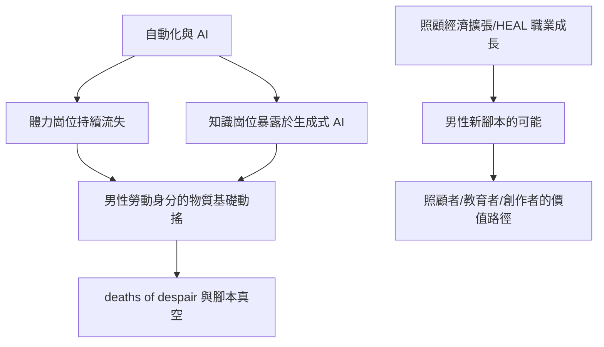

# 10.1 當體力與知識勞動被取代：AI 時代的男性身分

## 體力先被淘汰

男性身分與勞動的綁定（第五章）建立在一個物質基礎上：有些工作需要男性的身體。這個基礎正在被系統性拆除。

- 自動化與機器人：工業機器人自一九六〇年代（美國 Unimate 進入通用汽車）起步，二十一世紀加速。倉儲自動化（Amazon 的 Kiva 機器人，二〇一二收購）、自動駕駛卡車的測試、建築預製化，持續吞噬以男性為主的體力崗位。
- 產業結構變化：先進經濟體的製造業就業占比從一九七〇年的約兩成五降至二〇二〇年的約一成；煤礦、鋼鐵、造船等「男性產業」的崗位大幅萎縮。美國鋼鐵業就業從一九八〇年的約四十萬人降至二〇二〇年代的約十四萬。
- 女性教育優勢：自一九九〇年代起，先進國家的大學入學與畢業率出現性別反轉——美國、英國、北歐、韓國的女性高等教育完成率均已超過男性。知識經濟以學歷為門票，這個門票正在向女性傾斜。

對男性勞動階層的衝擊最為沉重。經濟學者（如 Autor、David Dorn 等對「中國衝擊」與自動化的研究）顯示，製造業崗位流失的地區出現男性勞動參與率下降、傷殘津貼申請增加、婚姻市場惡化、死亡絕望（deaths of despair，Case 與 Deaton 二〇一五年提出的概念：酒精、藥物、自殺導致的中年白人男性死亡率上升）等一系列社會後果。男性的工作消失不只是收入問題，是身分崩塌問題。

## 知識勞動再被衝擊

二〇二二年十一月 ChatGPT 發布後，AI 對知識勞動的衝擊進入公共視野。研究（如 OpenAI 與賓州大學二〇二三年的 GPTs are GPTs 報告、麥肯錫與 IMF 的就業報告）普遍估計：高度暴露於生成式 AI 的工作包括寫作、程式設計、法律文書、翻譯、設計、初級分析——這些白領崗位的男性比例高於藍領崗位。

這意味著一場更深刻的危機：如果連「讀書、進辦公室、專業能力」這條男性上升的階梯也不穩固，男性還有哪條腳本可以走？

## 腳本的真空

社會學者（如 Kathryn Edin 與 Timothy Nelson 對美國底層父親的研究、Richard Reeves 二〇二二年《Of Boys and Men》）指出，當代男性面臨的不是「角色太多」而是「腳本失效」：

1. 養家者腳本：在雙薪常態與 AI 勞動衝擊下，無法穩定履行。
2. 戰士腳本：徵兵制在多國取消或形同虛設，戰爭不再是多數男性的成年儀式。
3. 事業腳本：科層升遷的梯子在組織扁平化與零工經濟中變得斷裂。
4. 替代腳本尚未制度化：照顧者、教育者、社群貢獻者的男性形象，缺乏像「升職加薪」那樣清晰的社會獎勵路徑。

Reeves 提出的政策方向包括：男孩教育改革的早期介入（尤其讀寫能力，男孩的讀寫落後在小學階段已顯著）、男性進入照顧與教育職業的鼓勵（HEAL 職業：Health, Education, Administration, Literacy——女性主導的成長產業）、以及男性友善的社會政策。

## 新腳本的萌芽

同時，新的可能性正在出現：

- 照顧經濟的擴張：高齡化社會（日本、歐洲、中國）使照顧工作成為最大的勞動需求缺口之一，且難以被自動化——這是男性勞動力的潛在新戰場，前提是打破「照顧＝女性工作」的文化編碼。
- 男性在護理與幼教的微幅成長：北歐男性在幼教、護理中的比例雖仍低於女性（挪威男性幼教師約一成），但穩定上升。
- 零工與創作經濟的多元男性形象：YouTuber、電競選手、手工藝創作者、寵物照顧者——傳統男子氣概階序之外的價值實現路徑。

## 小結

AI 時代把男性推到一個數千年未有的位置：第一次，社會不再「需要」男性的身體與競爭。這既是危機，也是人類史上最好的時機——當「必須強壯、必須競爭、必須養家」不再是生存必需，男性有機會第一次以完整的人的身分重新選擇。下一節我們將看到這個選擇在親職中的具體實踐。
