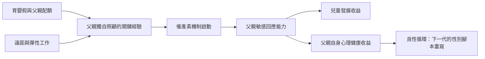

# 10.2 新時代的父親與情感連結

## 從缺席到參與的曲線

父親角色的歷史軌跡大致呈一條 U 形曲線：

- 傳統農業社會（第一、二章）：父親是家庭生產單位的負責人，與子女在工作與生活中朝夕相處——雖然權威冰冷，但物理在場。
- 工業與戰後時代（第五、七章）：父親離家進工廠與辦公室，成為「傍晚回家的陌生人」。一九七〇年代的經典研究（如 Michael Lamb 的父職研究、美國的 time-use 資料）顯示，戰後美國父親每天與孩子的直接互動不到十五分鐘。
- 當代：父親育兒時間在先進國家持續大幅上升。荷蘭、丹麥、美國的時間使用研究顯示，父親每天的育兒時間從一九七〇年代的約一刻鐘，升至二〇一〇年代的兩至三小時（母親則從約四小時略降至三小時左右）——兩性育兒時間的差距顯著縮小。

這條曲線的驅動力：母親大量就業、育嬰假制度（第八章第三節）、以及一代父親對自己童年的反思。

## 情感連結的科學證據

二十一世紀的發展心理學與神經科學為「父親的情感參與」提供了從前被視為理所當然屬於母親的證據：

- 激素研究：以色列學者 Ruth Feldman 等人的研究顯示，新手父親的催產素（oxytocin）與泌乳素水平上升，與其投入的照顧行為成正比——父親的生物學並不缺席，只是需要被啟動。
- 獨自照顧的關鍵性：瑞典的長期研究顯示，父親在嬰兒期獨自（而非「幫忙」母親）照顧孩子的時間，與數年後父子關係品質及父親持續參與度相關。「幫忙」與「共同承擔」的區別，是當代父職研究最重要的發現之一：當父親把母親當作「標準操作者」而自己只是助手，他的連結與能力都會停滯。
- 兒童發展的收益：系統回顧顯示，父親高度參與的兒童在認知發展、情緒調節、社會能力上多有優勢；父親的敏感回應（sensitivity）而非遊戲的粗糙度，是預測品質的關鍵變項。
- 父親自身的收益：父親參與育兒與其自身的抑鬱率下降、生活滿意度上升相關。日本與韓國的過勞父親文化（日本的 karoshi 過勞死問題自一九七〇年代進入公共討論）則展示了反面：把自我價值完全押在工作上的父親，往往是身心崩潰與家庭疏離的雙重失敗者。

## 教育方式的轉變

新時代父親的特徵不僅是時間投入，更是方式改變：

1. 從權威到對話：體罰在先進國家的接受度與合法性的崩塌（瑞典一九七九年成為全球第一個立法禁止體罰的國家，至二〇二四年已有六十多個國家跟進），迫使父親發展以解釋與協商為主的教養語言。
2. 情感教練：心理學者 John Gottman 提出的 emotion coaching 概念，使父親從「情緒的裁決者」轉為「情緒的教練」——幫助孩子（尤其是兒子）命名與接納情緒。
3. 對兒子的去規範化：新世代父親有意識地避免對兒子重複「不准哭、要強悍」的規訓（第九章的教訓），允許兒子玩娃娃、選粉色、表達害怕。

## 制度與文化的配套

情感連結需要時間，時間需要制度：

- 工時制度：法國二〇一七年的 right to disconnect（離線權）立法、荷蘭與北歐的兼職正常化，都間接解放了父親的時間。
- 靈活與遠距工作：二〇二〇年新冠疫情的大規模遠距實驗，使父親首次在歷史上大規模近距離目睹育兒的全貌。多國疫情後的時間使用調查顯示，父親的家務與育兒時間在疫情中顯著上升，且部分維持。
- 公共空間的父親友善：尿布台在男廁的普及、親子空間的設計、嬰兒車友善的都市——這些「小制度」決定了父親能否獨自帶孩子出門。

## 小結

新時代父親的故事，是本書最直接的希望：它證明男性角色可以在一到兩代人之內被改寫，只要制度先行、文化跟進。最後一節，我們把視野拉回全書的起點——當男性卸下戰士與養家者的重擔，與所有性別共同生活的社會，會是什麼樣子？
