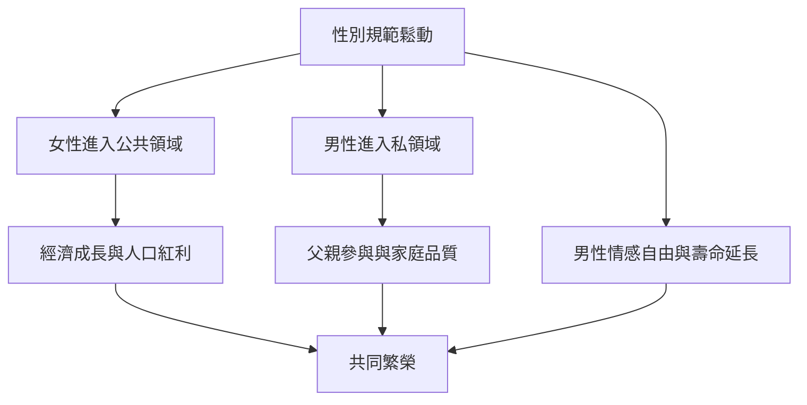

# 10.3 性別平權下的雙贏：共同的解放

## 回到起點

本書從篝火邊的獵人開始。回望這數萬年，男性的歷史是一部「被需要」的歷史：部落需要他的武力，家族需要他的繼承，城邦需要他的方陣，帝國需要他的騎士，工廠需要他的力氣，戰壕需要他的身體，公司需要他的忠誠。每一代男性都獲得了相應的特權，也付出了相應的代價：風險、暴力、情感壓抑、早死。

二十一世紀的特殊性在於：社會第一次不再「需要」男性以舊的方式存在。體力被機器取代（第十章第一節），戰爭職業化與去徵兵化，知識勞動被 AI 重組。這意味著一個危險的真空——但也是一個前所未有的機會。

## 男性為什麼需要性別平權

性別平權常被理解為女性的議題，但本書的歷史線索指向另一個結論：父權制度對男性的綁架，與對女性的壓迫是同一套機制的兩面。男性在平權中的具體利益包括：

1. 生命的長度：男性出生時預期壽命在全球各國普遍比女性短四至七年（WHO 數據）。研究指出，風險行為、就醫延遲、職業傷害（男性占職災死亡九成以上）是主要因素——這些全部與男性規範直接相關。
2. 心理的健康：情感表達的自由與求助的去污名（第九章）直接關係到男性自殺率的改善空間。
3. 親密的品質：當伴侶關係從「供養交換照顧」的契約，轉為平等的夥伴關係，雙方的親密滿意度均上升（家庭研究的一致發現：家務與育兒較平等的伴侶，關係滿意度較高，性生活滿意度也較高——John Gottman 與其他學者的研究）。
4. 兒童的未來：父親參與度高的家庭，女兒的職業抱負與兒子的情感表達能力都更佳。

## 雙贏的結構

經濟學的證據支持這個雙贏結構：麥肯錫全球研究院（二〇一五）估計，若各國女性勞動參與率達到與男性相同，全球 GDP 可增加十二兆至二十八兆美元；國際貨幣基金的研究顯示，性別平等與人均所得成長正相關。而社會層面，北歐國家的經驗顯示：育嬰假、性別中立的教育、高父親參與，與更高的幸福指數、更低的青少年問題行為並存。

## 未完成的工作

但雙贏不會自動到來，仍有幾條硬仗：

1. 規範的殘留：全球仍有大量地區的男性被強迫進入舊腳本（童婚中的男性、被禁止表達情感的教育、戰亂中的兒童兵）。UN 的 men and masculinities 議程把「讓男性脫離舊規範」列為性別平等戰略的一部分。
2. 經濟的接軌：男性的就業結構轉型（從製造到照顧與知識）需要教育、托育與社會政策的配套，否則將產生被拋棄感與政治極化（被部分研究者用來解釋二十一世紀多國的男性右翼民粹傾向）。
3. 對話的修復：性別議題的公共討論高度極化（男權運動 vs 激進批判的對立），需要回到本書的歷史方法：看見男性與女性都是制度的產物，解方在改變制度，而非責怪任何一個性別。

## 結語：可以自由選擇的男性

從篝火邊的獵人，到斯巴達的方陣、羅馬的家父、凡爾賽的紳士、工廠的 breadwinner、戰壕的士兵、郊區的組織人、二十一世紀的全職父親——男性的故事是一部被需求塑造、又終於有機會自我選擇的歷史。

當男性可以哭、可以脆弱、可以照顧、可以競爭也可以合作、可以在職場也可以在廚房；當他的價值不再由工資單或肌肉或戰功單獨定義——那不僅是男性的解放，也是女性、兒童與整個社會的解放。這是本書要講的最後一件事：性別平權的終點，是所有人都可以自由地成為完整的人。
