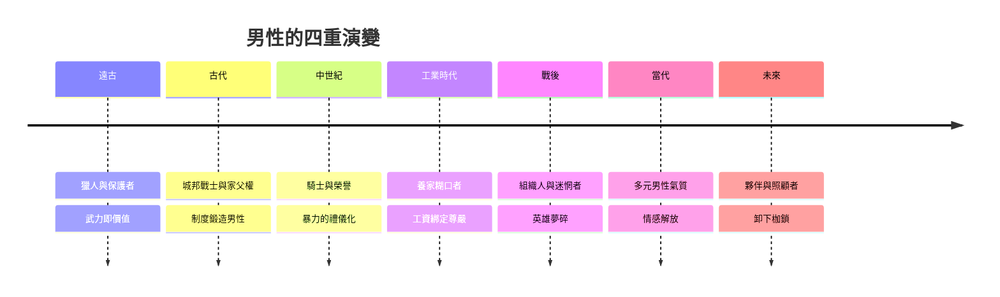

# 男性的故事：從獵人英雄、騎士榮譽到情感解放與男性氣質重構

本書跨越數萬年，講述「男性」這個性別角色如何從遠古荒野中的獵人與部落保護者開始，經歷戰爭體制、君權與騎士道、工業革命的鋼鐵勞動，一路演變成現代社會對男性氣質的反思、情感表達的解放，以及科技與性別平權時代下的角色重塑。

全書依照四條主線交織而成：身份與使命、情感與心理、男性氣質的定義、男性與社會制度的關係。

* 第1章-篝火邊的獵人與父權秩序的建立
    * [1.1-篝火邊的獵人與武力獨佔](01.1-篝火邊的獵人與武力獨佔.md)
    * [1.2-農耕、土地與父系繼承](01.2-農耕土地與父系繼承.md)
* 第2章-角鬥士、公民戰士與古典英雄觀
    * [2.1-斯巴達與城邦的戰爭機器](02.1-斯巴達與城邦的戰爭機器.md)
    * [2.2-吉爾伽美什與伊利亞德的英雄](02.2-吉爾伽美什與伊利亞德的英雄.md)
    * [2.3-羅馬家父權與男性法律支配](02.3-羅馬家父權與男性法律支配.md)
* 第3章-騎士精神、決鬥文化與流血的榮譽
    * [3.1-騎士道：忠誠、武力與保護的神話](03.1-騎士道忠誠武力與保護的神話.md)
    * [3.2-決鬥：為榮譽赴死的貴族傳統](03.2-決鬥為榮譽赴死的貴族傳統.md)
* 第4章-君王、哲人與理性時代的父權
    * [4.1-從戰場勇士到宮廷紳士](04.1-從戰場勇士到宮廷紳士.md)
    * [4.2-啟蒙時代的理性家長](04.2-啟蒙時代的理性家長.md)
* 第5章-工廠的鋼鐵與養家糊口者的誕生
    * [5.1-從農田到工廠：工資勞動的綁定](05.1-從農田到工廠工資勞動的綁定.md)
    * [5.2-Breadwinner：男主外家庭結構的定型](05.2-Breadwinner男主外家庭結構的定型.md)
    * [5.3-維多利亞時代的硬漢教育](05.3-維多利亞時代的硬漢教育.md)
* 第6章-大戰的戰壕與被打碎的英雄夢
    * [6.1-一次大戰：毒氣、戰壕與彈震症](06.1-一次大戰毒氣戰壕與彈震症.md)
    * [6.2-法西斯狂熱與二次大戰的肉身代價](06.2-法西斯狂熱與二次大戰的肉身代價.md)
* 第7章-戰後幸福夢與男性的中年危機
    * [7.1-灰色西裝男：組織中的異化](07.1-灰色西裝男組織中的異化.md)
    * [7.2-好萊塢硬漢形象的崩解](07.2-好萊塢硬漢形象的崩解.md)
* 第8章-女性主義浪潮與男性氣質的解構
    * [8.1-當父權紅利被檢視](08.1-當父權紅利被檢視.md)
    * [8.2-康奈爾與霸權男性氣質](08.2-康奈爾與霸權男性氣質.md)
    * [8.3-家庭主夫與育嬰假的艱難跨越](08.3-家庭主夫與育嬰假的艱難跨越.md)
* 第9章-擺脫毒性男性氣質與情感束縛
    * [9.1-毒性男性氣質的公共討論](09.1-毒性男性氣質的公共討論.md)
    * [9.2-孤獨流行病與男性心理健康危機](09.2-孤獨流行病與男性心理健康危機.md)
    * [9.3-身體自主與審美多樣化](09.3-身體自主與審美多樣化.md)
* 第10章-AI時代、勞動重構與多元互助的未來
    * [10.1-當體力與知識勞動被取代](10.1-當體力與知識勞動被取代.md)
    * [10.2-新時代的父親與情感連結](10.2-新時代的父親與情感連結.md)
    * [10.3-性別平權下的雙贏](10.3-性別平權下的雙贏.md)

## 全書架構圖

