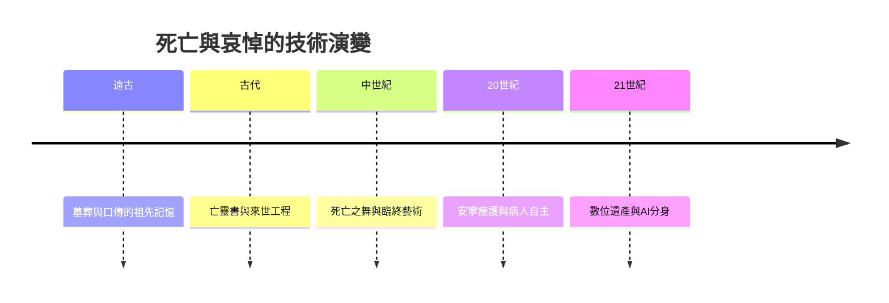

# 10.2 數位遺產與AI時代的哀悼

二十一世紀的死亡多了一個維度：數位。當一個人死去，他留下了電子郵件、社群帳號、雲端相簿、加密貨幣、遊戲帳號與聊天紀錄。這些數位遺產如何處理？更激進的問題是：如果用他的資料訓練出一個AI，能夠像他一樣說話，那麼他是死是活？哀悼在數位時代正在被重新發明。

## 數位遺產：看不見的遺產

數位遺產的問題首先是一個法律真空。傳統繼承法處理的是土地、房屋、存款與動產，沒有料到一個人會擁有數十萬張照片、十年的聊天紀錄與數十個帳號。帳號的法律地位依賴平台的使用者條款：臉書允許設置紀念帳號（Memorialization）與委託聯絡人；Google允許設置不活動帳戶管理員，在指定時間後移交或刪除資料；蘋果的數位遺產計畫允許指定繼承人接觸資料。各國陸續修法納入數位資產（美國多州通過統一受託人數位資產存取法、中國民法典明確虛擬財產受法律保護），但跨平台、跨國界的執行仍然複雜。

對家屬而言，數位遺產帶來了新的哀悼現實：與逝者的最後訊息成為無法刪除的慰藉，社交媒體的動態成為追思牆，逝者的生日與忌日在演算法的提醒下反覆回到生者的時間線。哀悼從一個集中於儀式的過程，變成被數位環境持續觸發的長期狀態。

## 數位復活：AI的親密挑戰

2020年代，生成式AI把問題推向了哲學邊界。出現了專門的數位復活服務：用逝者的文字、語音與影像訓練模型，生成能夠對話的數位分身。韓國2016年的紀錄片實驗《遇見你》讓一位母親與以亡女為基礎的VR形象互動，引發全球討論。中國的AI復活服務在2024年成為商業市場，可依需求生成可對話的逝者分身；微軟與其他公司為類似技術申請了專利。

倫理問題是多層的。逝者的同意：多數復活是在逝者死後由親屬決定的，逝者生前從未同意被數位重建。生者的哀悼：心理學界對此看法分歧——有人認為數位分身可能延長哀傷、阻礙接受死亡的現實；有人認為它可能是健康的過渡性客體，幫助生者度過最艱難的時期。商業剝削：情感脆弱的家屬面對的是營利性服務，情緒與商業的界線容易失衡。哲學問題：一個能模仿逝者說話的模型，承載的是記憶、是代理、還是一種新的存在？

歷史的對照是有啟發的。古埃及人為死者製作卡（靈魂的像）與雕像，讓死者有所依託；中國的祭祀與牌位、日本的位牌、天主教的遺像與追思彌撒，都是用物質媒介維繫生者與死者的關係。AI分身可以視為這個古老需求的技術升級：人類一直需要某種形式的逝者臨在，只是臨在的技術在進化。差異在於：過去的臨在是靜態的象徵（牌位不會回話），AI的臨在是動態的互動（它會說話，甚至會學習新的回應方式）。

## 終極的課題

從遠古的長老議會到AI的數位分身，本書的旅程呈現了一條長弧：人類如何對待衰老與死亡，取決於當時的生存條件、知識形態、制度能力與文化想像。部落長老是活圖書館，因為知識只存在於記憶；元老是權力核心，因為土地與經驗在老人手上；退休者是制度公民，因為國家有能力供養；數位分身是新課題，因為技術第一次讓死後的互動成為可能。

這條弧的盡頭還看不見。可以確定的是：衰老與死亡不會消失，它們只會以新的形態被談論、被管理、被哀悼。每一代人都在用自己的方式，回應那個自遠古以來就擺在人類面前的問題：如何與有限的人生好好相處。這就是老人的故事——一個永遠在書寫中的故事。
