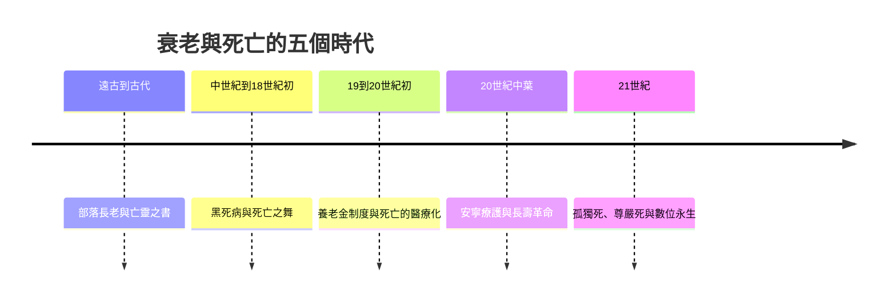

# 老人的故事：從部落長老、生命的安魂曲到長壽時代與優雅尊嚴

本書跨越數千年，講述「老人」與「死亡/臨終」如何從遠古部落中的智慧庫與靈魂橋樑，經歷高死亡率時代的命運宿命、工業革命下的邊緣化、現代醫療對死亡的病理化與機構化，一路演變成現代社會對長壽社會、尊嚴死、生命意義與超越性的深刻反思。

全書依循四條交織的線索：

1. 老人的社會角色：智慧與權力的頂峰、工業時代被邊緣化的生產力失能者、制度化保護的退休者、擁有自主選擇與第三人生的主體。
2. 死亡的場所與儀式：家庭客廳與親友圍繞的集體告別、醫院病房與儀器監控下的孤獨臨床事件、安寧病房與居家善終的尊嚴自主。
3. 對死亡的態度：自然接受與宗教救贖、對死後審判的恐懼、視死亡為醫療失敗的敵人、重新回歸將死亡視為生命自然且有尊嚴的終章。
4. 生命的終極課題：如何延長壽命、如何提升老年與臨終的生命品質與尊嚴。

## 目錄

* 第1章-記憶的載體與部落的活字典（約西元前30,000年–前3000年）
    * [1.1-長老：口傳時代的活圖書館](01.1-長老：口傳時代的活圖書館.md)
    * [1.2-尊崇與棄老：生存賭局的兩面](01.2-尊崇與棄老：生存賭局的兩面.md)
* 第2章-埃及冥界書、希臘悲劇與古羅馬元老院（約西元前1500年–西元5世紀）
    * [2.1-亡靈書與心臟的秤量](02.1-亡靈書與心臟的秤量.md)
    * [2.2-元老院與西塞羅論老年](02.2-元老院與西塞羅論老年.md)
* 第3章-黑死病狂潮與「死亡之舞」（西元14世紀–16世紀）
    * [3.1-黑死病：死亡的平等掠奪](03.1-黑死病：死亡的平等掠奪.md)
    * [3.2-死亡之舞與臨終藝術](03.2-死亡之舞與臨終藝術.md)
* 第4章-三代同堂、祖父權威與家庭安息（西元16世紀–18世紀）
    * [4.1-老農、土地與臨終床榻前的告別](04.1-老農、土地與臨終床榻前的告別.md)
    * [4.2-阿利耶斯與馴服的死亡](04.2-阿利耶斯與馴服的死亡.md)
* 第5章-俾斯麥、養老金與「退休」制度的發明（西元1880年代–1930年代）
    * [5.1-工廠體制下的老年邊緣化](05.1-工廠體制下的老年邊緣化.md)
    * [5.2-俾斯麥的養老金與退休的誕生](05.2-俾斯麥的養老金與退休的誕生.md)
* 第6章-醫院的白牆——死亡被移出家庭（西元19世紀末–20世紀中）
    * [6.1-壽命革命：死亡從常態變成例外](06.1-壽命革命：死亡從常態變成例外.md)
    * [6.2-死亡的機構化](06.2-死亡的機構化.md)
* 第7章-安寧照顧與《論死亡與臨終》（西元1960年代–1970年代）
    * [7.1-桑德斯與聖克里斯多福安寧醫院](07.1-桑德斯與聖克里斯多福安寧醫院.md)
    * [7.2-庫伯勒-羅斯與哀傷五階段](07.2-庫伯勒-羅斯與哀傷五階段.md)
* 第8章-銀髮族、老齡化社會與熟年經濟（西元1980年代–1990年代）
    * [8.1-第三人生與高齡化社會的爆發](08.1-第三人生與高齡化社會的爆發.md)
    * [8.2-老年學與健康老化的追求](08.2-老年學與健康老化的追求.md)
* 第9章-獨老、孤獨死與尊嚴善終的大辯論（西元2000年代至今）
    * [9.1-孤獨死與無緣社會](09.1-孤獨死與無緣社會.md)
    * [9.2-安樂死、病人自主與善終的選擇權](09.2-安樂死、病人自主與善終的選擇權.md)
* 第10章-抗衰老科技、數位遺產與永恆的追尋（21世紀至今）
    * [10.1-抗衰老科技與矽谷的長生夢](10.1-抗衰老科技與矽谷的長生夢.md)
    * [10.2-數位遺產與AI時代的哀悼](10.2-數位遺產與AI時代的哀悼.md)
