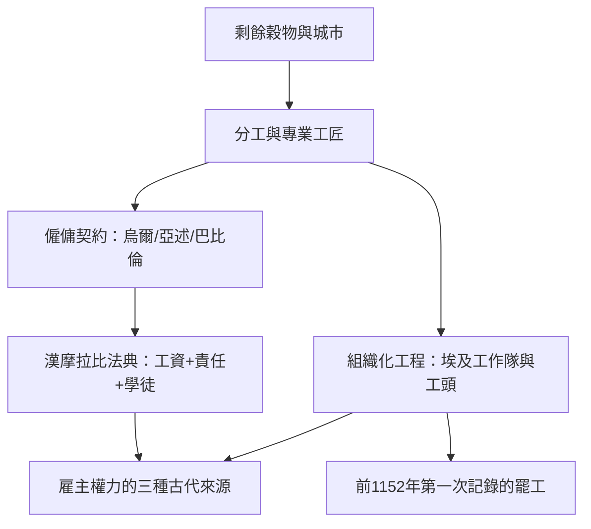

# 1.1 漢摩拉比法典與最早的僱傭契約

## 老闆的最古老定義：寫進法律的人

「老闆」作為一種社會角色，最早的文字記錄出現在美索不達米亞。約公元前1754年刻立的漢摩拉比法典（282條，以阿卡德語楔形文字刻於玄武岩石柱，現存巴黎羅浮宮）中，有大量條款直接規範僱傭關係：

- 工資定價：僱一個人收割，日薪為8西拉（silà）穀物（約第257條）；僱牛與趕牛者另有工價（約第258條）。這是「法定最低工資」概念的最早書面記錄之一。
- 作坊主責任：第229–232條規定，房屋倒塌壓死屋主，建築師（作坊主）處死；壓死屋主之子，建築師之子處死——產品責任以連坐方式成立。
- 手藝與學徒：第188、189條規定工匠收徒的權利義務，學徒半途離開者須賠償。
- 醫療與責任分級：醫師（一種「服務型老闆」）的收費與事故賠償按病人階級分檔（治自由人與奴隸的費用不同，第215–223條）。

這部法典揭示了一個根本事實：僱傭關係從誕生起就是一個法律結構——不是單純的「請人做事」，而是權力、定價與責任的三重契約。

## 烏爾第三王朝與更早的契約

漢摩拉比不是起點。烏爾納姆法典（約前2100–2050年）已有更早的僱傭與工資條款；古巴比倫與古亞述的大量契約泥板記錄了僱工、租牛、合夥（tapputum，利潤共享的合夥契約）與商業信貸。亞述商人卡尼什（Kültepe，今土耳其）遺址出土的泥板顯示，公元前2000年左右已有跨國家族商行：長輩坐鎮亞述城，晚輩駐外經銷，書信往來處理定價、賒帳與違約——這是「老闆指揮異地員工」的最早文書記錄。

古埃及的中王國與新王國時期（約前2000–前1100年）則留下了「工作隊」的記錄：戴爾艾爾-巴哈里的德爾麥地那工匠村（建陵工匠村，Deir el-Medina）的紙草與石片記錄了工頭（foreman）分配工作、記錄出勤（缺席需寫理由，如「去獻祭」「和妻子吵架」）、發放以穀物計價的月餉，甚至記錄了史上第一次有記載的罷工（前1152年，拉美西斯三世第29年，工地工人因穀物配給延誤而停止工作）——出勤紀律、工資發放與集體談判，三千年前都已登場。

## 雇主權力的三種古代來源

整理這些材料，古代「老闆」的權力來源可歸納為三類，此後數千年的演變都是它們的重組：

1. 對人的所有權：奴隸主擁有勞動者本身（最古老也最強的雇主權）。
2. 對契約的權威：自由僱工（僱傭、租佃、計件）關係中的互惠但不对等——漢摩拉比法典中，僱工違約的罰則遠重於雇主。
3. 對技術與組織的壟斷：工頭、工匠師傅掌握工藝與排程，權力來自知識而非所有權。

## 小結

古代社會沒有「公司」，但有完整的老闆原型：掌握剩餘與組織的人，用契約（對自由人）與所有權（對奴隸）動員他人的勞動。當羅馬把奴隸經濟推向頂峰，這個原型的第一形態達到了它的極限——而極限之處，正是新形態（銀行、行會、法人）將要萌發的地方。
