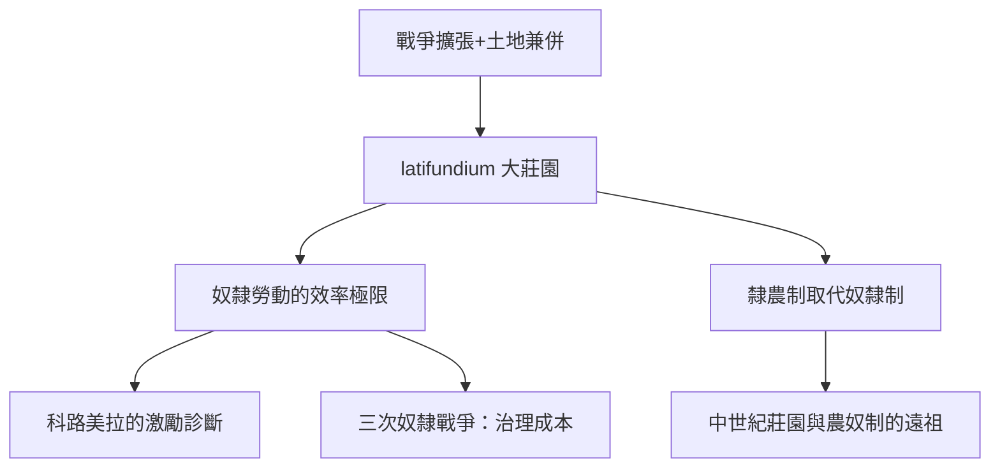

# 1.2 羅馬莊園主與奴隸經濟

## 大莊園：羅馬的老闆制度

羅馬共和後期至帝國時代，意大利與行省的大莊園（latifundium，大領地）構成了生產的主體。羅馬的擴張戰爭帶來兩個連鎖效應：長期戰役使小農無法耕作、土地集中於貴族；大量戰俘成為廉價奴隸。老加圖《農業志》（De Agri Cultura，約前160年）與瓦羅、科路美拉的農書，留下了莊園管理的手冊——老闆（地主，dominus）透過管莊（vilicus，常由被釋奴或奴隸擔任的經理）經營遠方產業，這是「所有權與經營權分離」的極早版本：管莊的職責清單包括管帳、記庫存、管理勞動隊、不得外出飲宴（加圖對管莊的行為規範巨細靡遺）。

奴隸經濟的規模有史可稽：奧古斯都時代的羅馬城人口約百萬，奴隸可能占三成上下；整個意大利半島的奴隸數量估計在數百萬級。礦山（西班牙銀礦）、葡萄園與橄欖園、牧場、手工作坊（陶磚作坊——帝國時期的磚瓦工業多由元老階級透過中介經營，形成了類似「跨行省連鎖企業」的組織）大量使用奴隸勞動。

## 老闆的責任：從虐待到管理的演變

羅馬莊園管理文獻記錄了一場關於「如何當老闆」的辯論。加圖建議對懶惰奴隸多鞭打少餵食；瓦羅則務實地建議：奴隸生產力下降不如僱自由工划算，且應給表現好的奴隸一些激勵（如允許積累私產 peculium）；科路美拉（一世紀《論農業》）對奴隸勞動的根本缺陷做了經典診斷：奴隸「把最差的牲口交給土地」，因為他們與產出無關——這是對「所有權激勵」問題的最早理論表述。帝國後期，佃農制（colonus，隸農）逐漸取代奴隸成為大莊園的主要勞動力：讓勞動者與土地的產出掛鉤，是奴隸經濟的效率極限倒逼出的制度改革。

## 奴隸的反抗：老闆權力的邊界

羅馬史留下了三次大規模奴隸戰爭：前135–132年西西里第一次奴隸戰爭（恩納的優努斯，數萬至十萬級奴隸起事）、前104–100年第二次西西里奴隸戰爭、以及最著名的斯巴達克斯起義（前73–71年，從卡普阿角鬥學校七十餘人逃亡開始，巔峰時軍隊擴至數萬至十萬級，一度逼近羅馬，最終被克拉蘇與龐培鎮壓，六千名俘虜被釘死在亞壁古道兩側）。奴隸起義的頻率與規模，證明這種極端老闆制度的治理成本：整個羅馬軍團相當一部分的力量被用於鎮壓與威懾內部勞動人口。

## 釋奴與「打工皇帝」

羅馬制度還預留了一個出口：釋放奴隸（manumission）。被釋奴（libertus）獲得自由身，可以經商致富，甚至成為皇帝的重臣（克勞狄與尼祿朝的帕拉斯、納爾奇蘇斯，被普林尼稱為影響帝國財政的權臣；更早的圖里烏斯，是老闆與高級打工者的混合體）。經濟史研究顯示，奧古斯都時代起釋奴成為城市工商業的重要經營者群體——他們的墓碑上常自豪地刻著自己的行會與商號。這提示了一個貫穿此後兩千年的規律：當老闆權力過大時，經濟效率與政治穩定都會受損；制度最終會生出「讓勞動者分利」的出口（釋奴、隸農、分成制、僱傭制），而每個出口都是下一種雇主—勞動關係的起點。

## 小結

羅馬莊園主把「老闆」的第一形態——以所有權直接支配勞動者本人——推到了極致，也推到了極限：效率天花板（激勵缺失）、治理成本（起義）、以及道德與法律壓力（帝國後期的奴隸法改良）。中世紀的行會師傅、文藝復興的銀行家、乃至現代的公司，都在尋找「不用擁有人也能指揮人」的方法。下一章的美第奇家族，展示的是另一條路：用錢本身當老闆。
