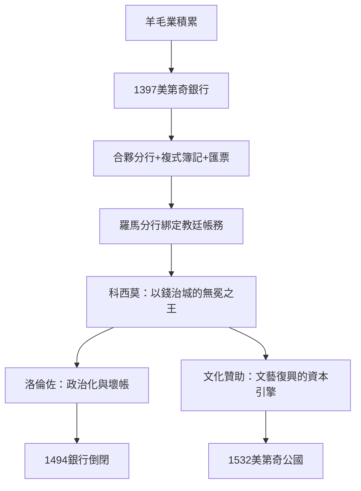

# 2.1 美第奇：跨國銀行與早期資本控制

## 從羊毛商到歐洲央行

美第奇家族起家於佛羅倫斯的羊毛業與典當業。老喬瓦尼·迪·比奇·美第奇（Giovanni di Bicci de' Medici，1360–1429）於1397年創立美第奇銀行（Banco Medici），把分散的小錢莊整合為一個總部在佛羅倫斯、分行遍布羅馬、威尼斯、布魯日、倫敦、日內瓦、里昂的跨國金融網絡。到科西莫·德·美第奇（1389–1464）時代，銀行達到頂峰：分行約十家，羅馬分行因管理教廷帳戶（教皇的存款與匯兌）而成為全行最賺錢的部門。歷史學者估算，銀行鼎盛期年利潤可與中型國家的歲入相比，家族是當時歐洲最富的私人家族之一。

美第奇銀行在組織技術上的創新，比它的財富更值得記錄：

1. 合夥制分行：每個分行是獨立合夥體，總行與分行經理按股分利——經理（通常是被釋奴後代或低出身人才）以股份與晉升為激勵，這是跨國企業分權治理的先驅。
2. 複式簿記的實務化：美第奇帳簿（現存於佛羅倫斯檔案館）是複式記帳法大規模商業應用的最早案例之一；該方法經盧卡·帕喬利1494年的《算術、幾何、比與比例概要》（Summa de arithmetica）系統發表而傳播全歐。
3. 匯票（bill of exchange）：以兩地不同幣種的匯兌結算規避教會的高利貸禁令（利息被「藏」進匯率），解決了跨國信貸的法律問題。
4. 代理與信託：以「可撤銷信託」與代理人結構隱匿真實持股，應對政治風險——洛倫佐死後，這個結構的脆弱性立即顯現。

## 老闆的黃金律與衰敗

科西莫的名言（見於其孫洛倫佐的傳記傳統與同時代記載）概括了美第奇的管理哲學：「與國家打交道，秤要精確到小數點」——即政治與財務必須嚴格分開核算。洛倫佐（1449–1492）時代的銀行開始變質：他把分行資金用於政治（維持佛羅倫斯聯盟）、藝術贊助與家族開支，倫敦與布魯日分行因英王愛德華四世與勃艮第的巨額壞帳崩潰。1494年，洛倫佐之子皮耶羅被逐出佛羅倫斯，美第奇銀行隨之倒閉——教訓是清晰的：當老闆把企業當作個人政治工具，資本紀律就會崩潰。這個教訓將在四百年後的福特與斯隆故事中再次出現。

## 用錢當老闆：贊助人制度

美第奇的另一面是「老闆權力」的文化形態。科西莫與洛倫佐贊助了多那太羅、波提且利、米開朗基羅（少年時住進美第奇宮）、以及人文主義者馬爾西利奧·費奇諾與皮科·德拉·米蘭多拉。這種贊助不是慈善，而是一種權力技術：用文化資本換取政治合法性——老科西莫以「第一公民」（primus civis，實際掌權但無官銜）的方式統治佛羅倫斯數十年，靠的正是銀行的錢、人脈網絡與文化聲望的疊加。1513年，家族成員利奧十世成為教皇，1523年克萊孟七世繼之；1532年佛羅倫斯正式成為美第奇公國（1569年升為大公國），銀行家王朝完成了向世襲貴族的轉型。

## 小結

美第奇證明了資本本身可以成為老闆：不需要擁有莊園或奴隸，控制錢的流動就能控制城市、教廷與藝術。它同時示範了現代公司的兩個原型問題——分權治理的必要（合夥分行）與所有權紀律的脆弱（洛倫佐的政治化）。與此同時，歐洲的另一種「老闆」——手工業行會大師——正在用完全不同的方式（控制技術與定價）行使權力，而兩者都將在1600年後被一個更大的發明超越：法人公司。那是下一節的主題。
